# AI Design Log – v2 (hướng mới: wishlist Shopee, extension, nhắc theo lịch sale)

**Project:** Why I Buy?
**Course:** PRM323 – Cross-Platform Application Development
**Giai đoạn:** 16/10/2026 – 18/10/2026 · tiếp nối `ai/ai-design-log.md` (v1 kết thúc ở mục R4)

> **Đọc trước:**
> - File này gom các phần **UX research** trong 4 session Claude (Cowork). Nguồn là log do chính từng session tự rà lại và ghi vào Project PRM (`why-i-buy/session-log/`).
> - **Prompt trong khối code là nguyên văn**, giữ cả lỗi gõ. Prompt quá dài để trong mục thu gọn.
> - Nhãn: **THẬT** (có nguồn công khai hoặc dữ liệu thật) · **AI GIẢ ĐỊNH** (AI tự đề xuất, không có dữ liệu người dùng) · **CHƯA KIỂM CHỨNG** (chưa thử thực tế). Trong cả 4 session, môi trường của AI **bị chặn truy cập Shopee**, nên mọi nhận định về cách Shopee hoạt động đều chưa được thử bằng request thật.
> - **Không có** trong 4 session: khảo sát, phỏng vấn người dùng, rà app đối thủ, kiểm thử với người dùng. Phần research người dùng vẫn là bản ở log v1 (RS, UT).

## Bảng ánh xạ session

| # | Session | Ngày (UTC+7) | Chủ đề chính | Mục |
|---|---|---|---|---|
| 1 | `session_013nuMZ7BMCEBkjSHj1qQHQw` | 16/10 → 17/10 | Dữ liệu lấy được từ link Shopee, cào dữ liệu, extension, liên kết tài khoản, lấy giá trên mobile → tạo `WhyIBuy_Extension_Mobile.docx` | S1 |
| 2 | `session_01EzXKKYz46S2UWTwVgLsV3h` | 17/10, khoảng 09:24–09:44 | Phân tích góp ý của thầy (bản ghi âm buổi chấm) về ngân sách → thêm mục Ngân sách vào docx | S2 |
| 3 | `session_018XV7oZqJc4rHt9NCyanV8Z` | 17/10, khoảng 11:07–12:13 | Tóm tắt *The Psychology of Money* → nguyên tắc sản phẩm, persona, feasibility → `WhyIBuy_ThietKe_HopNhat_v2.docx` | S3 |
| 4 | `session_012N23JYQckQxwBLxECMYMfS` | 17/10, khoảng 11:20–16:30 | Shopee Affiliate API, thư viện NuGet, AppID/Secret, repo shopee-mcp, addlivetag → sửa docx 6 điểm | S4 |

_Giờ của S2–S4 là ước lượng từ giờ tạo file, chỉ dùng để biết thứ tự._

## Khai báo công cụ AI (bổ sung cho v2)

| Công cụ | Mục đích |
|---|---|
| Claude (Cowork, web search, web fetch, git) | Desk research API, thư viện, repo và dịch vụ lấy dữ liệu Shopee; đánh giá khả thi và điều khoản; phân tích link sản phẩm thật |
| Claude (Cowork, đọc file) | Tóm tắt sách; phân tích bản gỡ băng buổi chấm; rà và hợp nhất tài liệu thiết kế của nhóm |
| Claude (Cowork, skill docx, Python, Node.js, LibreOffice) | Soạn và sửa file Word tổng hợp. Nhóm kiểm tra lại và tự quyết định giữ / sửa / bỏ |

---

## S1 — Lấy dữ liệu từ link Shopee, extension và mobile
`session_013nuMZ7BMCEBkjSHj1qQHQw` · 16/10 → 17/10/2026

### S1-1. Feasibility: dữ liệu lấy được từ một link Shopee (phân tích dữ liệu thật)

**Prompt (nguyên văn):**

```text
https://shopee.vn/Set-1-Kính-Cường-Lực-PlayStation-Portal-Glas.tR-EZ-Fit-Spigen-Lắp-Đặt-Dễ-Dàng-Tiện-Lợi-i.1367701657.27634673446?extraParams=%7B"display_model_id"%3A147815204739%2C"model_selection_logic"%3A3%7D

nếu tôi gửi 1 link như thế nào thì những giữ liệu nào có thể lấy được
```

- **AI trả về:** chia dữ liệu thành 3 mức:
  1. Lấy chắc chắn từ link: sàn, `shopId`, `itemId`, tên gần đúng từ slug, **`modelId`** (trong `extraParams.display_model_id`).
  2. Có thể có trong đoạn chữ chia sẻ (`EXTRA_TEXT`).
  3. Chỉ có khi đọc được trang / API: giá, giá gốc, ảnh, shop, đánh giá, lượt bán, tồn kho, phân loại.
- **Insight:** link có thể chứa sẵn mã phân loại, trong khi tài liệu đang để người dùng tự ghi phân loại.
- **Nguồn:** link thật người dùng gửi. AI thử `curl` Shopee → bị chặn (403).
- **Nhóm:** không phản hồi đề xuất sửa tài liệu, hỏi tiếp sang cào dữ liệu.

### S1-2. Desk research: repo "Shopee Scraper API"

**Prompt (nguyên văn, phần câu hỏi của người dùng):**

```text
https://github.com/lenoarditrryh/scraping/tree/main
[dán kèm toàn bộ README "How to Use Shopee Scraper API to Extract Product Data from Shopee" – xem log gốc]

tôi vừa đọc được github này về cào dữ liệu bạn nghĩ có thể thực hiện dưa trên ý tưởng này không
```

- **AI trả về:** repo **không có code**, là bài quảng cáo; mọi link dẫn về link giới thiệu `scraperapi.com?fp_ref=coupons`. Có dịch vụ cào trả phí thật (Apify, ScrapingBee). Rủi ro: tốn phí, vi phạm điều khoản Shopee, phần FAQ khuyên lách chống bot.
- **Nguồn (THẬT):** https://apify.com/enrico_7/shopee-scraper · https://www.scrapingbee.com/blog/introducing-shopee-api/ · https://apify.com/dtrungtin/shopee-scraper
- **Nhóm:** chưa đồng ý thêm vào tài liệu, hỏi tìm cách khác trước.

### S1-3. Desk research: API chính thức và repo lấy dữ liệu từ link

**Prompt (nguyên văn):**

```text
trước khi thêm vào có cách nào, repo nào có hướng để có thể build và cho cào dữ liệu từ link không
```

```text
tổng hợp lại cho tôi
```

- **AI trả về:** 3 hướng:
  1. **Shopee Affiliate Open API** (GraphQL `productOfferV2` theo `shopId`/`itemId`, có `priceMin`, `priceMax`, `priceDiscountRate`…). Cần được duyệt AppID/Secret.
  2. Tự cào bằng Playwright / Selenium: **không nên** (bị chặn, vi phạm điều khoản). AI không hỗ trợ lách chống bot.
  3. Dịch vụ trả phí: chỉ để dự phòng.
- **Nguồn (THẬT):** https://www.nuget.org/packages/Shopee.Affiliate · https://github.com/gregojoao/shopee-affiliate · https://pypi.org/project/saapi · https://github.com/snja/shopee-affiliate-openapi · https://help.shopee.sg/10/article/191702-API-Access · https://apify.com/viralanalyzer/shopee-affiliate-products
- **Sản phẩm:** `lay-du-lieu-tu-link.md` (gửi trong chat).
- **Nhóm:** sau đó cho biết không có Affiliate API → hướng 1 bị loại khỏi bản đầu (S1-7).

### S1-4. Feasibility: extension web → database → người dùng

**Prompt (nguyên văn):**

```text
về phần extension cho web rồi đẩy dữ liệu xuống database chuyển lên cho người dùng bạn đánh giá thế nào
```

- **AI trả về:**
  - Extension đọc trang người dùng đang xem nên là **cách lấy giá chính xác và hợp lệ nhất** (đúng phân loại, không bị chống bot).
  - Nhưng chỉ là **kênh phụ**: chỉ chạy trên Chrome máy tính, còn người dùng chủ yếu lướt Shopee trên điện thoại.
  - Không để thông tin đăng nhập database trong extension; Manifest V3 + `activeTab`; không quét ngầm.
- **Nguồn:** phân tích của AI, không có nguồn web.

### S1-5. Thiết kế liên kết tài khoản extension (ý tưởng nhóm được sửa)

**Prompt (nguyên văn):**

```text
làm sao để extension biết là của người dùng nào tôi có nên tạo id riêng cho mỗi user r khi dùng extension phải nhập chuỗi id đó để check
```

```text
tổng hợp lại những cách có thể làm
```

- **AI trả về:** không dùng ID cố định (giống mật khẩu không đổi: lộ là mất, không thu hồi được). Đề xuất **mã ghép nối 6 số, dùng một lần, hết hạn sau 5 phút, đổi lấy token**; lưu hash token, giới hạn nhập sai, màn "Thiết bị đã liên kết". So sánh 4 cách (A–D), chọn B.
- **Sản phẩm:** `extension-web.md` (gửi trong chat).
- **Nhóm:** ý tưởng ID cố định **được sửa** thành mã ghép nối theo đề xuất AI.

### S1-6. Ideation: extension làm gì, làm được gì

**Prompt (nguyên văn):**

```text
cả phần ý tưởng extension sẽ thực hiện gì, làm được những gì
```

- **AI trả về:**
  - Ý tưởng: đưa món vào **danh sách chờ** thay vì mua ngay, để tạo khoảng dừng trước khi mua và chờ đúng đợt sale.
  - 6 chức năng bản đầu: lưu một lần bấm, hỏi vì sao muốn mua, nhận ra món đã lưu, hiện đợt sale tiếp theo, đồng bộ về điện thoại, liên kết tài khoản.
  - 5 chức năng mở rộng (#7–#11): tự cập nhật giá, dòng nhắc trên trang, nhắc ngân sách không chặn mua, xem nhanh danh sách, giá người khác ghi.
- **Nối với research v1:** INS6 (cần chỗ dừng lại suy nghĩ), INS3 (mua vì khuyến mãi).

### S1-7. Desk research và feasibility: API người bán, bot, khi không có Affiliate API

**Prompt (nguyên văn):**

```text
https://open.shopee.com/documents/v2/v2.ams.get_open_campaign_added_product?module=127&type=1 này là gì có giúp được gì không
```

```text
tôi có thể làm một bot để kiểu một tính năng xong cho nó cào dữ liệu từ link k
```

```text
k có 	Shopee Affiliate Open API (productOfferV2)
```

- **AI trả về:**
  - `v2.ams.*` là **API cho người bán**: chỉ thấy sản phẩm của shop đã cấp quyền → không dùng được.
  - Bot được, nhưng phần tự cào Shopee thì không nên. Bot hợp lệ: tách mã, mở link rút gọn, gom giá từ extension và người dùng, chạy theo lịch sale, gửi thông báo.
  - Không có Affiliate API → **giá phải đến từ phía người dùng**. Bảng 7 nguồn giá; bot chuyển từ "đi lấy giá" sang "gom và xử lý giá".
- **Nguồn (THẬT, thứ cấp vì trang gốc bị chặn):** https://help.bigseller.pro/en_US/detailPage/12/1/9218/content · https://clawhub.ai/linkfox-ai/linkfox-shopee-store-ams · https://docs.celigo.com/hc/en-us/articles/18977971017883-Available-Shopee-APIs
- **Nhóm:** bỏ hướng API người bán; xác nhận **không có Affiliate API** (ràng buộc thật).

### S1-8. Feasibility: tự lấy giá trên điện thoại

**Prompt (nguyên văn):**

```text
không ý tôi là phần mobile nữa
```

_Trả lời hộp hỏi của AI ("Ý bạn về phần mobile là gì?"):_

```text
Mobile cũng phải tự lấy giá nếu có thể
```

- **AI trả về:** khi xem trong app Shopee, app mình không đọc được màn hình đó. 5 cách: giá trong đoạn chữ chia sẻ (khả năng thấp) → dùng lại giá đã có cùng `itemId` → WebView hiện trong app (phải thử) → OCR ảnh chụp bằng ML Kit (khả năng cao) → gõ tay. Quy tắc WebView: hiện trước mắt người dùng, không tải ngầm, không giả user-agent, không cho đăng nhập Shopee.
- **Đánh giá:** CHƯA KIỂM CHỨNG; việc phải làm: thử chia sẻ thật qua Zalo, viết app thử WebView.

### S1-9. Phân tích link thật thứ 2 → insight về đăng nhập

**Prompt (nguyên văn):**

```text
https://shopee.vn/Lovito-Áo-nữ-đen-thời-trang-xuân-hè-nút-bất-đối-xứng-thanh-lịch-LK7ED563-i.446089250.44081797761?is_from_login=true
```

- **AI trả về:**
  - Link này **không có `modelId`** → trường này phải cho phép trống.
  - Tham số `is_from_login=true` → **có thể Shopee bắt đăng nhập** mới cho xem trang → WebView trong app gần như không dùng được, bot server càng không chạy được, extension càng quan trọng.
  - Bỏ tham số theo dõi khi lưu link.
- **Đánh giá:** suy luận từ URL, CHƯA KIỂM CHỨNG. AI hỏi "mở link trên máy tính hay điện thoại, có bị bắt đăng nhập không?" — chưa trả lời.

### S1-10. Tổng hợp ra file Word

**Prompt (nguyên văn):**

```text
hãy tổng hợp lại phần extension + mobile rồi gửi cho tôi
[Request interrupted by user]
file word nhé
```

- **Sản phẩm:** `WhyIBuy_Extension_Mobile.docx` (9 trang, 10 mục). Extension là nguồn giá tự động chính; WebView hạ xuống "khả năng thấp"; bỏ nguồn giá `"server"`; thêm `modelId?`, nguồn `"extension"`, `"anh_chup"`.

---

## S2 — Góp ý của thầy về ngân sách và nhập chi tiêu
`session_01EzXKKYz46S2UWTwVgLsV3h` · 17/10/2026

### S2-1. Tổng hợp góp ý chuyên gia (expert feedback) từ bản ghi âm buổi chấm

**Prompt (nguyên văn, bỏ dòng đường dẫn file đính kèm `Recording_10_transcript.md`):**

```text
trong này có nói về phần người dùng nhập mức chi tiêu hãy liệt kê nó và những ý liên quan giúp tôi
```

- **AI trả về (có mốc thời gian để nghe lại):**
  - [00:32] Nhập tay chi tiêu khó thực tế vì app ngân hàng đã ghi nhận giao dịch; [00:46] cần điều chỉnh chặt chẽ hơn.
  - [04:40] Đặt ngân sách theo từng lĩnh vực; [05:30] dùng mô hình / AI đánh giá độ phù hợp với ngân sách; [05:41] việc mua đi qua app, kèm khuyến mãi phù hợp.
  - [08:16–08:30] Kê khai đồ đang có, phong cách (ví dụ "chỉ xài Apple"); [10:22] AI phân tích dữ liệu cả tuần / tháng rồi gợi ý.
  - [09:27–09:48] 3 màn chính: ghi nhận khoản mua, profile, quyết định mua → phân tích và gợi ý. [10:47] Nhắc persona "Công tử Bạc Liêu".
  - [04:08–04:37] Wishlist chưa mua; [06:03] lưu giá gốc, theo dõi giá, dự đoán ngày sale theo lịch Shopee.
  - **Tóm lại:** thầy không bỏ ngân sách, nhưng **nhập tay từng giao dịch không thực tế**.
- **Nguồn:** bản gỡ băng tự động của `Recording_10.m4a` (15:52), có nhiều chỗ `[?]`. Cần nghe lại 00:32, 07:53, 09:35, 12:21.
- **Đánh giá:** đây là nguồn THẬT (góp ý giảng viên), nhưng chữ đã qua nhận dạng tự động.

### S2-2. Gap analysis: góp ý so với tài liệu thiết kế

**Prompt (nguyên văn, bỏ dòng đường dẫn file đính kèm `WhyIBuy_Extension_Mobile.docx`):**

```text
có thể ứng dụng gì vào đây k
```

- **AI trả về:** tài liệu đã khớp phần wishlist, lưu giá gốc, lịch sale; phần **ngân sách còn mỏng**. 6 đề xuất:
  1. Chi tiêu tự tính từ món bấm "Đã mua" (hỏi "Giá cuối bạn trả?"), có nút "+ Khoản chi ngoài". Không làm sổ thu chi.
  2. Màn "Ngân sách tháng theo nhóm".
  3. Đánh giá độ phù hợp ngân sách ở màn Mua / Chờ / Bỏ; tính bằng quy tắc, AI chỉ viết câu nhận định.
  4. Kê khai đồ đang dùng và phong cách trong profile.
  5. Báo cáo tuần / tháng: tiết kiệm nhờ chờ sale, động cơ hay gặp.
  6. Ô voucher / mã giảm giá.
- **Nhóm:** chấp nhận toàn bộ 6 đề xuất.

### S2-3. Đưa insight vào tài liệu

**Prompt (nguyên văn):**

```text
hãy cập nhật file giúp t
```

- **Sản phẩm:** `WhyIBuy_Extension_Mobile.docx` thêm **mục 8 "Ngân sách và phân tích tiêu dùng"** (8.1 bảng góp ý của thầy → cách áp dụng; 8.2–8.6), dữ liệu mới `giaMua?`, `ngayMua?`, `nganSach`, `doDangDung`, `phongCach`, thêm 4 màn cần vẽ, 5 câu hỏi mở.
- **AI tự quyết, nhóm chưa duyệt riêng:** các số ví dụ (2.000.000 ₫, 35%…); câu hỏi "có làm lại user research không" dựa trên đoạn [07:53] chưa nghe rõ.

---

## S3 — Từ sách *The Psychology of Money* đến nguyên tắc sản phẩm
`session_018XV7oZqJc4rHt9NCyanV8Z` · 17/10/2026

### S3-1. Desk research: sách nguồn cảm hứng

**Prompt (nguyên văn, kèm `The Psychology of Money.pdf`):**

```text
hãy tóm tắt quyển sách the psychology of money giúp tôi
```

```text
quyển sách này muốn khuyên nhủ hay chỉ đơn giản là cung cấp kiến thức
```

- **AI trả về:** tóm tắt 20 chương; sách nghiêng về định hướng tư duy và hành vi, khuyên qua câu chuyện, không áp đặt công thức (dẫn ch. 1, 16, 19, 20).
- **Nguồn (THẬT):** Morgan Housel, *The Psychology of Money* (2020), file PDF nhóm cung cấp.

### S3-2. Insight sản phẩm, persona và định phạm vi

**Prompt (nguyên văn):**

```text
giờ tôi muốn build 1 app dựa trên cảm hứng của quyển sách này

1. Đây là 1  app kiểu quản lý chi tiêu có tích hợp Ai phân tích
2. Người dùng có thể dùng extension / link để lưu thông tin từ các sàn thương mại điện tử về ( bắt đầu nên chỉ có shopee ) để lưu thành wishlist trong app. 
3. Người dùng có thể nhập budget mong muốn dự kiến sẽ tiêu, tiêu cho những gì.
4. App có thể nhắc nhở gợi ý, khi món hàng có đợt giảm giá, những món mà người dùng đã wishlist hiện đang có sự chệnh lệch về giá so với lúc wishlist.
5. Từ đó App sẽ có Ai phân tích những món đồ wishlist, gợi ý những món nào có thể mua dựa trên sở thích người dùng, những combo mua để phù hợp với mức budget đã được đặt ra
```

_Trả lời 3 câu hỏi phạm vi của AI:_ `Tài liệu thiết kế (Recommended)` · `Flutter (mobile)` · `Đồ án / bài tập môn học`

- **AI trả về – nguyên tắc từ sách:**

| Chương | Quy tắc trong app |
|---|---|
| 3 *Never Enough* | Ngân sách là "vạch đủ", nhắc nhẹ, không chặn mua |
| 7 *Freedom* | Quy đổi giá ra số giờ làm việc (nếu có thu nhập/giờ) |
| 9 *Wealth is what you don't see* | Bộ đếm "Tiền đã giữ lại" |
| 13 *Room for Error* | Gói mua chừa biên độ an toàn 10% |
| 14 *You'll Change* | Thời gian nguội 7 ngày; hỏi mức hài lòng 7 ngày sau khi mua |
| 18 *When You'll Believe Anything* | Cảnh báo giá gốc bất thường (nghi giảm giá ảo), chỉ khi đủ lịch sử giá |

- **Persona (AI GIẢ ĐỊNH):** sinh viên / người mới đi làm, săn sale Shopee, mua bốc đồng vào 9.9 – 12.12 rồi hết tiền cuối tháng; 14 user story (US01–US14, Must/Should/Could). **Không có dữ liệu khảo sát** — nếu dùng phải đối chiếu với persona P1–P5 ở `ux/persona.md`.
- **Feasibility (web search):** Shopee có Affiliate Open API nhưng cần duyệt; web Shopee chống bot mạnh, tự cào có thể vi phạm điều khoản. Đề xuất 3 nguồn giá qua một interface: Affiliate API / extension–WebView / giá giả lập cho demo.
- **Nguồn (THẬT):** https://github.com/snja/shopee-affiliate-openapi · https://www.nuget.org/packages/Shopee.Affiliate · https://pypi.org/project/saapi · https://help.shopee.sg/10/article/191702-API-Access · https://apify.com/marc_plouhinec/shopee-api-scraper · https://scrapetalk.substack.com/p/top-5-shopee-scraper-api-solutions

### S3-3. Rà tài liệu nhóm và hợp nhất

**Prompt (nguyên văn, kèm `WhyIBuy_Extension_Mobile.docx`):**

```text
xem file này có giúp được gì k
```

```text
hãy gửi lại tôi file với những phần được cải thiện
```

- **AI trả về:** tài liệu nhóm sửa đúng bản của AI ở 6 điểm (không có Affiliate API → nhắc theo lịch sale; WebView phải hiện trước mắt; so giá cùng loại; tách link kỹ hơn; thêm OCR; liên kết extension an toàn hơn). AI bổ sung: ngân sách, AI cố vấn (Mua / Chờ / Bỏ, gói mua kiểu knapsack), nguyên tắc từ sách, dùng 8 động cơ làm dữ liệu cho AI.
- **Nhóm:** bỏ Affiliate API, bỏ job server kiểm tra giá 6 tiếng/lần, bỏ WebView ẩn; giữ interface `PriceSource` và giá giả lập chỉ cho demo.
- **Sản phẩm:** `WhyIBuy_ThietKe_HopNhat_v2.docx` (19 trang).
- **Số AI tự đặt, nhóm chưa chốt:** trọng số điểm phù hợp, ngưỡng 0,35 / 0,65, nguội 7 ngày, biên độ 10%, loại giá lệch 30%.

---

## S4 — Nguồn giá Shopee: Affiliate API, extension, bên thứ ba
`session_012N23JYQckQxwBLxECMYMfS` · 17/10/2026

### S4-1. Đánh giá repo `snja/shopee-affiliate-openapi` và thư viện NuGet

**Prompt (nguyên văn):**

```text
snja/shopee-affiliate-openapi này còn dùng đc k
```

```text
https://www.nuget.org/packages/Shopee.Affiliate thì ví dụ tôi muốn lấy toàn bộ thông tin 1 sản phẩm thì sẽ làm sao
```

- **AI trả về:**
  - Repo snja: 1 commit (07/2022), cách ký SHA256 vẫn khớp API hiện tại; endpoint cố định Indonesia, phải đổi sang `open-api.affiliate.shopee.vn/graphql`; có lỗi múi giờ.
  - Affiliate API **không có** mô tả, toàn bộ ảnh, phân loại, tồn kho, nội dung đánh giá. Ví dụ C# với SDK và với GraphQL `productOfferV2` (chưa chạy thử).
- **Nguồn (THẬT):** https://github.com/snja/shopee-affiliate-openapi · https://github.com/gregojoao/shopee-affiliate · https://www.nuget.org/packages/Shopee.Affiliate · https://help.shopee.sg/10/article/191702-API-Access

### S4-2. Rà tài liệu nhóm (6 góp ý)

**Prompt (nguyên văn, kèm `WhyIBuy_Extension_Mobile.docx`):**

```text
tôi đang có một file phân tích được chừng này rồi, có giúp ích được gì thêm k
```

- **AI trả về 6 góp ý:**
  1. Sửa "Không có Affiliate API" thành "nhóm chưa có quyền truy cập"; thiết kế adapter `PriceSource`.
  2. Tách link: bỏ `?query` trước regex; thêm `/opaanlp/`, query `shopid`/`itemid`, `shp.ee`, `vn.shp.ee`.
  3. Giá có thể là **khoảng giá** → `giaMin`/`giaMax`, cờ `laFlashSale`; giá trong JSON nhân 100.000.
  4. Mã 6 số: giới hạn theo IP và giới hạn chung toàn hệ thống.
  5. Manifest V3: `optional_host_permissions`, CORS, Shopee là SPA.
  6. Giá cộng đồng: cùng `modelId`, trong 3 ngày, từ 2 người trở lên, loại giá lệch xa trung vị.
  - Thêm package Flutter: `receive_sharing_intent`, `google_mlkit_text_recognition`, `webview_flutter`; OCR hay đọc nhầm "₫" thành "đ" / "d".

### S4-3. AppID / Secret và ràng buộc "không đăng ký được affiliate"

**Prompt (nguyên văn):**

```text
AppID và Secret lấy từ đâu
```

```text
nhóm tôi k đăng ký đc affiliate
```

- **AI trả về:** quy trình đăng ký affiliate.shopee.vn → mục Open API; không phải tài khoản nào cũng được cấp, không có tiêu chí công khai; không nhầm với open.shopee.com (API người bán). Khi không có: ghi lý do thật "đã đăng ký nhưng không được duyệt", giữ adapter, chuẩn bị nguồn giá giả cho demo, làm sớm 2 thử nghiệm; Accesstrade không khuyên dùng.
- **Nguồn (THẬT):** https://www.instabio.cc/prom/help/shopee-affiliate-appid-and-secret/ · https://ce-docs.keywordrush.com/modules/affiliate/shopee · https://github.com/fernandolisboa/mascate/issues/12 · https://developers.accesstrade.vn/api-publisher-vietnamese/lay-thong-tin-chi-tiet-san-pham.md
- **Ràng buộc thật do nhóm cung cấp:** **đăng ký Shopee Affiliate không được duyệt** → hướng "giá do người dùng mang về".

### S4-4. Áp dụng góp ý vào tài liệu (nhóm chọn)

**Prompt (nguyên văn):**

<details>
<summary>Tin nhắn dài: "hãy cập nhật lại file với những điểm này cho tôi" + dán lại 6 điểm</summary>

```text
hãy cập nhật lại file với những điểm này cho tôi 

File đã rất kỹ. Mình thấy có 6 chỗ nên bổ sung hoặc sửa:
1. Sửa câu “Không có Shopee Affiliate Open API”
API này vẫn hoạt động cho Shopee VN (`open-api.affiliate.shopee.vn`). Vấn đề là nhóm chưa được cấp AppID và Secret. Nên ghi là “nhóm chưa có quyền truy cập”, để lúc thuyết trình không bị bắt lỗi.
Câu hỏi “có xin lại API không” ở mục 10 cũng nên ghi rõ được gì và mất gì:

* Được: server tự lấy giá theo shopId/itemId qua `productOfferV2`, gồm `priceMin`/`priceMax`, `priceDiscountRate`, ảnh, tên, lượt bán, điểm đánh giá và tên shop. Đây chính là nguồn giá phía server mà tài liệu đang thiếu.
* Giới hạn: giá chỉ có ở cấp sản phẩm, không theo từng phân loại (modelId). Chỉ có những món nằm trong chương trình affiliate. Ngoài ra cần đọc điều khoản xem có được dùng dữ liệu này để theo dõi giá không.
* Gợi ý: thiết kế nguồn giá theo kiểu adapter ngay từ đầu (một interface `PriceSource`, mỗi nguồn là một bản cài đặt). Khi có API thì chỉ cần thêm nguồn `"affiliate_api"`, không phải sửa mô hình dữ liệu.

2. Tách link (mục 3.2) còn thiếu dạng

* Cần bỏ phần `?query` trước khi chạy regex `-i\.(\d+)\.(\d+)$`, nếu không regex sẽ trượt.
* Nên nhận thêm dạng `/opaanlp/{shopId}/{itemId}`, query có `shopid=...&itemid=...`, và các link rút gọn `shp.ee`, `vn.shp.ee` bên cạnh `s.shopee.vn`.

3. Giá không phải lúc nào cũng là một số

* Khi người dùng chưa chọn phân loại, Shopee hiện khoảng giá (₫120.000 – ₫250.000). Trong `lichSuGia` nên có `giaMin`/`giaMax`, hoặc chỉ so sánh giá khi trùng `modelId`. Nếu không, app sẽ báo nhầm là “giảm giá”.
* Nên phân biệt giá thường, giá Flash Sale và giá sau voucher. Ít nhất cần lưu thêm một cờ `laFlashSale`.
* Nếu extension đọc JSON nhúng trong trang, giá của Shopee thường được nhân 100.000 (ví dụ `25000000000` nghĩa là 250.000 ₫). Cần chia lại trước khi lưu.

4. Bảo mật mã 6 số (mục 5.3)
Giới hạn 5 lần nhập sai cho mỗi mã không chặn được kẻ tấn công thử ngẫu nhiên trên nhiều mã khác nhau. Cần thêm giới hạn số lần thử theo IP và giới hạn chung cho toàn hệ thống trên `/extension/pair`.
5. Chi tiết kỹ thuật extension (Manifest V3)

* Tính năng #7–#9 nên khai báo `optional_host_permissions` và gọi `chrome.permissions.request()` khi người dùng bật. Như vậy đúng với ý “mặc định tắt, phải xin phép”.
* Server cần cho phép CORS với origin `chrome-extension://<id>`, hoặc extension phải khai báo quyền truy cập domain của server.
* Shopee là ứng dụng một trang (SPA): chuyển sang sản phẩm khác thì URL đổi nhưng trang không tải lại. Vì vậy chỉ nên đọc dữ liệu tại lúc người dùng bấm nút, đúng như thiết kế dùng `activeTab` hiện tại.

6. Giá cộng đồng (#11, nguồn `cong_dong`) dễ bị nhập bậy

* Chỉ gợi ý giá khi cùng `modelId`, giá còn mới (ví dụ trong 3 ngày) và có từ 2 người ghi trở lên.
* Nên loại các giá lệch quá xa so với giá trung vị.

Với Flutter, có sẵn các package cho phần mobile: `receive_sharing_intent` (nhận link chia sẻ), `google_mlkit_text_recognition` (OCR, trả về khung bao từng dòng chữ nên chọn được “số có chữ to nhất”) và `webview_flutter`. Lưu ý OCR hay đọc nhầm ký hiệu “₫” thành “đ” hoặc “d”, nên regex cần chấp nhận cả ba.
```

</details>

- **Nhóm:** **chọn áp dụng toàn bộ 6 góp ý** của S4-2. **Không đưa vào:** nguồn giá giả cho demo, 2 thử nghiệm sớm, Accesstrade (S4-3).
- **Sản phẩm:** docx cập nhật (393 → 410 đoạn), có mục mới 7.1 "Nếu sau này có Affiliate API".

### S4-5. Desk research: repo `shopee-mcp` và dịch vụ addlivetag

**Prompt (nguyên văn):**

```text
https://github.com/bintangtimurlangit/shopee-mcp?fbclid=IwY2xjawU_8ZlleHRuA2FlbQIxMABwZG9mBWJyaWQRMU9Sa0R0SzdjUkdlbjRjZ2RzcnRjBmFwcF9pZBAyMjIwMzkxNzg4MjAwODkyAAEe4Xca1u7gY2MSJC0HAb5xvpDJbQhfrjsLXbLhxyTbqbWlBBrzhnlbxtkqtAQ_aem_g0BmrICsV7X0oibYe_JbUw


git này có gì có giúp giải quyết gì k
```

```text
https://data.addlivetag.com/tiktok/?fbclid=IwY2xjawU_BHBleHRuA2FlbQIxMABwZG9mBWJyaWQRMU5JS0pJWE9DMDQwOHNCZ09zcnRjBmFwcF9pZBAyMjIwMzkxNzg4MjAwODkyAAEeKZFzYBZPXiFlxcRIsuV-EUzyPF2B5GmdIcVFoC9mKcC-stf5D-1p4GCotMM_aem_ODxyjJp2M3APgC9nFMx4aw

này thì sao
```

- **AI trả về:**
  - **shopee-mcp:** dùng trình duyệt sửa dấu vân tay + tài khoản Shopee đã đăng nhập để lấy dữ liệu → **không nên làm backend** (lách chống bot, dễ bị khoá, chưa hỗ trợ VN, nặng). Có ích làm **bằng chứng**: API `/api/v4/*` chặn bằng lỗi `90309999`; xác nhận giá nhân 100.000 (`src/utils/price.ts`).
  - **addlivetag:** trang `/tiktok/` cần tài khoản creator. API Shopee của họ trả tên, giá, % giảm, ảnh, lượt bán; key miễn phí; **chỉ cho học tập / nghiên cứu**; nguồn không chính thức, có thể sai lệch → chỉ dùng làm nguồn phụ `"ben_thu_ba"`, độ tin thấp hơn extension.
- **Nguồn (THẬT):** https://github.com/bintangtimurlangit/shopee-mcp · https://data.addlivetag.com/shopee/ · https://github.com/bcat95/shopee-aff/blob/main/product-data-api.md
- **Nhóm:** chưa quyết định thêm hai nguồn này vào tài liệu.

---

## D1 — User flow F11–F13 và wireframe bổ sung (18/10/2026)

- **Nguồn ảnh:** Figma **Why I Buy ver2** (`VaPYFxfpx14tnQmOMSgdjP`). Sơ đồ flow lấy từ page 01 (bản sắp xếp), wireframe lấy từ page 02. Xuất ngày 18/10 bằng Figma MCP, ảnh 1× (theo `assets/figma/README.md`).
- **Vị trí:** `ux/userflow/Flow11_…`, `Flow12_…`, `Flow13_…` và `ux/wireframe/5_F11-F13-bo-sung-18-10/` (9 ảnh).
- **Mô tả chi tiết từng flow** (mermaid, happy path, nhánh lỗi, lỗi prototype): `ux/user-flow.md` mục F11–F13, 4.2 và 5.2.
- **Prompt (nguyên văn, nếu dựng bằng AI):**

```text
[Dán prompt đã dùng để dựng sơ đồ / wireframe trên Figma, nếu có]
```

### D1-1. User flow

| Flow | Ảnh | Nội dung chính |
|---|---|---|
| **F11** – Lưu món từ Shopee bằng nút Chia sẻ | 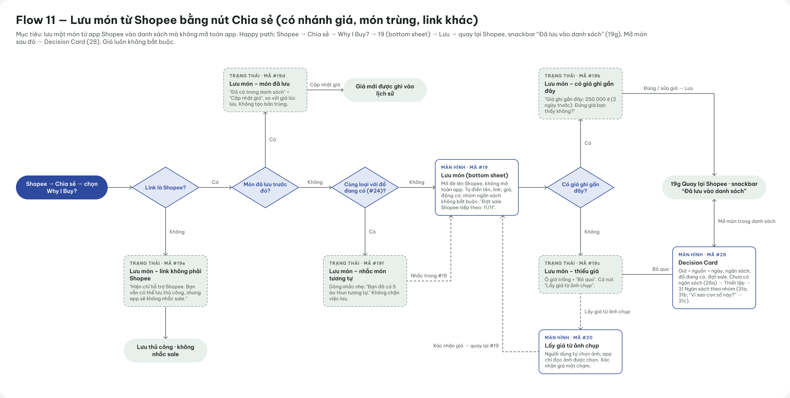 | Shopee → Chia sẻ → Why I Buy? → 19 bottom sheet → Lưu → 19g snackbar, quay lại Shopee → mở món → 28 Decision Card. Bốn điểm rẽ: link không phải Shopee (19e, lưu thủ công, không nhắc sale), món đã lưu (19d, cập nhật giá, không tạo bản trùng), có đồ cùng loại (19f, nhắc nhẹ, không chặn), có giá ghi gần đây (19b xác nhận 1 chạm) / thiếu giá (19c → 20 Lấy giá từ ảnh do người dùng chọn). Giá luôn không bắt buộc |
| **F12** – Ngày sale: cập nhật giá và quyết định | 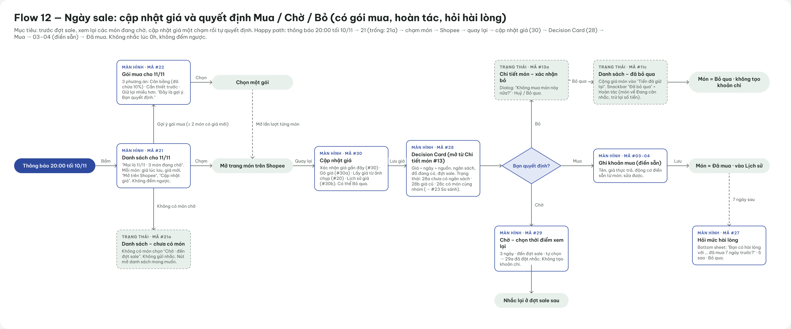 | Thông báo 20:00 tối 10/11 → 21 Danh sách cho 11/11 (trống: 21a, không gửi nhắc) → mở món trên Shopee → 30 Cập nhật giá → 28 Decision Card → Mua (03–04 điền sẵn → Đã mua, 7 ngày sau 27 Hỏi mức hài lòng) / Chờ (29 → nhắc lại đợt sau) / Bỏ qua (13a xác nhận → 11c có Hoàn tác, không tạo khoản chi). Nhánh 22 Gói mua khi có ≥ 2 món có giá mới. Ghi rõ "Không nhắc lúc 0h, không đếm ngược" |
| **F13** – Liên kết extension bằng mã 6 số | 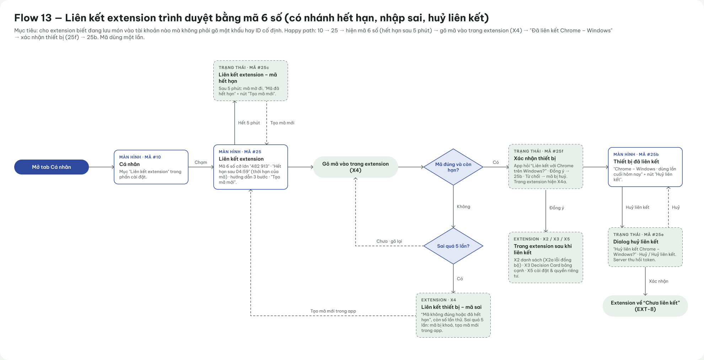 | 10 Cá nhân → 25 Liên kết extension (mã 6 số, hết hạn 5 phút) → gõ mã ở trang extension X4 → 25f xác nhận thiết bị trên điện thoại → 25b Thiết bị đã liên kết; trang extension sang X2 / X3 / X5. Nhánh: mã hết hạn (25c Tạo mã mới), nhập sai (X4, sai quá 5 lần thì khóa mã), từ chối (mã bị hủy), hủy liên kết (25e → extension về EXT-8 "Chưa liên kết") |

### D1-2. Wireframe bổ sung (`5_F11-F13-bo-sung-18-10/`)

**App Android (360 × 800):**

| Mã | Ảnh | Nội dung |
|---|---|---|
| WF28 Decision Card | 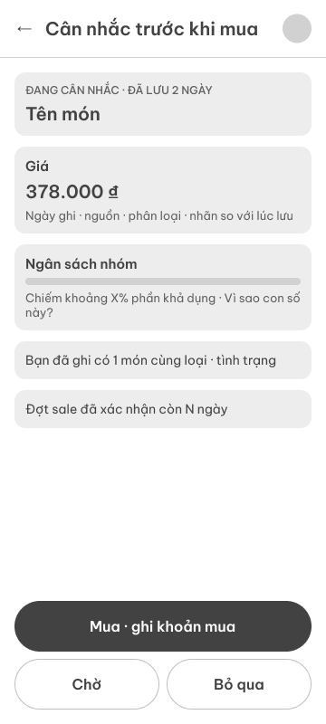 | Tên món + "Đang cân nhắc · đã lưu 2 ngày"; khối Giá (ngày ghi, nguồn, phân loại, nhãn so với lúc lưu); Ngân sách nhóm (% phần khả dụng, "Vì sao con số này?"); đồ cùng loại đã ghi; đợt sale; 3 nút Mua · Chờ · Bỏ qua |
| WF29 Chờ – chọn thời điểm | 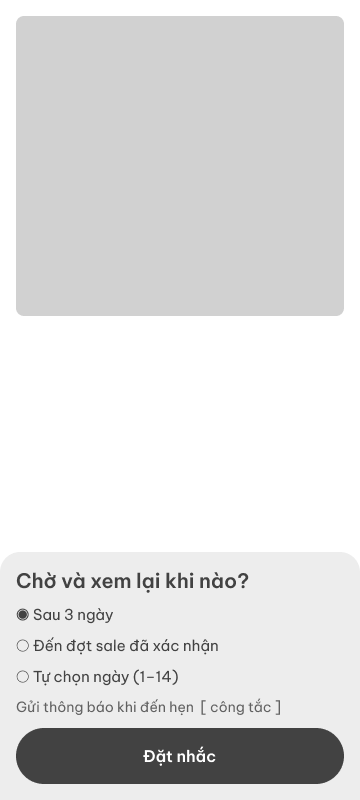 | Bottom sheet: Sau 3 ngày (mặc định) · Đến đợt sale đã xác nhận · Tự chọn ngày (1–14); công tắc gửi thông báo khi đến hẹn; nút "Đặt nhắc" |
| WF30 Cập nhật giá | 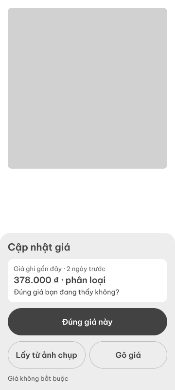 | Bottom sheet: giá ghi gần đây + phân loại, "Đúng giá bạn đang thấy không?" → "Đúng giá này"; phụ: "Lấy từ ảnh chụp", "Gõ giá"; ghi "Giá không bắt buộc" |
| WF30b Lịch sử giá | 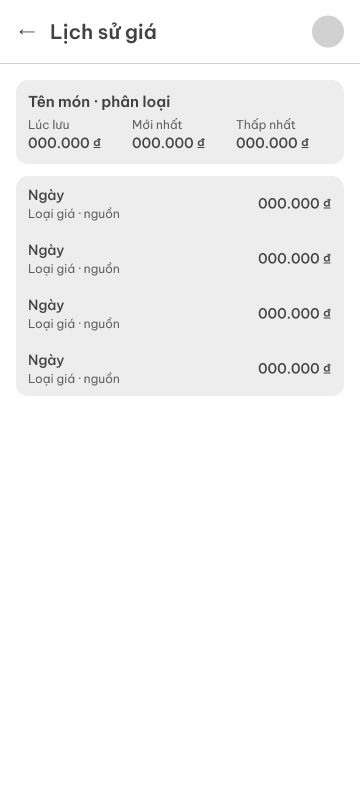 | Tóm tắt Lúc lưu · Mới nhất · Thấp nhất; danh sách từng lần ghi kèm ngày, loại giá, nguồn |
| WF31 Ngân sách theo nhóm | 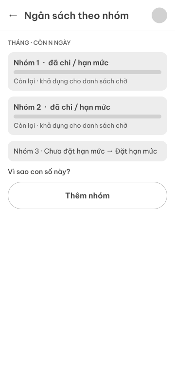 | Mỗi nhóm: đã chi / hạn mức, thanh tiến độ, "Còn lại · khả dụng cho danh sách chờ"; nhóm chưa đặt hạn mức → "Đặt hạn mức"; "Vì sao con số này?"; "Thêm nhóm" |

**Chrome extension (trang 960 × 640):**

| Mã | Ảnh | Nội dung |
|---|---|---|
| WFX2 Trang danh sách | 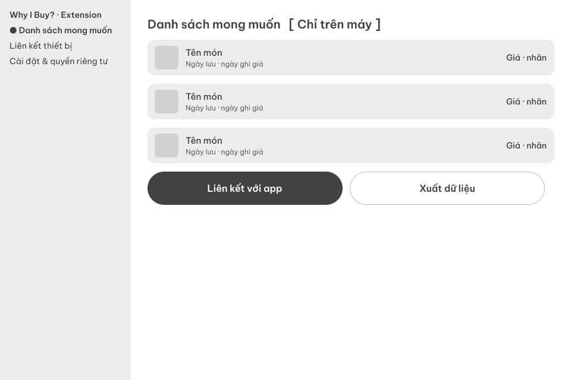 | Menu trái (Danh sách mong muốn · Liên kết thiết bị · Cài đặt & quyền riêng tư); nhãn "[Chỉ trên máy]"; mỗi món: tên, ngày lưu, ngày ghi giá, giá + nhãn; "Liên kết với app", "Xuất dữ liệu" |
| WFX3 Decision Card bảng cạnh | 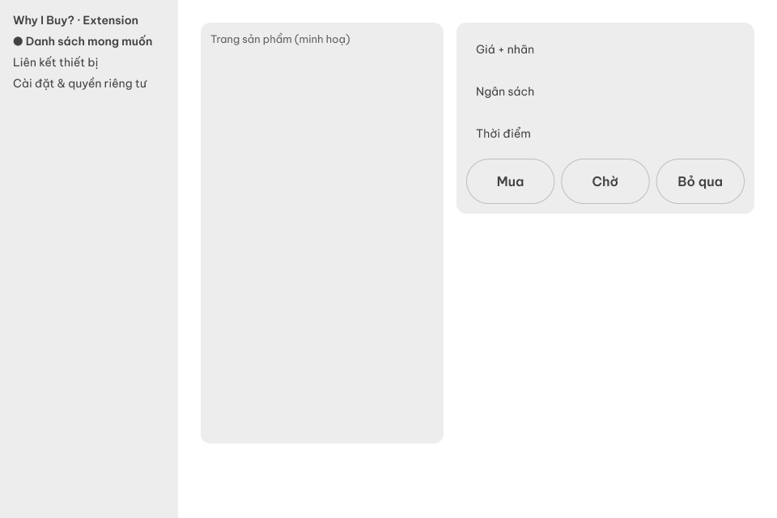 | Trang sản phẩm bên trái, bảng cạnh bên phải: Giá + nhãn, Ngân sách, Thời điểm; "Mua · mở form trên điện thoại", Chờ, Bỏ qua |
| WFX4 Liên kết thiết bị | 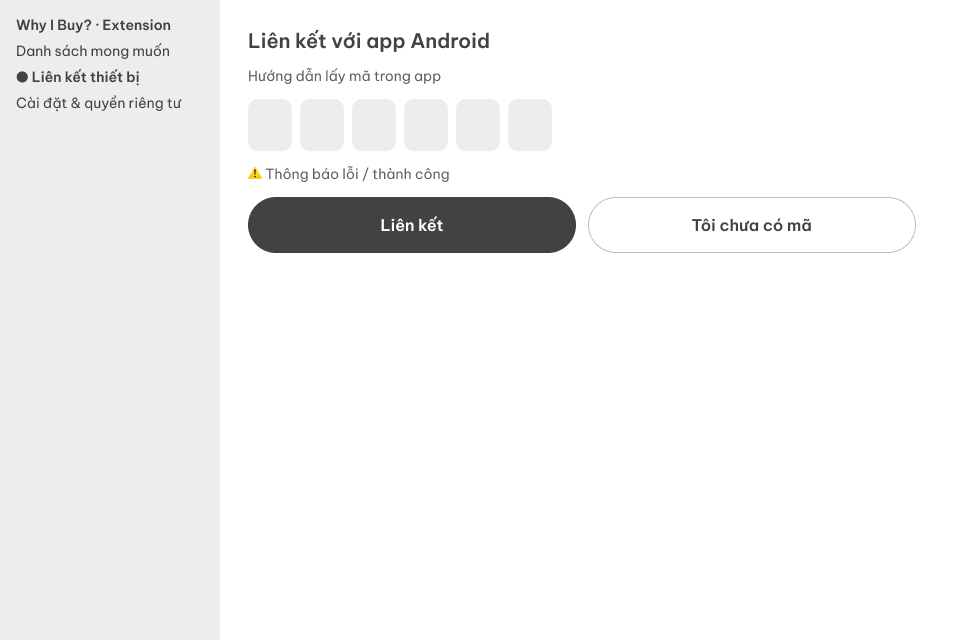 | "Liên kết với app Android", hướng dẫn lấy mã trong app, 6 ô nhập mã, dòng thông báo lỗi / thành công; "Liên kết", "Tôi chưa có mã" |
| WFX5 Cài đặt & quyền riêng tư | 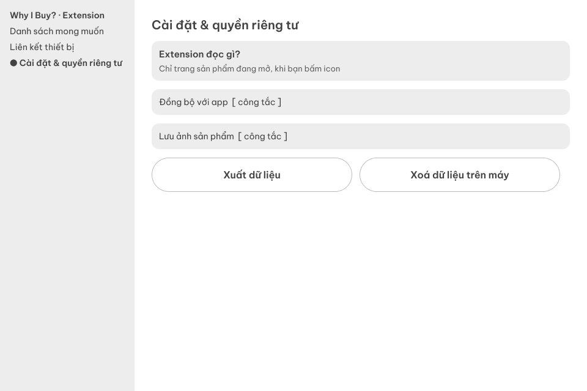 | "Extension đọc gì? Chỉ trang sản phẩm đang mở, khi bạn bấm icon"; công tắc Đồng bộ với app, Lưu ảnh sản phẩm; Xuất dữ liệu, Xóa dữ liệu trên máy |

### D1-3. Đối chiếu với `design/DESIGN.md` (rà ngày 18/10)

| # | Chỗ | Vấn đề | Đề xuất |
|---|---|---|---|
| 1 | WF28, WFX3 | Nút "Mua" là nút filled, "Chờ" và "Bỏ qua" là nút viền. Trái nguyên tắc 1 của DESIGN.md: ba nút Mua · Chờ · Bỏ qua **bằng nhau về độ nổi** | Ba nút cùng kiểu, cùng cỡ (như prompt Stitch bản 3) |
| 2 | WF28 | Dòng "Đợt sale đã xác nhận còn N ngày" là cách nói đếm ngược | Chỉ ghi ngày: "Đợt sale 11.11 · Thứ Tư 11/11 · Đã xác nhận" |
| 3 | WF28 | Tiêu đề "Cân nhắc trước khi mua" khác tên dùng ở Figma / spec ("Decision Card", "Cân nhắc món này") | Thống nhất một tên hiển thị |
| 4 | WF29 | "Tự chọn ngày (1–14)", trong khi DESIGN.md ghi thời gian cân nhắc chỉnh được 0–14 | Thống nhất khoảng |
| 5 | Flow 13 | Sơ đồ bắt đầu từ mục "Liên kết extension" trong 10 Cá nhân, nhưng màn 10 trên Figma chưa có hàng này (`ux/user-flow.md` F13) | Thêm hàng vào màn 10, hoặc ghi chú trong sơ đồ |
| 6 | Wireframe | Chưa có wireframe cho 19–27 và popup EXT-1…8 (theo `assets/figma/README.md`) | Bổ sung, hoặc ghi rõ các màn này đi thẳng từ Final UI |

- **Nhóm chỉnh sửa lại:** _(điền sau khi nhóm duyệt từng mục)_

---

## Tổng hợp insight → quyết định (cả 4 session)

| # | Insight / quyết định | Từ | Loại | Trạng thái |
|---|---|---|---|---|
| 1 | Thầy: nhập tay từng giao dịch không thực tế; giữ ngân sách theo nhóm, AI đánh giá wishlist theo ngân sách | S2-1 | THẬT (góp ý giảng viên) | Đã đưa vào docx (mục 8) |
| 2 | Chi tiêu tự tính từ món bấm "Đã mua", không làm sổ thu chi | S2-2 | AI đề xuất | Nhóm chấp nhận |
| 3 | Link Shopee luôn cho `shopId`, `itemId`; **có thể** có `modelId` | S1-1, S1-9 | THẬT (2 link) | Đã đưa vào docx |
| 4 | Nhóm **không được duyệt** Shopee Affiliate → server không tự lấy giá hợp lệ | S1-7, S4-3 | THẬT (ràng buộc) | Quyết định: giá do người dùng mang về; nhắc theo lịch sale |
| 5 | Không tự cào Shopee, không dùng repo / dịch vụ lách chống bot | S1-2, S1-3, S4-5 | AI đánh giá + nguồn | Nhóm không phản đối |
| 6 | Extension là cách lấy giá chính xác và hợp lệ nhất, nhưng chỉ chạy trên máy tính | S1-4 | AI phân tích | Đã đưa vào docx |
| 7 | Liên kết extension bằng mã ghép nối 6 số, không dùng ID cố định | S1-5, S4-2 | AI sửa ý tưởng nhóm | Đã đưa vào docx |
| 8 | Mobile: dùng lại giá có sẵn → WebView (rủi ro) → OCR → gõ tay | S1-8 | AI phân tích | CHƯA KIỂM CHỨNG |
| 9 | `is_from_login=true` → có thể Shopee bắt đăng nhập → WebView khó dùng | S1-9 | Suy luận | CHƯA KIỂM CHỨNG |
| 10 | Giá có thể là khoảng giá / Flash Sale → chỉ so cùng loại giá | S4-2 | AI + bằng chứng shopee-mcp | Đã đưa vào docx |
| 11 | Nguyên tắc từ sách (vạch đủ, nguội 7 ngày, tiền đã giữ lại…) | S3-2 | Nguồn sách + AI | Có trong bản hợp nhất v2; số liệu chưa chốt |
| 12 | Persona "săn sale ngày đôi, hết tiền cuối tháng" | S3-2 | AI GIẢ ĐỊNH | Cần đối chiếu persona v1 |

## Cần lưu ý trước khi nộp

- **Có 3 nhánh của `WhyIBuy_Extension_Mobile.docx`:** S2 thêm mục 8 Ngân sách (đánh số lại 8–10 thành 9–11); S4 sửa 6 điểm trên bản gốc (vẫn coi mục 8 là Mô hình dữ liệu); S3 tạo `WhyIBuy_ThietKe_HopNhat_v2.docx` riêng. Nhóm cần gộp lại một bản trước khi nộp.
- Nhiều nhận định về Shopee là **CHƯA KIỂM CHỨNG** vì AI không truy cập được Shopee.

## Việc còn mở

- [ ] Thử chia sẻ thật 3–5 sản phẩm từ app Shopee: đoạn chữ có giá không, dạng link nào.
- [ ] Thử WebView `shopee.vn` trên điện thoại khi chưa đăng nhập; trả lời câu hỏi "có bị bắt đăng nhập không".
- [ ] Nghe lại bản ghi âm ở 00:32, 07:53 (có phải thầy yêu cầu làm lại user research?), 09:35, 12:21.
- [ ] Quyết định có thêm addlivetag (nguồn `"ben_thu_ba"`) và cách "nghe dữ liệu trang tự tải về" của extension không.
- [ ] Chốt các con số AI tự đặt (ngưỡng điểm, nguội 7 ngày, biên độ 10%, mức loại giá lệch).
- [ ] Sửa các điểm D1-3 trên wireframe 28, 29, X3 và sơ đồ Flow 13; bổ sung wireframe 19–27, EXT-1…8.
- [ ] Đối chiếu persona S3 với P1–P5; thêm câu hỏi về Shopee (điện thoại hay máy tính, có chờ ngày sale không) vào khảo sát thật.

## Phụ lục: tài liệu 16/10 có sẵn trước 4 session

`why-i-buy/chia-se-de-luu.md` và `why-i-buy/tim-ngay-sale.md` (Project PRM) được tạo ở một session khác, **không nằm trong 4 session trên**, nên chưa có prompt nguyên văn. Nội dung research chính:

- Chọn Shopee vì khoảng 56% thị phần quý 3/2025 (theo Metric, **cần dán link**); thêm nút Chia sẻ Android vì người trẻ lướt Shopee trên điện thoại.
- Desk research lịch sale: ngày đôi, ngày 15, ngày 25, sự kiện lớn; 3 lớp biết ngày sale; 4 tầng nguồn quét; từ 2 nguồn khớp nhau mới gửi thông báo. 10 nguồn có link ở cuối `tim-ngay-sale.md`.
- Nguyên tắc: nhắc 20:00 tối hôm trước, không gửi 0h, không đếm ngược, câu chữ chỉ nói "có thể giảm" (nối với INS3 v1: mua khuya vì sale).
