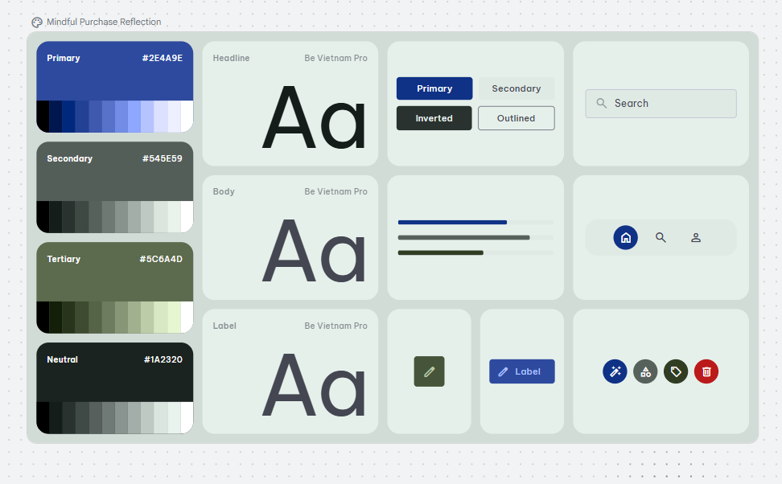
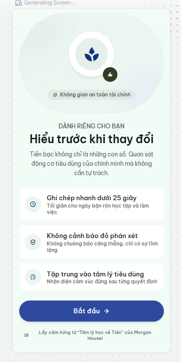
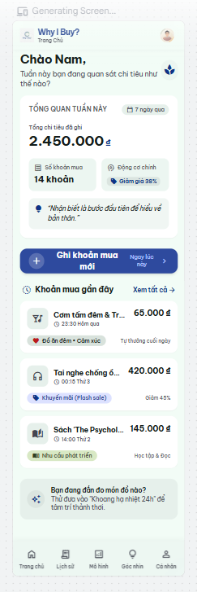
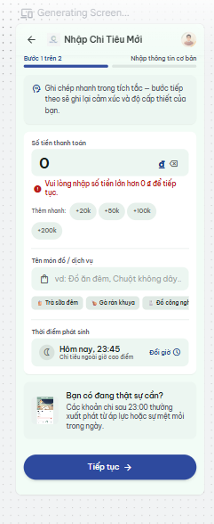
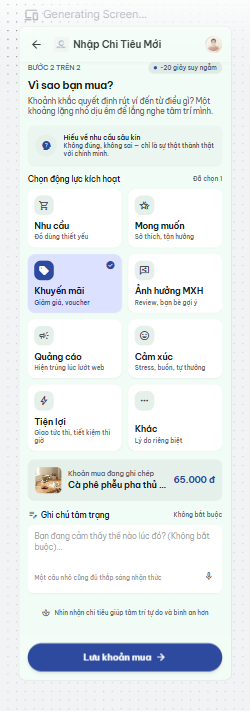

# AI Design Log

**Project:** Why I Buy?
**Course:** PRM323 – Cross-Platform Application Development

## Khai báo công cụ AI
| Công cụ | Mục đích |
|---|---|
| Claude (claude.ai) | Soạn nháp persona, user flow, DESIGN.md, prompt Stitch; giao diện tham chiếu; hỗ trợ nhận xét output Stitch |
| Google Stitch | Sinh UI ban đầu và các vòng lặp |

---

## P1 — Prompt đầu tiên (Flow 1)
**Ngày:** 11/10/2026
**Công cụ:** Google Stitch, chế độ Mobile
**Prompt (nguyên văn):**

```
Design a mobile app (Android, 360x800 dp, Material 3, light theme) called "Why I Buy?" — a non-judgmental purchase-reflection app inspired by Morgan Housel's "The Psychology of Money".

User: Nam, 22, final-year IT student and intern in Vietnam. He often orders late-night food and buys flash-sale items after 11 pm, uses his phone one-handed, and is near-sighted. He quit expense apps because logging was slow and red over-budget warnings made him feel guilty.
Main task: log a purchase and tag its psychological motive in under 25 seconds.

Screens:
1. Onboarding – headline "Hiểu trước khi thay đổi", short subtitle, one primary button "Bắt đầu".
2. Home Dashboard – weekly summary (number of purchases, total in VND, most common motive), one primary button "Ghi khoản mua" in the lower half, list of 3 recent purchases, bottom navigation with 5 tabs: Trang chủ, Lịch sử, Mô hình, Góc nhìn, Cá nhân.
3. Add Purchase, step 1 of 2 – large amount field in VND, item name field, date/time row, primary button "Tiếp tục". Also show an error variant: amount "0" with inline error message under the field.
4. Purchase Reason, step 2 of 2 – title "Vì sao bạn mua?", 8 selectable motive cards in a 2-column grid, each with icon and label: Nhu cầu, Mong muốn, Khuyến mãi, Ảnh hưởng MXH, Quảng cáo, Cảm xúc, Tiện lợi, Khác; optional note field; primary button "Lưu".
5. Home Dashboard after saving – same as screen 2 with a snackbar "Đã lưu" and the new purchase at the top of the recent list.

Style: calm and clean. Background #F5F6F2, primary indigo #2E4A9E, text #1A2320, secondary text #545E59, error #B3261E. Font Be Vietnam Pro. 16 dp side margins, 8 dp spacing grid, 12–16 dp corner radius, soft low elevation. Tone: warm and neutral, never judgmental — no red overspending warnings.

Constraints: all UI text in Vietnamese; exactly one primary action per screen; touch targets at least 48 dp; body text at least 14 sp; text contrast at least 4.5:1; motives always shown with icon + label, never by color alone; selected tab shown with a pill background and bold label.
```

**Kết quả:** Stitch sinh 5 màn hình và 1 bảng design system.

| Màn hình | Ảnh |
|---|---|
| Toàn cảnh |  |
| Design system do Stitch tạo |  |
| 01 Onboarding |  |
| 02 Home Dashboard |  |
| 03 Add Purchase (biến thể lỗi) |  |
| 04 Purchase Reason |  |
| 05 Home sau khi lưu |  |

**Phản hồi của Stitch (nguyên văn, chưa kiểm chứng):**

> Bộ thiết kế hoàn chỉnh cho ứng dụng "Why I Buy?" (Android, kích thước chuẩn 360x800 dp, Material 3, light theme) đã được hoàn thiện đáp ứng toàn bộ các tiêu chí và persona người dùng Nam (22 tuổi):
>
> 1. Phân tích & Giải pháp thiết kế cho Persona Nam:
> Thao tác một tay & Tốc độ < 25 giây: Toàn bộ các nút hành động chính (CTA) và lưới chọn nhanh đều được bố trí ở nửa dưới màn hình trong tầm với của ngón tay cái, kèm các chip gợi ý nhanh (+20k, +50k...).
> Độ rõ nét cho mắt cận: Font Be Vietnam Pro với cỡ chữ lớn, tương phản cao (trên 4.5:1), trường nhập số tiền hiển thị nổi bật dễ nhận biết.
> Tâm lý phi phán xét (Non-judgmental): Lấy cảm hứng từ cuốn "The Psychology of Money" của Morgan Housel. Không có bất kỳ thanh cảnh báo màu đỏ hay âm báo tiêu cực nào tạo cảm giác tội lỗi khi chi tiêu ngoài kế hoạch/đêm muộn; thay vào đó là sự ghi nhận khách quan về động cơ tâm lý.
>
> 2. Danh sách 5 màn hình đã thiết kế:
> Onboarding – Hiểu trước khi thay đổi: Tiêu đề chính "Hiểu trước khi thay đổi", phụ đề giải thích tinh tế. 3 điểm cam kết: Ghi chép nhanh dưới 25s, không phán xét, thấu hiểu tâm lý. Nút chính duy nhất: "Bắt đầu".
> Trang chủ – Tổng quan & Ghi khoản mua: Thẻ tổng kết tuần: Số khoản mua (14 khoản), Tổng tiền (2.450.000 ₫), Động cơ chính (Khuyến mãi 38%). Nút hành động chính nổi bật ở nửa dưới: "Ghi khoản mua mới". Danh sách 3 khoản mua gần nhất với đầy đủ Icon + Nhãn động cơ rõ ràng. Thanh điều hướng 5 tab chuẩn Material 3: Trang chủ (đang chọn với pill background & in đậm), Lịch sử, Mô hình, Góc nhìn, Cá nhân.
> Nhập chi tiêu – Bước 1/2 (kèm trạng thái lỗi): Ô nhập số tiền lớn bằng VNĐ, ô tên món đồ, dòng chọn ngày giờ ("Hôm nay, 23:45"). Hiển thị trực quan biến thể trạng thái lỗi hợp lệ: Khi số tiền là "0", thông báo lỗi nội dòng màu #B3261E: "⚠️ Vui lòng nhập số tiền lớn hơn 0 ₫ để tiếp tục." Nút chính: "Tiếp tục".
> Động cơ mua – Bước 2/2 (Vì sao bạn mua?): Tiêu đề "Vì sao bạn mua?". Lưới 2 cột gồm 8 thẻ động cơ tâm lý (có đầy đủ icon + nhãn): Nhu cầu, Mong muốn, Khuyến mãi (đang chọn), Ảnh hưởng MXH, Quảng cáo, Cảm xúc, Tiện lợi, Khác. Khung nhập ghi chú tâm trạng tùy chọn. Nút chính: "Lưu khoản mua".
> Trang chủ sau khi lưu (kèm Snackbar): Hiển thị Snackbar ở đáy: "✓ Đã lưu khoản mua thành công" kèm nút "Hoàn tác". Thẻ tổng kết tuần tự động cập nhật (+1 khoản, +65.000 ₫). Khoản mua mới vừa lưu được đưa lên vị trí đầu tiên trong danh sách gần đây.
>
> Thông số kỹ thuật & Thiết kế: Tone & Theme: Nền #F5F6F2, màu chủ đạo Indigo #2E4A9E, chữ chính #1A2320, chữ phụ #545E59, màu lỗi #B3261E. Quy cách: Bo góc 12–16 dp, lề 16 dp, lưới 8 dp, mục tiêu chạm tối thiểu 48 dp

**Nhận xét của tôi (đối chiếu với ảnh):**
- Được:
  - Toàn bộ chữ là tiếng Việt, đủ dấu, dùng font Be Vietnam Pro như DESIGN.md.
  - 01 Onboarding: đúng một nút chính "Bắt đầu", thông điệp "Hiểu trước khi thay đổi" rõ ràng, 3 cam kết khớp pain point của Nam.
  - 04 Purchase Reason: lưới 2 cột đủ 8 động cơ, mỗi thẻ có icon + tên + mô tả; thẻ được chọn có nền khác màu và dấu tích, không chỉ dựa vào màu.
  - 03 Add Purchase: lỗi số tiền hiển thị ngay dưới ô nhập, có icon và câu hướng dẫn cách sửa.
  - Không có cảnh báo đỏ hay câu chữ về "vượt ngân sách" ở Trang chủ.
  - Màu chính #2E4A9E, chữ #1A2320, chữ phụ #545E59 được dùng đúng.

- Chưa được:
  - 02 Home Dashboard: động cơ chính ghi "Giảm giá 38%" thay vì "Khuyến mãi"; danh sách gần đây có nhãn ngoài bộ 8 động cơ như "Đồ ăn đêm • Cảm xúc", "Khuyến mãi (Flash sale)", "Nhu cầu phát triển" → không nhất quán tên gọi (Nielsen #4).
  - 03 và 04: tiêu đề màn là "Nhập Chi Tiêu Mới" trong khi Trang chủ dùng "Ghi khoản mua"; màn 04 dùng "Chọn động lực kích hoạt" thay vì "động cơ" → cùng một khái niệm có nhiều tên (Nielsen #4).
  - 03 Add Purchase (biến thể lỗi): số tiền đang là 0 và đã báo lỗi nhưng nút "Tiếp tục" vẫn hiển thị như đang bấm được → thiếu phòng ngừa lỗi (Nielsen #5).
  - 03 Add Purchase: thẻ "Bạn có đang thật sự cần? Các khoản chi sau 23:00 thường xuất phát từ áp lực học tập hoặc sự mệt mỏi…" mang tính phán đoán và gợi cảm giác tội lỗi, trái với triết lý không phán xét và pain point của Nam; thẻ còn xuất hiện trước khi Nam chọn động cơ nên có thể làm Nam chọn lệch.
  - 03 Add Purchase: chip "Thêm nhanh" (+20k, +50k, +100k, +200k) và chip gợi ý tên món trông thấp hơn nhiều so với 48dp; dãy chip gợi ý bị cắt ở mép phải.
  - 02 Home Dashboard: nút chính "Ghi khoản mua mới" bị xuống 2 dòng và chen thêm chữ "Ngay lúc này" cùng mũi tên; nút nằm khoảng giữa màn hình chứ không ở nửa dưới như yêu cầu (Nam dùng một tay).
  - 02 Home Dashboard: tên món trong danh sách bị cắt nhiều ("Cơm tấm đêm & Tr…", "Tai nghe chống ồ…", "Sách 'The Psychol…").
  - 02 Home Dashboard: thẻ "Khoảng hạ nhiệt 24h" là một tính năng không có trong phạm vi và cạnh tranh với hành động chính (Nielsen #8).
  - 02 Home Dashboard: nhãn thanh điều hướng rất nhỏ, và khó nhận ra tab "Trang chủ" đang được chọn (không thấy nền pill như yêu cầu).
  - Nhiều chữ phụ trông nhỏ hơn 14sp: mô tả dưới tên động cơ ở 04, dòng phụ trong thẻ cam kết ở 01, các dòng chú thích nhỏ ở cuối màn 04 và 01.
  - 05 Home sau khi lưu: biểu đồ các ngày trong tuần (T2–CN) chỉ phân biệt bằng kích thước và màu chấm, không có số liệu → truyền thông tin chỉ bằng hình/màu.
  - 05 Home sau khi lưu: bố cục và nhãn khác hẳn màn 02 dù prompt yêu cầu "giống màn 2" ("Tổng chi tiêu đã ghi" thành "Tổng chi tiêu đã nhận diện", "Số khoản mua" thành "Số lần ra quyết định") → không nhất quán giữa hai trạng thái của cùng một màn.
  - 04 và 05: khoản đang ghi ở bước 2 là "Cà phê phễu pha thủ công", nhưng khoản mới ở Trang chủ sau khi lưu lại là "Trà sữa nướng & Bánh tráng" → dữ liệu không liên tục giữa các bước.
  - 02, 03, 04: theo tỷ lệ ảnh, các màn dài hơn khung 800dp; ở màn 04, nút "Lưu khoản mua" nằm dưới cùng nên trên máy 360×800 Nam phải cuộn mới thấy nút chính.
  - Design system: Stitch tự thêm màu Tertiary #5C6A4D (xanh rêu) không có trong DESIGN.md, dùng #545E59 (màu chữ phụ) làm màu Secondary, và không thể hiện màu nền #F5F6F2 cùng màu lỗi #B3261E trong bảng màu.

---

## P2 — Prompt thứ hai (Flow 2, Flow 3)
**Ngày:**
**Công cụ:** Google Stitch, chế độ Mobile
**Prompt (nguyên văn):**

(dán prompt 2 vào đây)

**Kết quả:**
| Màn hình | Ảnh |
|---|---|
| | assets/stitch/v2-... |

**Nhận xét của tôi:**
- Được:
- Chưa được:
