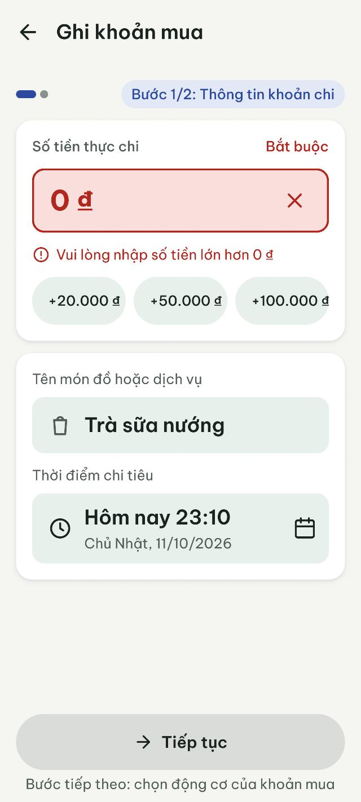
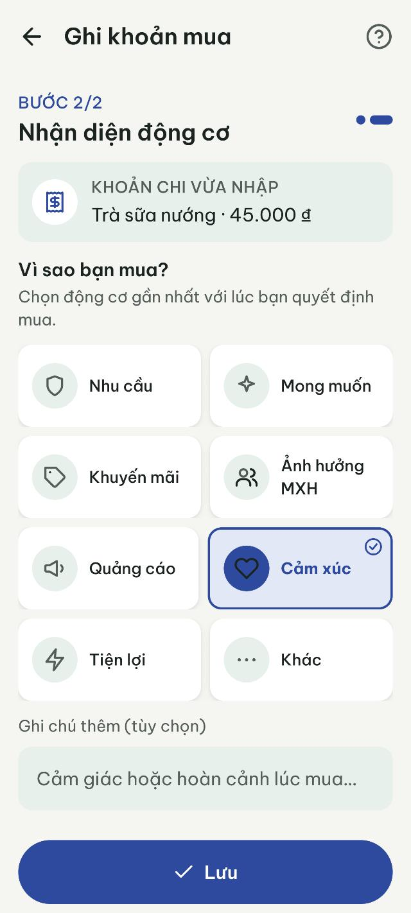
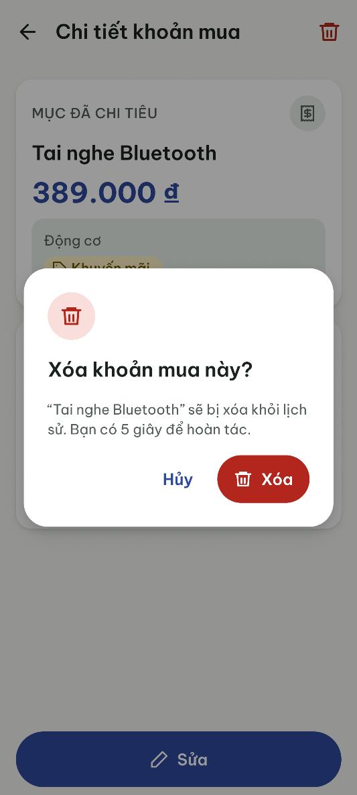
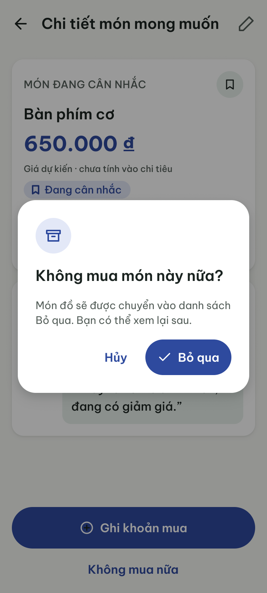
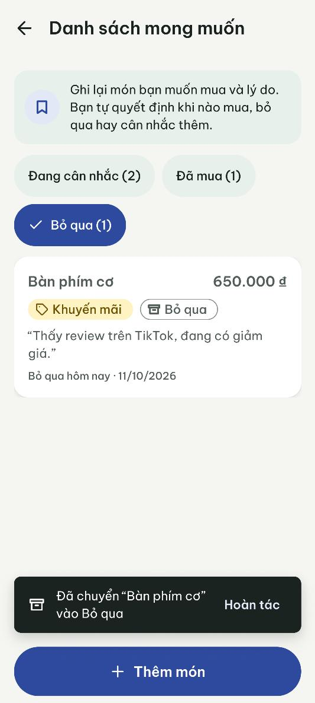
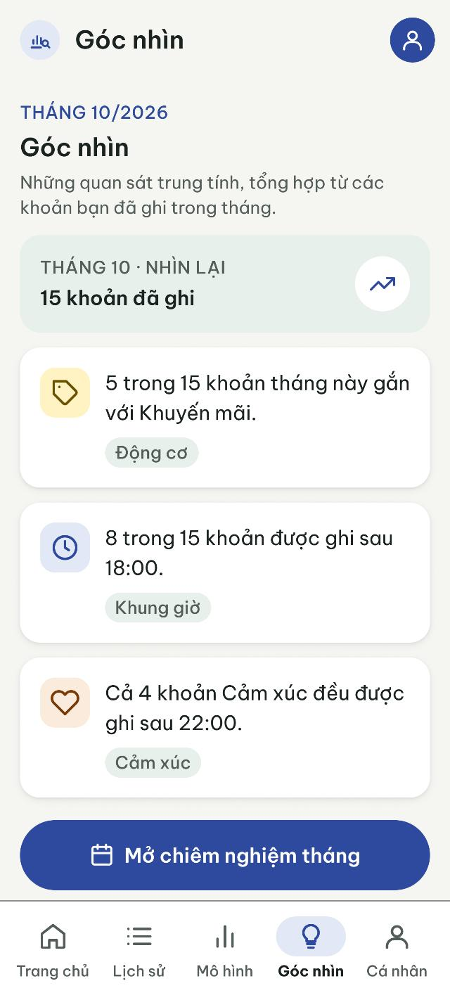
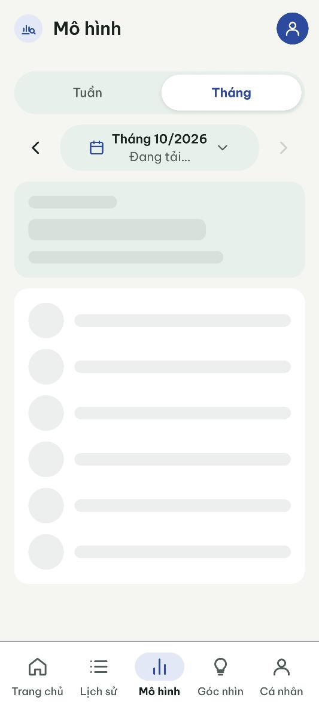
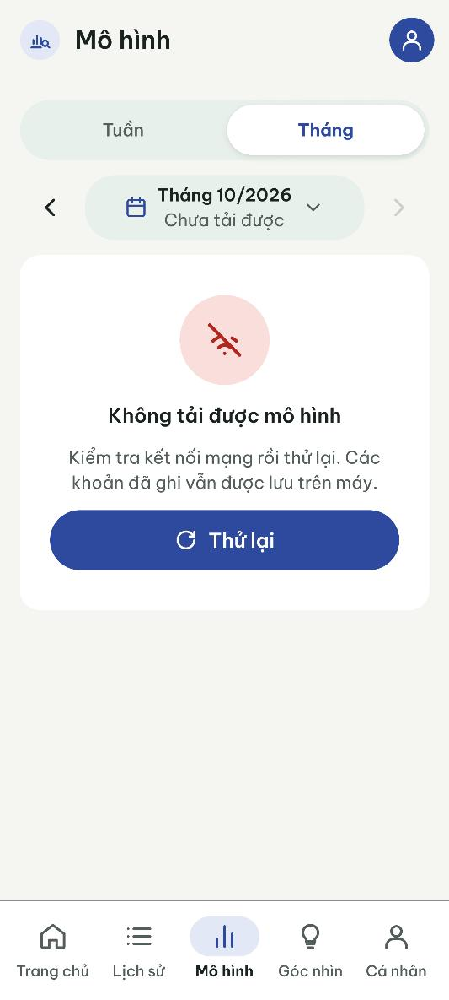
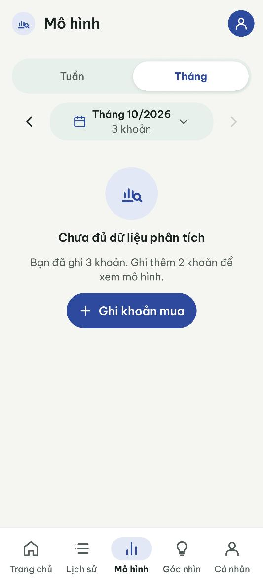
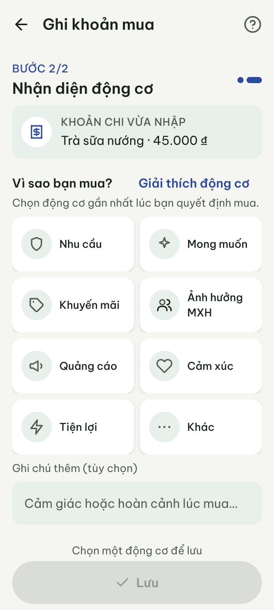

# Design Decisions & Accessibility

**Project:** Why I Buy? – lấy cảm hứng từ "The Psychology of Money"
**Course:** PRM323 – Lab 2
**Nguồn:** các quyết định dưới đây lấy từ quá trình làm việc với Google Stitch (P1, P2, R1–R3, F6) và phản biện bằng AI trong [`ai/ai-design-log.md`](../ai/ai-design-log.md). Token màu, chữ, khoảng cách theo [`DESIGN.md`](DESIGN.md). Số đo accessibility lấy từ page `04 Design System › Accessibility check` trong Figma.

---

## 1. Mười quyết định quan trọng nhất

| # | Đề xuất của AI | Quyết định | Căn cứ chính | Nằm ở đâu trong Figma |
|---|---|---|---|---|
| 1 | Thẻ nhắc nhở, khuyên bảo, khen ngợi trên màn ghi khoản mua và chi tiết | **Từ chối** | Persona (cảm giác tội lỗi); thông điệp "Hiểu trước khi thay đổi" | 03 Final UI – màn 03, 05 |
| 2 | Thẻ động cơ có icon + tên + một dòng mô tả | **Sửa** | Khung 800 dp và chữ ≥ 14 sp; mục tiêu ghi ≤ 25 giây; Nielsen #6 | 05 Components – Motive card; màn 04 |
| 3 | Dialog xác nhận xóa dạng overlay; dialog "Không mua món này nữa?" | **Chấp nhận** (bổ sung hoàn tác 5 giây; bỏ qua đổi sang nút primary) | Nielsen #3, #5; Nam thao tác một tay dễ chạm nhầm; bỏ qua không phải xóa | Dialog, Snackbar; màn 05, 06, 13a, 11c |
| 4 | Thẻ Góc nhìn chứa số liệu và diễn giải tâm lý | **Sửa** | Brief: insight là quan sát trung lập; Nielsen #2 | màn 07, 08 |
| 5 | Màn lỗi và skeleton loading của Mô hình | **Chấp nhận** (chỉnh vị trí nút) | Nielsen #1, #9 | Skeleton, Empty / Error state; màn 07 |
| 6 | "Khoảng lặng 48h", "Còn 48h suy ngẫm", "Đã hạ nhiệt 40%", đồng hồ cát; "Nhật ký tâm lý" 3 bước ở chi tiết món (Flow 6) | **Từ chối** | Nielsen #3, #8; persona sợ bị phán xét; con số không đo được; phạm vi, tăng ma sát | màn 11, 13 |
| 7 | Stitch thiết kế lại Trang chủ quanh danh sách mong muốn | **Sửa** | Nielsen #4; một hành động chính mỗi màn | Wishlist entry; màn 02 |
| 8 | Chip lọc trạng thái cuộn ngang, chip cuối bị cắt ở 360 dp | **Sửa** | Accessibility (không cắt chữ, vùng chạm 48 dp) | màn 11 |
| 9 | Bảng màu: màu chính và màu cảnh báo (kiểm chứng bằng research) | **Chấp nhận** primary indigo, đỏ chỉ cho lỗi | INS2 (MÔ PHỎNG); I1 | 04 Design System – Màu |
| 10 | Bước 2/2 chọn sẵn động cơ (kiểm thử phát hiện F1) | **Sửa** (R4-1) | Nielsen #5; F1 (MÔ PHỎNG, lỗi có thật trong Figma) | màn 04 (chưa chọn động cơ) |

---

### Quyết định 1 — TỪ CHỐI: thẻ nhắc nhở và khuyên bảo

**AI đề xuất:** Ở P1, Stitch tự thêm thẻ "Bạn có đang thật sự cần? Các khoản chi sau 23:00 thường xuất phát từ áp lực học tập hoặc sự mệt mỏi…" vào bước 1 của Ghi khoản mua. Khi các thẻ này bị xóa, Stitch lại sinh câu mới cùng kiểu ở R2: "Ghi nhận đơn thuần, không tự phán xét…" (Bước 1/2), "Bạn nhận diện được cơn sốt ưu đãi kịp thời. Sự tỉnh thức là bước đầu tiên…" (Chi tiết).

| Trước | Sau (đã bỏ thẻ) | Figma cuối |
|---|---|---|
|  |  |  |

**Phân tích:**
- **Persona:** Nam đã bỏ các app chi tiêu vì cảm giác tội lỗi khi bị cảnh báo. Câu "Bạn có đang thật sự cần?" đặt đúng lúc Nam vừa mua xong chính là trải nghiệm đó.
- **Thứ tự hiển thị:** thẻ xuất hiện *trước* bước chọn động cơ, nên có thể khiến Nam chọn động cơ "đúng đắn" hơn là động cơ thật → dữ liệu mất giá trị.
- **Thông điệp sản phẩm:** "Hiểu trước khi thay đổi" nghĩa là app quan sát, không dạy bảo. Cả câu khen ("Bạn nhận diện được… kịp thời") cũng là đánh giá hành vi.

**Quyết định:** Từ chối mọi thẻ, câu nhắc nhở, khen ngợi hoặc suy diễn tâm lý. Vì Stitch tự thêm lại sau mỗi vòng, các câu còn sót được xóa tay trong Figma, và quy tắc giọng văn được ghi vào DESIGN.md.

---

### Quyết định 2 — SỬA: thẻ động cơ chỉ còn icon + tên

**AI đề xuất:** Ở P1, Stitch làm lưới 8 thẻ động cơ, mỗi thẻ có icon, tên và một dòng mô tả nhỏ ("Thiết yếu thường ngày", "Ưu đãi, combo…").

| Trước | Sau | Figma cuối |
|---|---|---|
|  |  |  |

**Phân tích:**
- **Giữ lại:** dạng lưới thẻ có icon thay vì danh sách thả xuống. Nam nhận ra động cơ qua icon mà không phải nhớ (Nielsen #6), và mỗi thẻ là một vùng chạm lớn (156 × 72 dp).
- **Vấn đề:** dòng mô tả nhỏ hơn 14 sp (Nam cận 2 độ) và làm lưới dài quá khung 800 dp. Nút "Lưu" bị đẩy xuống dưới, Nam phải cuộn bằng một tay, đi ngược mục tiêu ghi ≤ 25 giây.
- **Đánh đổi:** tên 8 động cơ đã đủ rõ; phần giải thích chuyển vào nút "?" trên app bar (bottom sheet "Các động cơ nghĩa là gì?", Nielsen #10).

**Quyết định:** Sửa — giữ lưới 2 × 4 với icon + tên, bỏ dòng mô tả. Thẻ được chọn thể hiện bằng nền, viền và dấu tích (không chỉ đổi màu). Lưới, ô ghi chú và nút "Lưu" nằm gọn trong một màn.

---

### Quyết định 3 — CHẤP NHẬN: dialog xác nhận và hoàn tác 5 giây cho mọi hành động "mất dữ liệu"

**AI đề xuất:** Ở P2, Stitch làm dialog xóa khoản mua dạng overlay trên nền tối, nút "Hủy" dạng chữ và nút "Xóa" màu đỏ có icon. Ở Flow 6, Stitch làm dialog "Không mua món này nữa?" / "Món đồ sẽ được chuyển vào danh sách Bỏ qua. Bạn có thể xem lại sau." cho hành động bỏ qua món mong muốn.

| P2 | Sau R2 | Figma cuối |
|---|---|---|
|  |  |  |

| Stitch (Flow 6) | Figma cuối | Sau khi xác nhận |
|---|---|---|
|  |  |  |

**Phân tích:**
- **Nielsen #5 (phòng ngừa lỗi):** xóa là hành động khó đảo ngược, cần một bước xác nhận. Hai nút tách biệt, nút nguy hiểm có màu đỏ và icon, nên không chỉ dựa vào màu.
- **Nielsen #3 (kiểm soát và tự do):** bản P2 hứa "có thể hoàn tác" nhưng màn sau khi xóa không có hoàn tác. Lời hứa này phải được thực hiện.
- **Persona:** Nam dùng một tay, dễ chạm nhầm. Hoàn tác ngay sau khi xóa tốn ít công hơn nhập lại cả khoản mua.
- **Bỏ qua món không phải hành động phá hủy:** món vẫn còn trong danh sách Bỏ qua và đưa về được. Vì vậy dialog bỏ qua không dùng màu đỏ, để màu đỏ chỉ báo những hành động thật sự mất dữ liệu.

**Quyết định:** Chấp nhận dạng dialog cho cả hai hành động, cùng một quy tắc: xác nhận trước, hoàn tác 5 giây sau.
- **Xóa khoản mua:** sửa nội dung thành "“Tai nghe Bluetooth” sẽ bị xóa khỏi lịch sử. Bạn có 5 giây để hoàn tác." và thêm snackbar "Đã xóa … · Hoàn tác" ở màn Lịch sử (khung `06 Lịch sử – sau khi xóa`). Cùng kiểu snackbar dùng cho "Đã lưu … · Hoàn tác" sau khi ghi khoản mua.
- **Bỏ qua món mong muốn:** giữ nguyên câu chữ của Stitch. Có ba thay đổi: dựng lại thành overlay thật trên khung 360 × 800 (Stitch đặt trong canvas ngang), đổi icon và nền sang primary, và sau khi xác nhận hiện snackbar "Đã chuyển “Bàn phím cơ” vào Bỏ qua · Hoàn tác" (5 giây, [11c](../assets/figma/11c-wishlist-skipped.png)).
- **Khác biệt:** xóa dùng nút Danger (màu error), bỏ qua dùng nút Primary vì không phải hành động phá hủy.

---

### Quyết định 4 — SỬA: thẻ Góc nhìn chỉ còn câu quan sát từ dữ liệu

**AI đề xuất:** Ở P2 và R1, Stitch viết thẻ Góc nhìn có số liệu không có nguồn ("Khoảng dừng 15 phút giúp giảm 40% mua bốc đồng", "75% đơn sau 23h…") và diễn giải tâm lý ("Bạn thường lướt điện thoại trước khi ngủ", "…những ngày có lịch học dày đặc").

| Trước | Sau | Figma cuối |
|---|---|---|
|  |  |  |

**Phân tích:**
- **Ràng buộc trong brief:** insight phải là quan sát trung lập, lấy từ chính dữ liệu Nam đã ghi.
- **Nielsen #2:** con số không lấy từ dữ liệu của người dùng thì không đúng với thực tế của họ, và làm giảm niềm tin vào toàn bộ màn hình.
- **Nhất quán dữ liệu:** các số liệu bịa còn mâu thuẫn với màn Mô hình (P2: "8/15 khoản từ 22h" vs "75% đơn sau 23h").

**Quyết định:** Sửa — giữ dạng thẻ có icon, thay nội dung bằng 3 câu kiểm chứng được từ dữ liệu mẫu: "5 trong 15 khoản tháng này gắn với Khuyến mãi.", "8 trong 15 khoản được ghi sau 18:00.", "Cả 4 khoản Cảm xúc đều được ghi sau 22:00." Khung "Tối" ở màn Mô hình được định nghĩa là 18–05h để hai màn dùng cùng một cách tính.

---

### Quyết định 5 — CHẤP NHẬN: trạng thái lỗi và đang tải của Mô hình

**AI đề xuất:** Ở R3 (lần 2), Stitch tạo màn lỗi gồm icon wifi gạch trong vòng tròn, tiêu đề, câu nêu nguyên nhân và trấn an dữ liệu, nút "Thử lại". Màn đang tải là skeleton giữ đúng khung sườn biểu đồ.

| Đang tải | Lỗi | Chưa đủ dữ liệu |
|---|---|---|
|  |  |  |
|  |  |  |

**Phân tích:**
- **Nielsen #1:** skeleton cho Nam biết app đang xử lý, và vì giữ đúng hình dạng nên khi có kết quả bố cục không bị nhảy.
- **Nielsen #9:** màn lỗi có đủ 3 yếu tố: nguyên nhân bằng ngôn ngữ dễ hiểu ("Kiểm tra kết nối mạng…"), trấn an ("Các khoản đã ghi vẫn được lưu trên máy") và một hành động khắc phục.
- **Không ngõ cụt:** màn chưa đủ dữ liệu dẫn thẳng về Flow 1 bằng nút "Ghi khoản mua".

**Quyết định:** Chấp nhận, với 2 chỉnh sửa trong Figma: khung lỗi và khung chưa đủ dữ liệu dùng chung component `Empty / Error state`; prototype Flow 2 có chuyển cảnh tự động từ đang tải sang kết quả.

---

### Quyết định 6 — TỪ CHỐI: cơ chế ép chờ và nhật ký tâm lý nhiều bước ở Flow 6

Stitch tự thêm chip "Khoảng lặng 48h", nhãn "Đang tĩnh tâm", dòng "Còn 48h suy ngẫm", "Đã hạ nhiệt 40%" kèm đồng hồ cát, và thẻ "Nhật ký tâm lý · Bước 2/3" ở chi tiết món.

| Trước | Sau |
|---|---|
|  |  |

**Phân tích:**
- **Thời gian chờ và chỉ số "hạ nhiệt":** các chi tiết này biến danh sách mong muốn thành công cụ ép người dùng ngừng mua. Điều đó trái Nielsen #3 (người dùng phải tự quyết định) và trái tông "không phán xét" trong DESIGN.md. Ngoài ra "40%" là con số ứng dụng không có cách đo.
- **Nhật ký tâm lý nhiều bước:** thẻ "Nhật ký tâm lý · Bước 2/3" buộc người dùng đi qua các giai đoạn trước khi quyết định. Nó thêm thao tác (Nielsen #8), nằm ngoài phạm vi và lặp lại chức năng của Chiêm nghiệm tháng (09).

**Quyết định:** Từ chối cả hai. Bản Figma bỏ toàn bộ: nút "Ghi khoản mua" luôn bấm được, chỉ còn ngày thêm ("2 ngày trước") làm thông tin trung lập. Ghi chú tự do ở 12/13 đã đủ để ghi lại cảm xúc.

### Quyết định 7 — SỬA: không thiết kế lại Trang chủ
Bản Stitch của Trang chủ có bố cục khác 02 hiện tại, nhãn "Danh …" bị cắt và thêm thẻ trích dẫn mang giọng khuyên bảo. Figma giữ nguyên 02 của nhóm, chỉ chèn component "Wishlist entry" (thẻ trắng, cao 64 dp, chevron) dưới Tổng quan tuần ([02d](../assets/figma/02d-home-wishlist-entry.png)). Nút "Ghi khoản mua" vẫn là hành động chính duy nhất.

### Quyết định 8 — SỬA: bộ lọc không bị cắt ở 360 dp
Ở 360 dp, ba chip "Đang cân nhắc (2)", "Đã mua (1)", "Bỏ qua (0)" rộng khoảng 410 dp, nên bản Stitch cắt mất chip cuối. Figma cho chip xuống hàng (wrap). Số lượng vẫn nằm trong nhãn để không cần nhìn màu cũng biết đang lọc gì.

### Quyết định 9 — CHẤP NHẬN: màu chính indigo, đỏ chỉ dành cho lỗi
**Căn cứ:** INS2 ([`ux/research.md`](../ux/research.md)): nhóm 18–25 chấm cảnh báo đỏ 1,79/5 (MÔ PHỎNG); I1 "thấy màu đỏ là tắt app".
**Quyết định:** primary #2E4A9E (indigo, trung tính, không mang nghĩa khen hay chê như xanh lá / đỏ). Đỏ #B3261E chỉ dùng cho lỗi nhập liệu và hành động xóa. 8 động cơ mỗi cái một cặp nền nhạt và chữ đậm cùng tông (6,66–9,43 : 1), luôn kèm icon và tên.
**Kiểm tra:** bảng 2.1 – mọi cặp chữ ≥ 4,5 : 1.

### Quyết định 10 — SỬA: Bước 2/2 không chọn sẵn động cơ (R4-1)
**Căn cứ:** kiểm thử F1 ([`ux/usability-test.md`](../ux/usability-test.md)): 3/5 người lưu theo lựa chọn có sẵn mà không biết (MÔ PHỎNG; lỗi có thật trong Figma).
**Quyết định:** bước 2 mở ra không có thẻ nào được chọn; nút "Lưu" khóa kèm dòng "Chọn một động cơ để lưu". Không làm chậm luồng chính (thời gian chuẩn KLM vẫn 16,5 giây vì đã tính một chạm chọn động cơ).
**Nguyên tắc:** Nielsen #5 Phòng ngừa lỗi; mục tiêu cốt lõi của app là ghi đúng động cơ.

| Trước | Sau (chưa chọn) | Sau (đã chọn) |
|---|---|---|
|  |  |  |

> Các phát hiện của vòng phản biện bằng AI (Nielsen + accessibility + persona) và quyết định cho từng phát hiện được ghi ở mục **"Phản biện bằng AI"** trong [`ai/ai-design-log.md`](../ai/ai-design-log.md).

---

## 1b. Quyết định theo hướng Smart Shopping Companion (18/10/2026)

> **Cần nhóm chốt:** đề Lab 2 yêu cầu `design-decisions.md` có **không quá 10 quyết định quan trọng nhất**. Mục 1 đang có 10 quyết định của Flow 1–10; mục này thêm 8 quyết định của hướng mới (QĐ-N1 … QĐ-N8), nên tổng hiện là 18. Trước khi nộp, nhóm chọn lại 10 quyết định quan trọng nhất, các quyết định còn lại chuyển sang `ai/ai-design-log.md`. Không quyết định cũ nào bị xóa; chỗ bị thay thế ghi ở cột "Thay thế / liên quan".
>
> Nguồn: đặc tả hợp nhất v1.0 (17/10, mục 1.3, 1.5, 6–8, 15), báo cáo "So sánh giá cộng đồng và voucher" (Khoa, tài liệu đề xuất), Figma ver2 đọc ngày 18/10. Các quyết định là **đề xuất của nhóm, chưa được giảng viên xác nhận**.

| # | Vấn đề | Quyết định | Căn cứ chính | Thay thế / liên quan | Hiện trạng Figma 18/10 |
|---|---|---|---|---|---|
| N1 | Có làm ngân sách không | **Có**, theo nhóm hàng, tùy chọn, màu trung tính, không chặn mua | Góp ý giảng viên (04:40 "bao nhiêu ngân sách cho các lĩnh vực này"); P3 Huy; Nielsen #3 | **Thay thế** "ngân sách ngoài phạm vi" (DESIGN.md bản 14/10, INS2) | 31, 31a–c đúng; "đã vượt" dùng chữ trung tính |
| N2 | Cách người dùng quyết định | Ba nút **Mua · Chờ · Bỏ qua** bằng nhau; Chờ là hành động, không phải trạng thái; thời gian cân nhắc gợi ý **3 ngày** (0–14), không khóa Mua | Đặc tả 1.5 #7, #8, mục 15 #7, #15; Nielsen #3, #4 | Giữ tinh thần QĐ 6 (từ chối ép chờ) | 28 đúng. **Lệch:** 13 v3 "Chờ đợt sau"; 18 còn "Vẫn mua / Để mình nghĩ thêm"; 26 mặc định 7 ngày |
| N3 | Nhãn trên Decision Card | Chỉ nhãn trung tính do Rules Engine tính ("Cần giá gần đây", "Có thể chờ", "Trong ngân sách"…); **không** "Nên mua / Nên chờ / Hợp lý để mua"; AI chỉ diễn giải, không tạo số mới | Đặc tả 7.4, 7.6, 1.3; persona sợ bị phán xét; Nielsen #2 | Mở rộng QĐ 1 và QĐ 4 (không khuyên bảo) | **Lệch:** Verdict tag "Hợp lý để mua", "Nên chờ", "Cân nhắc bỏ" ở 11 v3, 13 v3, 13g, 23 |
| N4 | Hiển thị giá | Mọi giá có nguồn, ngày, phân loại, trạng thái xác nhận; chỉ so khi "so được" và ≤ 3 ngày; không gọi là giá hiện tại | Đặc tả 6.5, 8.3; Nielsen #1; ràng buộc kỹ thuật: không có nguồn giá tự động hợp lệ | — | 28, 28b, 30, 30b đúng |
| N5 | Voucher | Không đọc kho voucher hay tài khoản Shopee, không tự áp mã, không ô nhập mã. Khi mua: **giá thực trả** + chip "Có dùng mã giảm giá". Giá sau voucher là giá cá nhân, không dùng làm giá chung | Đặc tả 6.1 (không có API cho người mua; điều khoản Shopee VN mục 3.1), 7.3, quyết định 13, 19; P1 ngại nhập lâu | **Nhóm chốt 18/10:** giữ loại giá "Sau voucher" trong lịch sử giá theo báo cáo của Khoa (khác đặc tả 6.5) | 30a, 30b có "Sau voucher" (đúng quyết định). **Lệch:** 30b lấy giá sau voucher làm "Thấp nhất"; 03 từ Wishlist chưa có chip |
| N6 | Nguồn dữ liệu Shopee và vai trò extension | Không cào, không vượt chống bot; extension là kênh lưu phụ, **lưu được khi chưa ghép**; đọc giá tự động là thử nghiệm có cổng, giá đọc được ở trạng thái "chưa xác nhận" | Đặc tả 1.5 #1, 5.2, 6.1–6.3, quyết định 1, 21; ràng buộc pháp lý | — | X5 đúng ("Không đọc giỏ hàng, đơn mua, kho voucher hay cookie"). **Lệch:** EXT-1 chặn lưu khi chưa liên kết |
| N7 | "Tiền đã giữ lại" | Đổi thành chỉ số trung tính **"giá trị món đã quyết định không mua"**, đặt ở Nhìn lại, GĐ4, tùy chọn; không gọi là tiết kiệm | Đặc tả 7.8, quyết định 16; app không biết người dùng có mua món thay thế không | — | **Lệch:** component "Kept money card" ("Tiền đã giữ lại · 1.240.000 ₫ · Nhờ chờ và bỏ bớt") trên Trang chủ (27), 22b, 23 |
| N8 | Giá cộng đồng | Chỉ là định hướng GĐ5: ẩn danh, có đồng ý, cùng phân loại, ≤ 3 ngày, ≥ 2 người; chỉ là nhãn tham khảo, **không gửi thông báo đẩy**. Không tự coi mọi chênh > 30% là giá sai | Đặc tả 8.3, quyết định 3; báo cáo của Khoa (cold start, dữ liệu sai, quyền riêng tư) | **Xung đột với báo cáo của Khoa:** "giá lệch quá 30% so với trung vị bị ẩn" áp cho mọi lần ghi | Chưa có màn; X5 có công tắc riêng tư |

### QĐ-N3 — SỬA (đề xuất sửa Figma): nhãn nhận định phải trung tính

**Hiện trạng:** component `Verdict tag` (page 05) có 5 biến thể "Hợp lý để mua", "Nên chờ", "Cân nhắc bỏ", "Cần giá", "Đang chờ · còn 4 ngày", được dùng ở 11 v3, 13 v3, 13g và 23.
**Phân tích:** "Nên chờ" là lời khuyên trực tiếp; "Hợp lý để mua" là phán đoán thay người dùng. Cả hai trái đặc tả 7.4 ("Không có nhãn Nên mua hay Không nên mua") và giọng văn trong DESIGN.md. Persona P1 từng bỏ app vì cảm giác bị phán xét (giả định). Ba nút quyết định đã cân bằng ở 28, nhưng nhãn đứng trước lại nghiêng về một lựa chọn.
**Quyết định đề xuất:** đổi biến thể theo bảng nhãn của đặc tả 7.4: "Hợp lý để mua" → "Trong ngân sách"; "Nên chờ" → "Có thể chờ"; "Cân nhắc bỏ" → "Có thể cân nhắc bỏ"; "Cần giá" → "Cần giá gần đây". Câu giải thích ở 13g đã dùng "Có thể chờ 11/11 rồi so lại", giữ nguyên.

### QĐ-N5 — ĐÃ CHỐT (18/10): giữ "Sau voucher" trong lịch sử giá

**Hai phương án:**
1. **Theo đặc tả (khuyến nghị):** bản ghi giá chỉ có loại giá đơn · khoảng giá · Flash Sale. Giá sau voucher chỉ xuất hiện ở khoản mua (giá thực trả). Bỏ chip "Sau voucher" khỏi 30a.
2. **Theo báo cáo của Khoa:** giữ loại giá "Sau voucher" trong lịch sử giá, hiển thị song song với giá niêm yết, nhưng **không** tính vào "Thấp nhất", không dùng để so tăng/giảm với giá niêm yết, và không bao giờ chia sẻ ra giá cộng đồng.

**Quyết định của nhóm (18/10): phương án 2.** Giữ loại giá "Sau voucher" như Figma 30a, 30b, để người dùng ghi được mức giá mình thực sự thấy sau khi áp mã. Ràng buộc bắt buộc: không tính vào "Thấp nhất", không so tăng/giảm với giá niêm yết, không đưa vào giá cộng đồng (voucher cá nhân hóa theo tài khoản – báo cáo Khoa mục 5.2). Việc còn lại trên Figma: 30b đang lấy 359.000 ₫ (sau voucher) làm "Thấp nhất" – phải sửa. Đây là điểm repo khác đặc tả hợp nhất 6.5; có thể xem lại khi nhóm quyết kỹ hơn.

---

## 2. Checklist accessibility và responsive

Tóm tắt kết quả (đo trong Figma, page `04 Design System › Accessibility check`):

| Tiêu chí | Cách đo | Kết quả | Bằng chứng / đã sửa |
|---|---|---|---|
| Chữ nội dung ≥ 14 sp | Quét `fontSize` mọi lớp chữ hiển thị; chỉ cho phép 12 sp khi dùng style Caption / Caption Strong | **Đạt** — 0 lỗi / 790 lớp chữ | Đã sửa 33 chỗ: Label 12 → 14 sp, thêm style Overline 14 sp, nhãn tab dùng Caption |
| Vùng chạm ≥ 48 × 48 dp | Đo chiều cao mọi instance bấm được (Button, chip, thẻ động cơ, switch, segmented, period switcher) và icon button | **Đạt** | Switch nới vùng chạm thành 52 × 48; chip cộng nhanh, ô tháng, thang 1–5 đều 48 dp |
| Contrast chữ ≥ 4.5 : 1 (chữ lớn, thành phần UI ≥ 3 : 1) | Công thức WCAG 2.1 trên màu token và màu nền thực tế của từng lớp chữ | **Đạt** — mọi cặp token ≥ 4.5 : 1 | Nút đang tải đổi sang nền primary đầy đủ (4.18 → 8.11); nút bị khóa (2.19) thuộc trường hợp được WCAG 1.4.3 miễn |
| Không dùng màu làm tín hiệu duy nhất (WCAG 1.4.1) | Rà từng chỗ dùng màu để truyền nghĩa | **Đạt** | Bảng 2.4 |
| Bố cục ở 360 dp và 412 dp | Dựng lại 3 màn dài nhất ở 412 dp, Auto Layout FILL | **Đạt** ở 3 màn đã dựng lại; phản biện AI tìm thêm 2 chỗ chữ bị cắt ở 360 dp (mục 2.6) | Thanh % ở Mô hình đổi constraint sang Scale để giữ đúng tỉ lệ; PB-2 |
| Contrast viền ô nhập (WCAG 1.4.11) | Phản biện AI đo trên ảnh | **Chưa đạt** → đang sửa | PB-5, mục 2.6 |
| Nhãn cho trình đọc màn hình | Liệt kê mọi nút chỉ có icon / thành phần đồ họa | Có danh sách | `handoff/flutter-handoff.md` mục 5 |

### 2.1. Contrast (WCAG 2.1, tính từ token light mode)

| Cặp màu | Chữ / nền | Tỷ lệ | Ngưỡng | Kết quả |
|---|---|:-:|:-:|:-:|
| Chữ chính trên nền màn | `#1A2320` / `#F5F6F2` | 14.82 : 1 | 4.5 | Đạt |
| Chữ chính trên thẻ | `#1A2320` / `#FFFFFF` | 16.09 : 1 | 4.5 | Đạt |
| Chữ trong ô nhập, chip | `#1A2320` / `#E8F0EB` | 13.86 : 1 | 4.5 | Đạt |
| Chữ phụ trên nền màn | `#545E59` / `#F5F6F2` | 6.20 : 1 | 4.5 | Đạt |
| Chữ phụ trên thẻ | `#545E59` / `#FFFFFF` | 6.73 : 1 | 4.5 | Đạt |
| Placeholder, nhãn trong ô tonal | `#545E59` / `#E8F0EB` | 5.80 : 1 | 4.5 | Đạt |
| "Xem tất cả", overline | `#2E4A9E` / `#F5F6F2` | 7.47 : 1 | 4.5 | Đạt |
| Số tiền ở Chi tiết, tổng ngày | `#2E4A9E` / `#FFFFFF` | 8.11 : 1 | 4.5 | Đạt |
| Chip ngày, tab segmented | `#2E4A9E` / `#E3E8F7` | 6.62 : 1 | 4.5 | Đạt |
| Chữ trên nút chính | `#FFFFFF` / `#2E4A9E` | 8.11 : 1 | 4.5 | Đạt |
| "Bắt buộc", "Xóa toàn bộ dữ liệu" | `#B3261E` / `#FFFFFF` | 6.54 : 1 | 4.5 | Đạt |
| Số tiền lỗi, dòng lỗi | `#B3261E` / `#F9DEDC` | 5.14 : 1 | 4.5 | Đạt |
| Chip Nhu cầu | `#1F4D3A` / `#E3EEE8` | 8.10 : 1 | 4.5 | Đạt |
| Chip Mong muốn | `#5E2A5E` / `#F3E6F3` | 8.85 : 1 | 4.5 | Đạt |
| Chip Khuyến mãi | `#6B5200` / `#FFF3C4` | 6.66 : 1 | 4.5 | Đạt |
| Chip Ảnh hưởng MXH | `#154466` / `#E1EEF8` | 8.67 : 1 | 4.5 | Đạt |
| Chip Quảng cáo | `#3F2C78` / `#EDE7F8` | 9.43 : 1 | 4.5 | Đạt |
| Chip Cảm xúc | `#7A3A05` / `#FBEBDC` | 7.40 : 1 | 4.5 | Đạt |
| Chip Tiện lợi | `#135656` / `#E2F1F1` | 7.25 : 1 | 4.5 | Đạt |
| Chip Khác | `#3E4743` / `#ECEEE8` | 8.21 : 1 | 4.5 | Đạt |
| Viền ô tháng hiện tại, viền switch tắt | `#8A918A` / `#FFFFFF` | 3.23 : 1 | 3 (UI) | Đạt — chỉ dùng cho viền |
| Thẻ động cơ đang chọn, ô tháng đang chọn | `#2E4A9E` / `#E8F0EB` | 6.99 : 1 | 3 (UI) | Đạt |

Có thể kiểm lại bằng WebAIM Contrast Checker.

### 2.2. Vùng chạm (tối thiểu 48 × 48 dp)

| Thành phần | Vùng chạm | Đạt? |
|---|---|:-:|
| Nút chính (ghim đáy) | 328 × 56 dp | ✓ |
| Filter chip (Lịch sử, Danh sách mong muốn) | cao 48 dp (163 × 48 với "Khuyến mãi (2)") | ✓ |
| Thẻ động cơ | 156 × 72 dp | ✓ |
| Chip cộng nhanh "+20.000 ₫" | cao 48 dp | ✓ |
| Switch nhắc nhở | 52 × 48 dp | ✓ |
| Thang hài lòng 1–5 | 48 × 48 dp mỗi ô | ✓ |
| Bộ chọn kỳ | mũi tên 48 × 48, pill 224 × 52 dp | ✓ |
| Icon button trên app bar (Back, ?, Xóa, Sửa, avatar) | icon 24 trong vùng 48 × 48 dp | ✓ |
| Tab thanh điều hướng | khoảng 69 × 80 dp mỗi tab | ✓ |
| Thẻ lối vào Danh sách mong muốn | cao 64 dp | ✓ |

### 2.3. Cỡ chữ
- Thang chữ sau khi sửa: Display 28 · Title 20 · Subtitle 16 · Body 16 · Body Small 14 · Label 14 · Overline 14 · Caption 12 · Caption Strong 12 (sp).
- 12 sp chỉ dành cho nhãn thanh điều hướng và mốc giờ (Material cho phép label small 11–12 sp). Script kiểm tra trong Figma: 0 lớp chữ nội dung dưới 14 sp trên 790 lớp.

### 2.4. Không chỉ dùng màu

| Nơi dùng màu | Màu biểu thị | Tín hiệu thứ hai (không phụ thuộc màu) |
|---|---|---|
| Chip / thẻ động cơ | 8 màu riêng | Icon riêng + tên động cơ |
| Thẻ động cơ đang chọn | nền primary-container | Viền 2 dp + dấu tích góc + chữ đậm |
| Tab đang chọn | màu primary | Nền pill + nhãn đậm (Caption Strong) |
| Lỗi số tiền | màu error | Icon cảnh báo + câu "Vui lòng nhập số tiền lớn hơn 0 ₫" + viền |
| Biểu đồ động cơ (Mô hình) | màu theo động cơ | Icon + tên + số khoản + phần trăm trên từng dòng |
| Khung giờ "Tối" cao nhất | cột primary đậm | Số khoản ghi trên mỗi cột |
| Hành động xóa | màu error | Icon thùng rác + chữ "Xóa" + dialog nêu tên khoản |
| Tháng chưa có dữ liệu (chọn tháng) | làm mờ | Không chọn được + chú thích "Tháng chưa có dữ liệu bị làm mờ" |
| Trạng thái món (Flow 6) | nền chip | Icon bookmark / check-circle / archive + chữ |

### 2.5. Màn hình 360 dp và 412 dp

| Màn hình | 360 × 800 | 412 × 915 | Kết quả |
|---|---|---|---|
| 02 Trang chủ | khung `02 Trang chủ` | bản sao 412 ở page 04, mục 6 | Thẻ và nút giãn theo chiều ngang, không cắt chữ |
| 04 Ghi khoản mua – Bước 2/2 | khung `04` | bản sao 412 | Lưới 2 × 4 giãn đều, nút Lưu vẫn trong khung |
| 07 Mô hình | khung `07` | bản sao 412 | Thanh % đổi constraint sang Scale, giữ đúng tỉ lệ |
| 11b, 12b, 13 (Flow 6) | khung gốc | bản clone 412 | Không vỡ bố cục; tên dài xuống 2 dòng rồi "…" |

Cách kiểm tra: khung dùng Auto Layout với ràng buộc Left & Right (FILL). Nhân bản khung 360 rồi đổi chiều rộng thành 412, kiểm tra không có chữ bị cắt hay phần tử tràn khung. Hành vi ở màn ≥ 600 dp mô tả trong [`handoff/flutter-handoff.md`](../handoff/flutter-handoff.md) mục 6.

### 2.6. Phát hiện thêm sau phản biện bằng AI

Script kiểm tra trong Figma chỉ đo cỡ chữ và chiều cao vùng chạm. Vòng phản biện trên ảnh (mục PB trong `ai-design-log.md`) tìm thêm các lỗi sau, đang được sửa trong Figma:

| Phát hiện | Màn | Tiêu chí | Cách sửa | Mã |
|---|---|---|---|---|
| Chú thích dưới nút tràn khỏi khung, mất chữ "Khuyến mãi" | 03c | Chữ không bị cắt ở 360 dp | Rút gọn câu, bật wrap; nút giữ nhãn "Tiếp tục" | PB-2 |
| Chip "+100.000 ₫" bị cắt mép phải | 03, 03a, 03b, 03c | Chữ không bị cắt ở 360 dp | 3 chip dùng Fill chia đều chiều rộng | PB-2 |
| Ô nhập (nền #E8F0EB) không có viền: 1.16 : 1 với thẻ trắng, 1.07 : 1 với nền | 00a, 00b, 03, 04, 12 | WCAG 1.4.11 (thành phần UI ≥ 3 : 1) | Viền 1 dp: #8A918A trên thẻ trắng (3.23 : 1), #7A817B trên nền #F5F6F2 (3.68 : 1) | PB-5 |
| Thanh "Động cơ chính" không có chú giải | 02, 02b, 02c, 02d | WCAG 1.4.1 | Thêm dòng chú giải icon + tên + % cho 3 động cơ lớn nhất | PB-6 |
| Giờ trong dòng khoản mua khoảng 12 sp | 06, 06b | Chữ nội dung ≥ 14 sp | Đổi sang Body Small 14 sp như ở 02 | PB-7 |

### 2.7. Kiểm tra cho component và màn F11–F13 (18/10/2026)

Đo bằng Figma Plugin API trên file ver2 (màu fill thực tế của component trên page 05). **Chưa kiểm** vùng chạm, bố cục 412 dp và các màn F11–F13 ở mức khung.

| Thành phần | Chữ / nền | Tương phản | Cỡ chữ (sp) | Kết quả |
|---|---|---|---|---|
| Price tag – Thấp hơn (biến `price/lower` mới) | #1B5E36 / #DCF1E3 | 6,57 : 1 | 12 | Đạt tương phản; **cỡ chữ 12 sp < 14 sp** |
| Price tag – Cao hơn, Ổn định | #545E59 / #E8F0EB | 5,80 : 1 | 12 | Đạt tương phản; cỡ chữ 12 sp |
| Verdict tag – Hợp lý để mua | #2E4A9E / #E3E8F7 | 6,62 : 1 | 12 | Đạt tương phản; cỡ chữ 12 sp; câu chữ cần sửa (QĐ-N3) |
| Verdict tag – Nên chờ | #1A2320 / #E8F0EB | 13,86 : 1 | 12 | Đạt tương phản; cỡ chữ 12 sp; câu chữ cần sửa |
| Condition tag – Sắp hỏng | #6B5200 / #FFF3C4 | 6,66 : 1 | 12 | Đạt tương phản; cỡ chữ 12 sp |
| Condition tag – Đã hỏng | #B3261E / #F9DEDC | 5,14 : 1 | 12 | Đạt tương phản; **dùng màu error cho trạng thái không phải lỗi** (trái quy tắc đỏ chỉ dành cho lỗi và xóa) |
| Price tag – Cần giá; Verdict tag – Cân nhắc bỏ, Cần giá | #545E59 trên nền thẻ | — | 12 | Không có nền riêng; cần đo trên nền thẻ thực tế |

Quy tắc của dự án: 12 sp chỉ dùng cho nhãn thanh tab và mốc thời gian. Các tag mới nên dùng Label 14 sp, hoặc nhóm ghi rõ ngoại lệ kèm lý do.

**Thiếu so với đề Lab 2 (mục 7):** component `Text field` chỉ có 3 biến thể (Default, Focused, Error); đề yêu cầu thêm **Filled và Disabled**. Đặc tả mục 11.4 đề xuất thêm Budget meter, Sync status chip, ô nhập mã 6 số, khung popup: chưa thấy dưới dạng component trên page 05 (có thể đang là frame rời).
