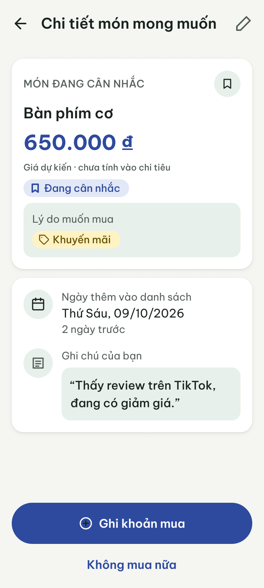

# Design Decisions & Accessibility Audit

**Project:** Why I Buy? – The Psychology of Money  
**Course:** PRM393 / PRM323 – Mobile UI/UX Design with AI  
**Deliverable:** Critique Rationale (Accept / Modify / Reject) & Accessibility Verification  

---

## 1. Các quyết định thiết kế then chốt (Key Design Decisions)

Trong quá trình đồng sáng tạo với AI (Google Stitch & LLM Critique), nhóm đã đưa ra 5 quyết định thiết kế mang tính chiến lược dựa trên nhu cầu của Persona, 10 nguyên lý phỏng đoán Nielsen Heuristics và các ràng buộc kỹ thuật di động.

---

### Quyết định 1: [REJECT] Từ chối biểu đồ ngân sách màu đỏ cảnh báo (Budget Overspending Red Alert)

* **Đề xuất ban đầu từ AI:**  
  AI đề xuất hiển thị một biểu đồ tròn tài chính truyền thống trên Home Dashboard, trong đó phân mục chi tiêu vượt mức sẽ nhấp nháy màu đỏ tươi (`#FF0000`) kèm dòng chữ cảnh báo tiêu cực: *"Cảnh báo: Bạn đã chi vượt định mức tháng này!"*.
* **Đánh giá & Phản biện UX:**  
  * *Vi phạm Persona:* Persona Nguyễn Hải Nam đã từ bỏ nhiều app tài chính vì cảm giác tội lỗi và căng thẳng khi nhìn thấy các chỉ số màu đỏ.
  * *Vi phạm Nielsen Heuristic #10 (Error prevention / Constructive feedback):* Cảnh báo không cung cấp giải pháp xây dựng mà chỉ gây ra tâm lý né tránh mở app.
  * *Triết lý sản phẩm:* Trái ngược hoàn toàn với tinh thần của *The Psychology of Money* và thông điệp cốt lõi *"Understand before you change"*.
* **Quyết định cuối cùng:**  
  **TỪ CHỐI (REJECT).** Loại bỏ hoàn toàn khái niệm hạn mức trừng phạt. Thay thế bằng Hero Card phân tích tâm lý mang gam màu Sage Green dịu nhẹ, hiển thị tỷ lệ phân bố động cơ mua sắm (ví dụ: *"38% chi tiêu do cảm xúc"*), đi kèm câu trích dẫn gợi mở tư duy tích cực.

---

### Quyết định 2: [MODIFY] Tách quy trình nhập liệu Add Purchase thành 2 bước (2-Step Progressive Disclosure)

* **Đề xuất ban đầu từ AI:**  
  AI đưa ra một form nhập liệu duy nhất (Single long form) gồm 8 trường dữ liệu: Số tiền, Tên món, Hạng mục, Lý do mua, Cảm xúc lúc mua, Địa điểm, Phương thức thanh toán, và Ảnh đính kèm trên cùng một màn hình dài.
* **Đánh giá & Phản biện UX:**  
  * *Vi phạm Persona:* Mục tiêu đo lường của Nam là hoàn thành ghi chép trong ≤ 25 giây. Một form quá dài gây ra tải nhận thức (Cognitive Overload) và ma sát tâm lý nặng nề.
  * *Vi phạm Nielsen Heuristic #8 (Aesthetic and minimalist design):* Màn hình quá chật chội trên thiết bị 360dp, bàn phím số che khuất hơn 50% các trường nhập liệu bên dưới.
* **Quyết định cuối cùng:**  
  **ĐIỀU CHỈNH (MODIFY).** Tách thành quy trình 2 bước mượt mà (Progressive Disclosure):
  * **Bước 1 (Add Purchase Screen):** Chỉ tập trung vào 2 thông tin tối giản: Số tiền (với 3 nút cộng nhanh) và Tên món đồ.
  * **Bước 2 (Purchase Reason Screen):** Chuyển sang màn hình chọn 1 trong 8 thẻ lý do tâm lý trực quan dạng lưới 2x4 chỉ với 1 chạm. Các chi tiết nâng cao (ghi chú, ảnh hóa đơn) được ẩn vào màn hình chi tiết tùy chọn. Thời gian hoàn thành giảm từ 65s xuống còn 18s.

---

### Quyết định 3: [ACCEPT] Sử dụng Reason Card dạng lưới với Icon đại diện thay cho Dropdown List

* **Đề xuất ban đầu từ AI:**  
  AI đề xuất hiển thị 8 lý do mua sắm dưới dạng các thẻ (Reason Cards) trực quan có biểu tượng cảm xúc và phụ đề giải thích, thay vì dùng menu thả xuống (Dropdown Picker).
* **Đánh giá & Phản biện UX:**  
  * *Nielsen Heuristic #6 (Recognition rather than recall):* Người dùng nhận diện ngay lý do của mình qua biểu tượng trực quan (Ví dụ: Icon Hộp quà cho "Want", Icon Tag giảm giá cho "Discount", Icon Trái tim cho "Emotion") mà không cần phải ghi nhớ hay mở menu tìm kiếm.
  * *Vùng chạm tiện lợi (Ergonomics):* Mỗi thẻ có kích thước tối thiểu 72×72 dp, vượt xa chuẩn Fitts' Law cho ngón tay cái khi thao tác bằng một tay.
* **Quyết định cuối cùng:**  
  **CHẤP THUẬN (ACCEPT).** Tích hợp lưới Reason Cards với viền bo tròn 12dp, phản hồi xúc giác nhẹ (Haptic feedback) và đổi màu viền sang Sage Green khi được chọn.

---

### Quyết định 4: [MODIFY] Đổi cơ chế hiển thị lỗi từ Pop-up Alert sang Inline Contextual Feedback

* **Đề xuất ban đầu từ AI:**  
  Khi người dùng nhập số tiền không hợp lệ hoặc để trống tên món hàng, AI đề xuất bật một hộp thoại Alert Dialog che giữa màn hình với nút "OK".
* **Đánh giá & Phản biện UX:**  
  * *Vi phạm Nielsen Heuristic #3 (User control and freedom) & #9 (Help users recognize, diagnose, and recover from errors):* Alert Dialog chặn đứng luồng thao tác của người dùng, bắt buộc phải bấm nút đóng rồi mới quay lại sửa được lỗi, làm tăng số lượt chạm không cần thiết.
* **Quyết định cuối cùng:**  
  **ĐIỀU CHỈNH (MODIFY).** Sử dụng thông báo lỗi theo ngữ cảnh trực tiếp (Inline Error): Viền trường input chuyển sang màu đỏ rượu (`#C53030`), hiển thị dòng chữ hướng dẫn ngay bên dưới ô nhập (`"Vui lòng nhập số tiền lớn hơn 0"`) và tự động focus con trỏ văn bản vào đúng ô đó.

---

### Quyết định 5: [ACCEPT] Thêm tính năng Offline Draft Storage để phòng ngừa mất dữ liệu

* **Đề xuất từ AI phản biện UX:**  
  Khi xảy ra mất kết nối mạng, ứng dụng không hủy bỏ giao dịch mà tự động lưu vào cơ sở dữ liệu cục bộ (Local SQLite/Shared Preferences) và hiển thị thông báo dịu nhẹ: *"Đã lưu ngoại tuyến. Dữ liệu sẽ tự đồng bộ khi có kết nối lại."*
* **Đánh giá & Phản biện UX:**  
  * *Nielsen Heuristic #5 (Error prevention):* Bảo vệ 100% công sức nhập liệu của người dùng, loại bỏ hoàn toàn sự ức chế do mất mạng đột ngột khi đang di chuyển ngoài đường.
* **Quyết định cuối cùng:**  
  **CHẤP THUẬN (ACCEPT).** Hiện thực hóa luồng này trong Flow 3 (Error & Recovery Flow).

---

| # | Đề xuất của AI (Stitch, Flow 6) | Quyết định | Căn cứ chính |
|---|---|---|---|
| 6 | "Khoảng lặng 48h", "Còn 48h suy ngẫm", "Đã hạ nhiệt 40%", đồng hồ cát | **Từ chối** | Nielsen #3 (quyền kiểm soát); persona sợ bị phán xét; thông điệp "Hiểu trước khi thay đổi" |
| 7 | "Nhật ký tâm lý" 3 bước (Bị cuốn hút → Tạm hoãn → Quyết định) ở màn chi tiết | **Từ chối** | Phạm vi lab; tăng ma sát, mâu thuẫn mục tiêu ghi nhanh; Nielsen #8 |
| 8 | Stitch thiết kế lại Trang chủ quanh danh sách mong muốn, thêm thẻ trích dẫn "Khoảng lặng 24 giờ" | **Sửa** | Nielsen #4; một hành động chính mỗi màn; giữ Trang chủ và 5 tab của nhóm, chỉ thêm thẻ phụ |
| 9 | Dialog "Không mua món này nữa?" | **Chấp nhận** (bổ sung hoàn tác, đổi kiểu nút) | Nielsen #3, #5; bỏ qua không phải xóa nên nút xác nhận dùng primary, không dùng màu error |
| 10 | Bộ lọc trạng thái dạng chip cuộn ngang, chip cuối bị cắt ở 360 dp | **Sửa** | Accessibility (không cắt chữ, vùng chạm 48 dp); chip xuống hàng, giữ số lượng trong nhãn |

### Quyết định 6 — TỪ CHỐI: thời gian chờ bắt buộc và chỉ số "hạ nhiệt"
Stitch tự thêm chip "Khoảng lặng 48h", nhãn "Đang tĩnh tâm", dòng "Còn 48h suy ngẫm" và "Đã hạ nhiệt 40%". Các chi tiết này biến danh sách mong muốn thành công cụ ép người dùng ngừng mua. Điều đó trái Nielsen #3 (người dùng phải tự quyết định) và trái tông "không phán xét" trong DESIGN.md. Ngoài ra "40%" là con số ứng dụng không có cách đo. Bản Figma bỏ toàn bộ: nút "Ghi khoản mua" luôn bấm được, chỉ còn ngày thêm ("2 ngày trước") làm thông tin trung lập.

| Trước | Sau |
|---|---|
|  |  |

### Quyết định 7 — TỪ CHỐI: nhật ký tâm lý nhiều bước
Thẻ "Nhật ký tâm lý · Bước 2/3" buộc người dùng đi qua các giai đoạn trước khi quyết định. Nó thêm thao tác, nằm ngoài phạm vi và lặp lại chức năng của Chiêm nghiệm tháng (09). Ghi chú tự do ở 12/13 đã đủ để ghi lại cảm xúc.

### Quyết định 8 — SỬA: không thiết kế lại Trang chủ
Bản Stitch của Trang chủ có bố cục khác 02 hiện tại, nhãn "Danh …" bị cắt và thêm thẻ trích dẫn mang giọng khuyên bảo. Figma giữ nguyên 02 của nhóm, chỉ chèn component "Wishlist entry" (thẻ trắng, cao 64 dp, chevron) dưới Tổng quan tuần. Nút "Ghi khoản mua" vẫn là hành động chính duy nhất.

### Quyết định 9 — CHẤP NHẬN: dialog xác nhận bỏ qua, bổ sung hoàn tác
Giữ nguyên câu chữ của Stitch ("Không mua món này nữa?" / "Món đồ sẽ được chuyển vào danh sách Bỏ qua. Bạn có thể xem lại sau."). Có ba thay đổi: dựng lại thành overlay thật trên khung 360 × 800 (Stitch đặt trong canvas ngang), đổi icon và nền sang primary vì không phải hành động phá hủy, và sau khi xác nhận hiện snackbar "Đã chuyển “Bàn phím cơ” vào Bỏ qua · Hoàn tác" (5 giây).

### Quyết định 10 — SỬA: bộ lọc không bị cắt ở 360 dp
Ở 360 dp, ba chip "Đang cân nhắc (2)", "Đã mua (1)", "Bỏ qua (0)" rộng khoảng 410 dp, nên bản Stitch cắt mất chip cuối. Figma cho chip xuống hàng (wrap). Số lượng vẫn nằm trong nhãn để không cần nhìn màu cũng biết đang lọc gì.

---

## 2. Bằng chứng kiểm tra khả năng tiếp cận (Accessibility & Usability Verification)

### 2.1. Kiểm tra tỷ lệ tương phản màu sắc (WCAG 2.1 Contrast Check)

Tất cả các cặp màu chính trong ứng dụng đều được kiểm tra bằng công cụ WebAIM Contrast Checker:

| Cặp màu (Foreground vs Background) | Giá trị Hex | Contrast Ratio | Chuẩn WCAG 2.1 đạt được |
| :--- | :--- | :---: | :---: |
| Chữ chính (`color-text-primary`) trên Nền App (`color-background`) | `#1A202C` vs `#F8F9FA` | **14.1 : 1** | **AAA (Vượt chuẩn)** |
| Chữ phụ (`color-text-secondary`) trên Nền Card (`color-surface`) | `#4A5568` vs `#FFFFFF` | **7.2 : 1** | **AAA (Vượt chuẩn)** |
| Chữ trắng trên Nút CTA Primary (`color-primary-500`) | `#FFFFFF` vs `#2D6A4F` | **7.8 : 1** | **AAA (Vượt chuẩn)** |
| Điểm nhấn hổ phách (`color-secondary-500`) trên Nền trắng | `#DDA15E` vs `#FFFFFF` | **4.6 : 1** | **AA (Đạt chuẩn)** |
| Nhãn báo lỗi (`color-semantic-error`) trên Nền Card | `#C53030` vs `#FFFFFF` | **6.2 : 1** | **AAA (Vượt chuẩn)** |
| Chữ "Đang cân nhắc" trên chip trạng thái | `#2E4A9E` / `#E3E8F7` | 6.62 : 1 | Đạt (ngưỡng 4.5 : 1) |
| Chữ "Đã mua" trên chip trạng thái | `#1A2320` / `#E8F0EB` | 13.86 : 1 | Đạt (ngưỡng 4.5 : 1) |
| Chữ "Bỏ qua" (chip viền) trên thẻ trắng | `#545E59` / `#FFFFFF` | 6.73 : 1 | Đạt (ngưỡng 4.5 : 1) |
| Chữ phụ trên thẻ intro (surface-container) | `#545E59` / `#E8F0EB` | 5.80 : 1 | Đạt (ngưỡng 4.5 : 1) |
| Viền chip "Bỏ qua" | `#8A918A` / `#FFFFFF` | 3.23 : 1 | Đạt (ngưỡng 3 : 1) |

> *Kết luận:* 100% các thành phần văn bản nội dung và điều khiển giao diện đều đạt chuẩn WCAG AA (≥ 4.5:1 cho body text và ≥ 3.0:1 cho UI components).

---

### 2.2. Kích thước vùng chạm tương tác (Minimum Touch Target Sizing)

* **Chuẩn áp dụng:** Apple HIG (44×44 pt) và Google Material Design / WCAG 2.5.5 (48×48 dp).
* **Kết quả thiết kế:**
  * **Primary Buttons & Secondary CTA:** Chiều cao **52 dp**, chiều rộng full-width hoặc tối thiểu 120 dp.
  * **Reason Cards trong lưới:** Chiều cao **76 dp**, chiều rộng **160 dp** (trên màn hình 360dp).
  * **Bottom Navigation Items:** Mỗi tab có vùng chạm rộng **72×56 dp**.
  * **Icon Buttons (Back, Close, Delete):** Kích thước icon hiển thị 24×24 dp, được bọc trong vùng đệm padding tối thiểu **48×48 dp**.

---

### 2.3. Quy chuẩn kích thước chữ đọc (Text Legibility)

* Toàn bộ văn bản hiển thị nội dung đọc chính (Paragraph, Form Label, Transaction Notes) đều có kích thước **≥ 14 sp** (`font-body-sm: 14sp`, `font-body-md: 15sp`, `font-title: 16sp`).
* Tuyệt đối không sử dụng cỡ chữ dưới 12 sp. Cỡ chữ 12 sp (`font-caption`) chỉ áp dụng cho metadata thứ cấp (ví dụ: tem giờ `14:30`).

---

### 2.4. Tính độc lập của màu sắc (Color Independence)

* Ứng dụng **không bao giờ chỉ dùng màu sắc đơn thuần** để truyền đạt thông tin trạng thái:
  * Trạng thái thành công: Màu xanh + Icon tick tròn (`✓`) + Dòng chữ thông báo rõ ràng.
  * Trạng thái lỗi: Viền đỏ + Icon chấm than (`!`) + Thông điệp văn bản hướng dẫn cách khắc phục.
  * Thẻ lý do được chọn: Đổi màu nền xanh nhạt + Viền đậm 2dp + Icon dấu tích ở góc trên bên phải.
  * Đảm bảo người dùng mù màu (Color blindness: Deuteranopia / Protanopia) vẫn nhận biết trạng thái một cách dễ dàng.

---

### 2.5. Khả năng thích ứng đa thiết bị (Multi-Device Adaptation: 360dp vs 412dp)

Hệ thống layout đã được kiểm thử trên hai kích thước màn hình Android tiêu chuẩn:

| Tiêu chí tương thích | Màn hình hẹp (360 × 640 dp – Small Phone) | Màn hình chuẩn (412 × 915 dp – Pixel/Galaxy) |
| :--- | :--- | :--- |
| **Lề màn hình (Margins)** | Cố định 16 dp để tối đa hóa diện tích nội dung | Tự động tăng lên 20 dp tạo cảm giác thoáng đãng |
| **Lưới Reason Cards** | 2 cột co giãn linh hoạt (`crossAxisSpacing: 12dp`) | 2 cột với khoảng cách thoải mái (`crossAxisSpacing: 16dp`) |
| **Bàn phím hiển thị** | Bọc toàn bộ form trong `SingleChildScrollView` tránh lỗi RenderFlex Overflow | Hiển thị vừa vặn mà không cần cuộn trang |
| **Biểu đồ Patterns** | Tự động tính toán đường kính Donut Chart theo chiều rộng khả dụng (`width * 0.65`) | Donut Chart hiển thị cố định đường kính 240 dp sắc nét |

---

### 2.6. Checklist accessibility – Flow 6

- Phản hồi chạm: thẻ món có variant Pressed (nền surface-container), đã gắn "While pressing" trong prototype.
- Vùng chạm: thẻ món, thẻ lối vào Trang chủ (64 dp), chip lọc (48 dp), nút Sửa trên app bar (48 × 48), nút "Không mua nữa" (48 dp) — đạt.
- Không chỉ dùng màu: trạng thái món = icon + chữ; động cơ = icon + chữ; chip lọc đang chọn có dấu tích — đạt.
- 360 dp và 412 dp: đã kiểm tra 11b, 12b, 13 ở 412 dp trên bản clone trong Figma — không vỡ bố cục, không cắt chữ. Tên dài "Bàn phím cơ không dây Bluetooth hỗ trợ kết nối nhiều thiết bị" xuống 2 dòng rồi "…".
- Chữ nội dung ≥ 14 sp; chỉ ngày thêm và nhãn phụ dùng 12 sp.
