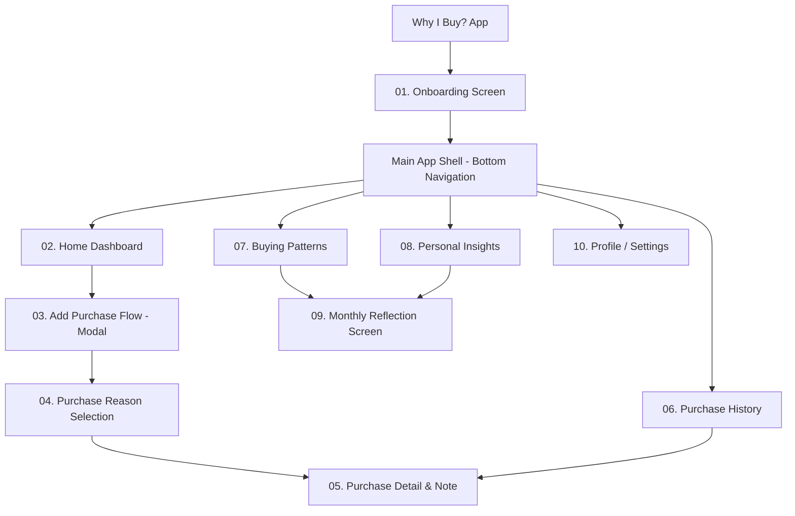
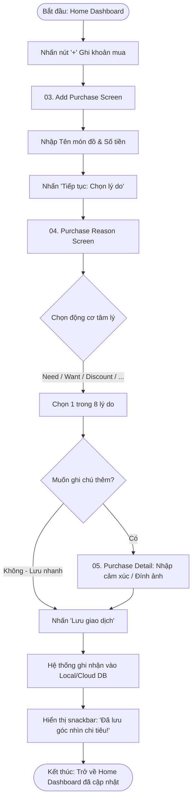
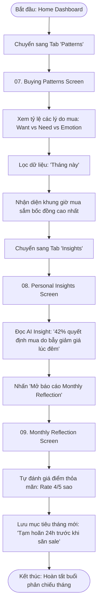
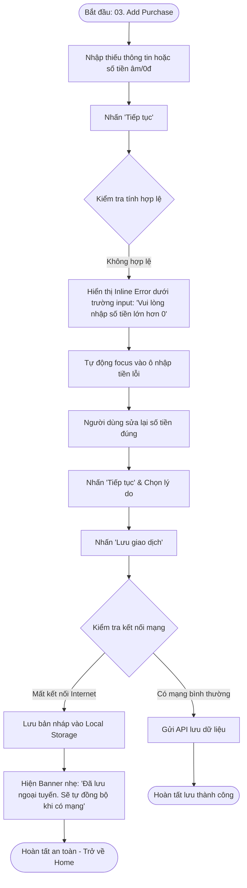

# Information Architecture & User Flows

**Project:** Why I Buy? – The Psychology of Money  
**Course:** PRM393 / PRM323 – Mobile UI/UX Design with AI  
**Deliverable:** Sitemap, Screen Hierarchy & User Interaction Flows  

---

## 1. Information Architecture (IA) & Sitemap

Ứng dụng **Why I Buy?** được cấu trúc theo mô hình điều hướng phân tầng hiện đại, sử dụng **Bottom Navigation Bar** 5 tab cấp cao (Top-Level Destinations), hỗ trợ người dùng truy cập tức thì các tính năng cốt lõi và mở các màn hình chi tiết (Child / Modal Screens).

### Cấu trúc Sitemap (Hệ thống 10 màn hình)

### Danh mục màn hình theo cấp bậc (Hierarchy)

| STT | Tên màn hình (Screen Name) | Cấp bậc (Level) | Mục đích chính |
| :---: | :--- | :--- | :--- |
| **01** | **Onboarding Screen** | Entry Point | Giới thiệu triết lý "The Psychology of Money" và thông điệp "Understand before you change". |
| **02** | **Home Dashboard Screen** | Level 1 (Tab 1) | Tổng quan tâm lý mua sắm tuần này, quick quote, các giao dịch gần nhất, nút CTA nổi bật "Record Purchase". |
| **03** | **Add Purchase Screen** | Level 2 (Modal) | Nhập thông tin nhanh: Tên món đồ, Số tiền, Thời gian & Danh mục cơ bản. |
| **04** | **Purchase Reason Screen** | Level 2 (Step 2) | Chọn động cơ tâm lý cốt lõi (Need, Want, Discount, Social Influence, Advertising, Emotion, Convenience, Other). |
| **05** | **Purchase Detail Screen** | Level 2 (Detail) | Xem chi tiết, chỉnh sửa ghi chú cảm xúc, đính kèm ảnh hóa đơn, hoặc xóa giao dịch. |
| **06** | **Purchase History Screen** | Level 1 (Tab 2) | Danh sách giao dịch theo thời gian kèm bộ lọc đa chiều (theo lý do tâm lý, khoảng tiền, ngày tháng). |
| **07** | **Buying Patterns Screen** | Level 1 (Tab 3) | Biểu đồ phân tích tâm lý: Tỷ lệ phân bố động cơ mua sắm, xu hướng bốc đồng theo khung giờ trong tuần. |
| **08** | **Personal Insights Screen** | Level 1 (Tab 4) | Thẻ phân tích thông minh do AI tổng hợp ("Bạn có xu hướng mua vì Discount sau 22h đêm", "Top trigger: Stress"). |
| **09** | **Monthly Reflection Screen** | Level 2 (Report) | Báo cáo chiêm nghiệm định kỳ hàng tháng, tự đánh giá điểm hài lòng sau mua sắm. |
| **10** | **Profile & Settings Screen** | Level 1 (Tab 5) | Quản lý tài khoản, thiết lập nhắc nhở chiêm nghiệm (Daily Nudge), Dark Mode, Export dữ liệu. |

---

## 2. Ba User Flows Chi Tiết (Three User Flows)

### Flow 1: Record a Purchase (Ghi nhận giao dịch và động cơ tâm lý)

* **Starting Point:** Màn hình `02. Home Dashboard` (hoặc phím nổi FAB `+`).
* **User Goal:** Ghi nhận khoản mua vừa phát sinh và gán động cơ tâm lý cốt lõi trong thời gian dưới 25 giây.
* **Ending Point:** Giao dịch được lưu vào hệ thống, hiển thị Toast thông báo thành công và cập nhật tức thì trên Dashboard.

* **Happy Path:** Home → Add Purchase (nhập "Cà phê", 45.000đ) → Purchase Reason (chọn "Convenience") → Quick Save → Home (khoản mua xuất hiện ở Recent Activities).
* **Alternate Path (Chi tiết sâu):** Home → Add Purchase → Purchase Reason (chọn "Emotional Purchase") → Mở Purchase Detail để viết ghi chú: *"Mua vì deadline khuya quá mệt mỏi"* → Lưu giao dịch.

---

### Flow 2: Understand Buying Behavior & Reflection (Chiêm nghiệm thói quen chi tiêu)

* **Starting Point:** Màn hình `02. Home Dashboard`.
* **User Goal:** Khám phá nguyên nhân chi tiêu ngoài tầm kiểm soát trong tháng và xem phân tích hành vi tâm lý.
* **Ending Point:** Đọc xong báo cáo Monthly Reflection và đặt cam kết cải thiện (Reflection Action).

---

### Flow 3: Error & Recovery Flow (Xử lý lỗi nhập liệu và gián đoạn kết nối)

* **Starting Point:** Màn hình `03. Add Purchase Screen` khi người dùng nhập dữ liệu không hợp lệ hoặc mất mạng khi đồng bộ.
* **User Goal:** Khắc phục lỗi mà không làm mất thông tin đã nhập (zero data loss) và lưu thành công.
* **Ending Point:** Giao dịch được lưu ngoại tuyến / khôi phục thành công, hiển thị thông báo phản hồi rõ ràng.

---

## 3. Flow-to-Screen Mapping Matrix

Bảng đối chiếu đảm bảo mọi màn hình đều có vị trí và vai trò rõ ràng trong hành trình người dùng:

| Màn hình | Flow 1: Record Purchase | Flow 2: Reflect & Insights | Flow 3: Error & Recovery |
| :--- | :---: | :---: | :---: |
| **01. Onboarding** | (First-time) | (First-time) | - |
| **02. Home Dashboard** | Starting & Ending | Starting Point | Landing View |
| **03. Add Purchase** | Step 1 (Input) | - | Error Detection & Retry |
| **04. Purchase Reason** | Step 2 (Select Tag) | - | Step 2 |
| **05. Purchase Detail** | Step 3 (Optional Detail) | - | Offline Draft Review |
| **06. Purchase History** | Verified in List | Data Reference | Filter by Offline Status |
| **07. Buying Patterns** | - | Step 1 (Pattern Discovery) | - |
| **08. Personal Insights**| - | Step 2 (AI Explanations) | - |
| **09. Monthly Reflection**| - | Step 3 (Self-Audit & Goal)| - |
| **10. Profile & Settings** | - | Preference Config | Data Sync Management |
