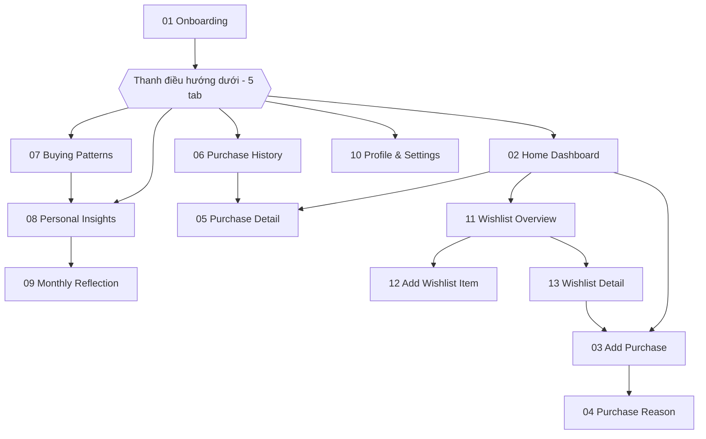
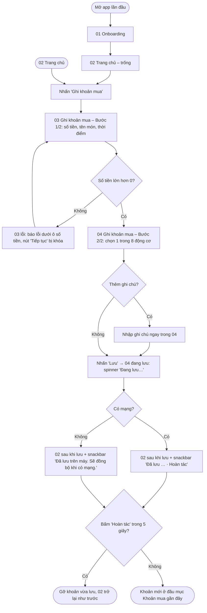
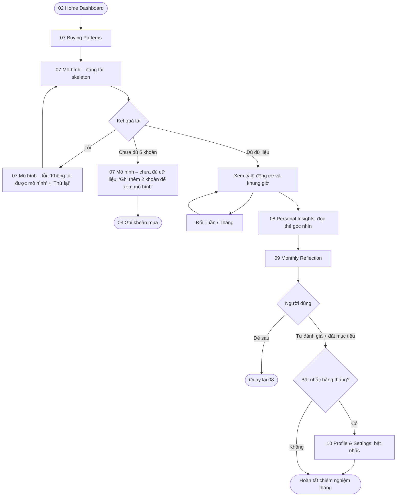
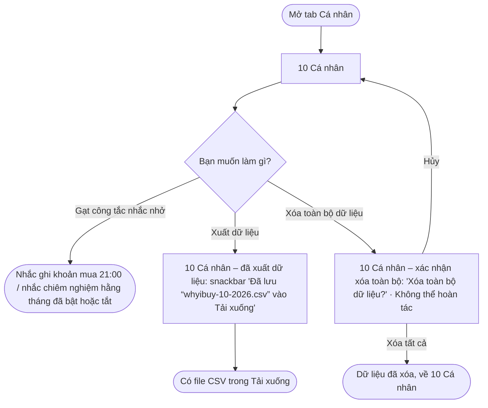

# Information Architecture & User Flows

**Project:** Why I Buy? – lấy cảm hứng từ "The Psychology of Money"
**Course:** PRM323 – Cross-Platform Application Development

---

## 1. Danh sách màn hình

| # | Màn hình | Cấp | Truy cập từ | Mục đích |
|---|---|---|---|---|
| 01 | Onboarding | Điểm vào (lần đầu mở app) | Mở app | Giới thiệu thông điệp "Hiểu trước khi thay đổi" |
| 02 | Home Dashboard | Tab 1 | Thanh điều hướng, sau 01 | Tổng quan tuần, nút "Ghi khoản mua", khoản gần đây |
| 03 | Add Purchase | Lồng – bước 1/2 | 02, trạng thái trống của 07 | Nhập số tiền, tên món, thời điểm |
| 04 | Purchase Reason | Lồng – bước 2/2 | 03 | Chọn 1 trong 8 động cơ, ghi chú tùy chọn, lưu |
| 05 | Purchase Detail | Lồng | 02 (mục Gần đây), 06 | Xem, sửa hoặc xóa một khoản mua |
| 06 | Purchase History | Tab 2 | Thanh điều hướng | Danh sách khoản mua theo ngày, lọc theo động cơ |
| 07 | Buying Patterns | Tab 3 | Thanh điều hướng | Tỷ lệ động cơ, khung giờ hay mua |
| 08 | Personal Insights | Tab 4 | Thanh điều hướng, 07 | Thẻ góc nhìn tổng hợp từ dữ liệu người dùng ghi |
| 09 | Monthly Reflection | Lồng | 08 | Tự đánh giá mức hài lòng và đặt mục tiêu tháng |
| 10 | Profile & Settings | Tab 5 | Thanh điều hướng, 09 | Nhắc nhở, xuất dữ liệu, cài đặt |
| 11 | Wishlist Overview (Danh sách mong muốn) | Lồng | 02 (thẻ "Danh sách mong muốn") | Xem món muốn mua theo trạng thái Đang cân nhắc / Đã mua / Bỏ qua |
| 12 | Add Wishlist Item (Thêm món mong muốn) | Lồng | 11 | Lưu một món muốn mua kèm 1 trong 8 động cơ; dùng lại để sửa món (12c) |
| 13 | Wishlist Detail (Chi tiết món mong muốn) | Lồng | 11 | Xem lý do muốn mua; quyết định Ghi khoản mua / Không mua nữa / tiếp tục cân nhắc |

Tám động cơ (dùng thống nhất trong toàn bộ dự án): Nhu cầu, Mong muốn, Khuyến mãi,
Ảnh hưởng MXH, Quảng cáo, Cảm xúc, Tiện lợi, Khác.

## 2. Cấu trúc điều hướng

Độ sâu tối đa: 3 lần chạm từ một tab (02 → 11 → 13 → 03 khi mua từ danh sách mong muốn). Cấu trúc 5 tab giữ nguyên; Danh sách mong muốn là màn lồng, không thêm tab.

## 3. User flows

### Flow 1 — Ghi nhanh một khoản mua (có nhánh lỗi và phục hồi)
- **Bắt đầu:** 02 Home Dashboard (lần đầu: 01 Onboarding)
- **Mục tiêu:** ghi một khoản mua kèm động cơ trong ≤ 25 giây
- **Kết thúc:** quay về 02 với snackbar "Đã lưu “Trà sữa nướng”" kèm "Hoàn tác", khoản mới ở đầu mục Khoản mua gần đây

- **Happy path:** 02 → 03 (nhập "Trà sữa nướng", 45.000 ₫) → 04 (chọn Cảm xúc) → Lưu → 04 đang lưu → 02 sau khi lưu.
- **Nhánh thay thế:** thêm ghi chú "Mệt sau giờ làm đồ án" trong 04 trước khi lưu.
- **Nhánh lỗi và phục hồi:** nhập 0 ₫ → báo lỗi, nút "Tiếp tục" bị khóa đến khi sửa; mất mạng → vẫn lưu trên máy, không mất dữ liệu; chọn nhầm động cơ → bấm "Hoàn tác" trên snackbar trong 5 giây.

### Flow 2 — Khám phá mô hình và chiêm nghiệm tháng
- **Bắt đầu:** 02 Home Dashboard
- **Mục tiêu:** hiểu động cơ mua phổ biến nhất trong tháng và tự đánh giá
- **Kết thúc:** hoàn tất Monthly Reflection (tùy chọn bật nhắc hằng tháng)

### Flow 3 — Xem lại, xóa và hoàn tác (nhánh phục hồi)
- **Bắt đầu:** 06 Purchase History
- **Mục tiêu:** sửa hoặc xóa một khoản ghi nhầm
- **Kết thúc:** lịch sử được cập nhật, hoặc khôi phục nếu hoàn tác

### Flow 5 — Cá nhân & dữ liệu (cài nhắc nhở, xuất dữ liệu, xóa có xác nhận)
- **Bắt đầu:** 10 Cá nhân (tab 5)
- **Mục tiêu:** chủ động quản lý nhắc nhở và dữ liệu cá nhân
- **Kết thúc:** nhắc nhở đã bật/tắt, có file CSV trong Tải xuống, hoặc dữ liệu đã xóa sau khi xác nhận

- **Happy path:** 10 → Xuất dữ liệu → 10 đã xuất dữ liệu → snackbar tự ẩn.
- **Nhánh thay thế:** bật/tắt nhắc nhở ngay trên 10.
- **Nhánh phòng ngừa lỗi:** xóa toàn bộ luôn qua dialog xác nhận, có "Hủy".

### Flow 6 — Danh sách mong muốn: hiểu lý do trước khi mua (có nhánh lỗi, xác nhận và hoàn tác)
- **Bắt đầu:** 02 Trang chủ, thẻ phụ "Danh sách mong muốn · 2 món đang cân nhắc"
- **Mục tiêu:** lưu một món muốn mua kèm động cơ, rồi tự quyết định mua, bỏ qua hay tiếp tục cân nhắc. Không có thời gian chờ bắt buộc.
- **Kết thúc:** món ở trạng thái Đã mua (khoản mua vào Lịch sử), Bỏ qua, hoặc vẫn Đang cân nhắc
- **Ràng buộc dữ liệu:** lưu một món vào danh sách mong muốn KHÔNG tính vào chi tiêu, không đổi biểu đồ và Lịch sử. Món chỉ chuyển Đã mua khi khoản mua ở 04 được lưu thành công.

- **Happy path:** 02 → 11 → Thêm món → 12 (Chuột công thái học, 520.000 ₫, Tiện lợi) → Lưu → 11b → chạm "Bàn phím cơ" → 13 → Ghi khoản mua → 03 (650.000 ₫ điền sẵn) → 04 (Khuyến mãi chọn sẵn) → Lưu → 11e.
- **Nhánh thay thế:** tiếp tục cân nhắc (Back từ 13); sửa ghi chú (12c → 13b); bỏ qua món (13a → 11c).
- **Nhánh lỗi và phục hồi:** bấm Lưu khi chưa nhập tên và chưa chọn động cơ → 12a báo lỗi ngay dưới từng trường, sửa xong lưu được; bỏ qua nhầm → "Hoàn tác" trong 5 giây; thoát 03/04 trước khi lưu → món vẫn Đang cân nhắc.

## 4. Bảng ánh xạ flow → màn hình

| Màn hình | Flow 1 | Flow 2 | Flow 3 | Flow 5 | Flow 6 |
|---|:-:|:-:|:-:|:-:|:-:|
| 01 Onboarding | ✓ (lần đầu) | | | | |
| 02 Home Dashboard | ✓ bắt đầu, kết thúc | ✓ bắt đầu | | | ✓ bắt đầu (thẻ Danh sách mong muốn) |
| 03 Add Purchase | ✓ bước 1, nhánh lỗi | ✓ từ trạng thái trống | | | ✓ điền sẵn từ món mong muốn |
| 04 Purchase Reason | ✓ bước 2 | | | | ✓ động cơ chọn sẵn, lưu → Đã mua |
| 05 Purchase Detail | | | ✓ sửa, xóa | | |
| 06 Purchase History | | | ✓ bắt đầu, kết thúc | | |
| 07 Buying Patterns | | ✓ loading, lỗi, trống | | | |
| 08 Personal Insights | | ✓ | | | |
| 09 Monthly Reflection | | ✓ | | | |
| 10 Profile & Settings | | ✓ bật nhắc | | ✓ bắt đầu, kết thúc | |
| 11 Wishlist Overview | | | | | ✓ bắt đầu, kết thúc (11a–11e) |
| 12 Add Wishlist Item | | | | | ✓ thêm, nhánh lỗi, sửa (12a–12c) |
| 13 Wishlist Detail | | | | | ✓ quyết định, dialog bỏ qua (13a, 13b) |

## 5. Khung trạng thái theo flow

Mỗi trạng thái là một khung riêng, giống hệt màn gốc và chỉ khác phần thay đổi (xem `design/DESIGN.md`).

| Khung trạng thái | Màn gốc | Flow | Khi nào xuất hiện | Hành động tiếp theo |
|---|---|---|---|---|
| Trang chủ – trống | 02 | Flow 1 | Lần đầu dùng, tuần chưa có khoản mua | "Ghi khoản mua" → 03 |
| Ghi khoản mua – lỗi số tiền | 03 | Flow 1 | Số tiền bằng 0 | Sửa số tiền, nút "Tiếp tục" mở lại |
| Ghi khoản mua – đang lưu | 04 | Flow 1 | Sau khi nhấn "Lưu" | Tự chuyển sang 02 sau khi lưu |
| Trang chủ sau khi lưu | 02 | Flow 1 | Lưu thành công | "Hoàn tác" trong 5 giây |
| Trang chủ sau khi lưu – ngoại tuyến | 02 | Flow 1 | Lưu khi mất mạng | Tự đồng bộ khi có mạng |
| Mô hình – đang tải | 07 | Flow 2 | Mở tab Mô hình | Tự chuyển sang kết quả |
| Mô hình – lỗi | 07 | Flow 2 | Không tải được dữ liệu | "Thử lại" |
| Mô hình – chưa đủ dữ liệu | 07 | Flow 2 | Ít hơn 5 khoản | "Ghi khoản mua" → 03 (Flow 1) |
| Dialog xóa | 05 | Flow 3 | Nhấn icon xóa | "Hủy" → 05 · "Xóa" → 06 sau khi xóa |
| Lịch sử – không có kết quả | 06 | Flow 3 | Bộ lọc không có khoản nào | "Xóa bộ lọc" |
| Lịch sử sau khi xóa | 06 | Flow 3 | Xóa thành công | "Hoàn tác" trong 5 giây |
| Cá nhân – đã xuất dữ liệu | 10 | Flow 5 | Bấm "Xuất dữ liệu" | Snackbar tự ẩn, về 10 |
| Cá nhân – xác nhận xóa toàn bộ | 10 | Flow 5 | Bấm "Xóa toàn bộ dữ liệu" | "Hủy" → 10 · "Xóa tất cả" → 10 (đã xóa) |
| Trang chủ – lối vào Danh sách mong muốn | 02 | Flow 6 | Có ≥ 1 món đang cân nhắc | Chạm thẻ → 11 |
| Danh sách mong muốn – trống | 11 | Flow 6 | Chưa có món nào | "Thêm món" → 12 |
| Danh sách mong muốn – Bỏ qua trống | 11 | Flow 6 | Lọc Bỏ qua khi chưa có món | "Xem đang cân nhắc" → 11 |
| Danh sách mong muốn – đã lưu | 11 | Flow 6 | Lưu món thành công | Snackbar tự ẩn |
| Danh sách mong muốn – đã bỏ qua | 11 | Flow 6 | Xác nhận Bỏ qua | "Hoàn tác" trong 5 giây |
| Danh sách mong muốn – sau hoàn tác | 11 | Flow 6 | Bấm Hoàn tác | Món về Đang cân nhắc |
| Danh sách mong muốn – đã mua | 11 | Flow 6 | Lưu khoản mua từ món | Kết thúc |
| Thêm món mong muốn – lỗi | 12 | Flow 6 | Lưu khi tên trống / chưa chọn động cơ | Sửa trường lỗi rồi Lưu |
| Thêm món mong muốn – đã điền | 12 | Flow 6 | Dữ liệu hợp lệ | "Lưu món" |
| Sửa món mong muốn | 12 | Flow 6 | Nút Sửa ở 13 | "Lưu thay đổi" → 13b |
| Chi tiết món – xác nhận bỏ qua | 13 | Flow 6 | "Không mua nữa" | "Hủy" → 13 · "Bỏ qua" → 11c |
| Chi tiết món – sau khi sửa | 13 | Flow 6 | Lưu thay đổi | Snackbar tự ẩn |
| Ghi khoản mua – Bước 1/2 và 2/2 (từ danh sách mong muốn) | 03, 04 | Flow 6 | "Ghi khoản mua" ở 13 | Lưu → 11e · Back → 13 |
| Chi tiết món – đã bỏ qua | 13 | Flow 6 | Chạm món ở bộ lọc Bỏ qua | "Đưa về Đang cân nhắc" → 11d |
| Chi tiết món – đã mua | 13 | Flow 6 | Chạm món ở bộ lọc Đã mua | Chỉ xem; Back → 11e |
