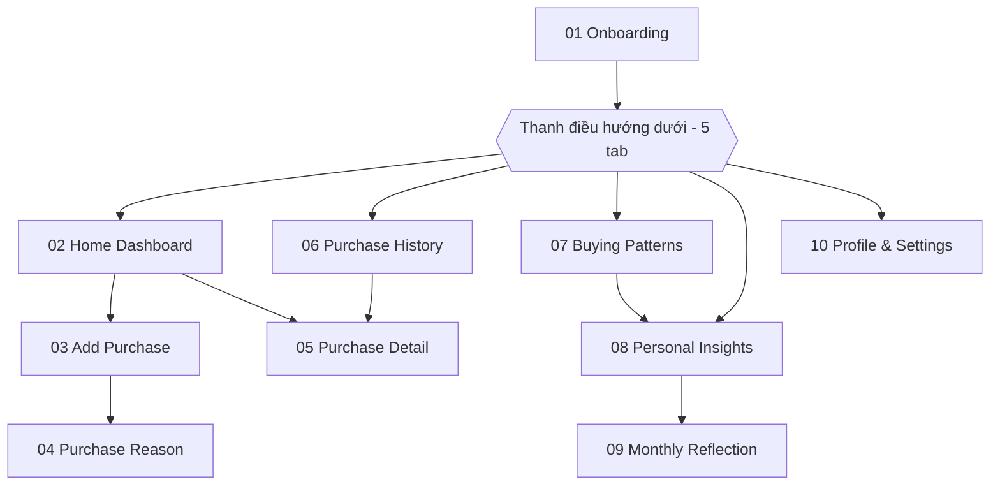

# Information Architecture & User Flows

**Project:** Why I Buy? – lấy cảm hứng từ "The Psychology of Money"
**Course:** PRM323 – Cross-Platform Application Development

---

## 1. Danh sách màn hình

| # | Màn hình | Cấp | Truy cập từ | Mục đích |
|---|---|---|---|---|
| 01 | Onboarding | Điểm vào (lần đầu mở app) | Mở app | Giới thiệu thông điệp "Hiểu trước khi thay đổi" |
| 02 | Home Dashboard | Tab 1 | Thanh điều hướng, sau 01 | Tổng quan tuần, nút "Ghi khoản mua", khoản gần đây |
| 03 | Add Purchase | Lồng – bước 1/2 | 02, trạng thái trống của 07 | Nhập số tiền, tên món, thời điểm |
| 04 | Purchase Reason | Lồng – bước 2/2 | 03 | Chọn 1 trong 8 động cơ, ghi chú tùy chọn, lưu |
| 05 | Purchase Detail | Lồng | 02 (mục Gần đây), 06 | Xem, sửa hoặc xóa một khoản mua |
| 06 | Purchase History | Tab 2 | Thanh điều hướng | Danh sách khoản mua theo ngày, lọc theo động cơ |
| 07 | Buying Patterns | Tab 3 | Thanh điều hướng | Tỷ lệ động cơ, khung giờ hay mua |
| 08 | Personal Insights | Tab 4 | Thanh điều hướng, 07 | Thẻ góc nhìn tổng hợp từ dữ liệu người dùng ghi |
| 09 | Monthly Reflection | Lồng | 08 | Tự đánh giá mức hài lòng và đặt mục tiêu tháng |
| 10 | Profile & Settings | Tab 5 | Thanh điều hướng, 09 | Nhắc nhở, xuất dữ liệu, cài đặt |

Tám động cơ (dùng thống nhất trong toàn bộ dự án): Nhu cầu, Mong muốn, Khuyến mãi,
Ảnh hưởng MXH, Quảng cáo, Cảm xúc, Tiện lợi, Khác.

## 2. Cấu trúc điều hướng

Độ sâu tối đa: 2 lần chạm từ một tab (02 → 03 → 04).

## 3. User flows

### Flow 1 — Ghi nhanh một khoản mua (có nhánh lỗi và phục hồi)
- **Bắt đầu:** 02 Home Dashboard (lần đầu: 01 Onboarding)
- **Mục tiêu:** ghi một khoản mua kèm động cơ trong ≤ 25 giây
- **Kết thúc:** quay về 02 với snackbar "Đã lưu “Trà sữa nướng”" kèm "Hoàn tác", khoản mới ở đầu mục Khoản mua gần đây

- **Happy path:** 02 → 03 (nhập "Trà sữa nướng", 45.000 ₫) → 04 (chọn Cảm xúc) → Lưu → 04 đang lưu → 02 sau khi lưu.
- **Nhánh thay thế:** thêm ghi chú "Mệt sau giờ làm đồ án" trong 04 trước khi lưu.
- **Nhánh lỗi và phục hồi:** nhập 0 ₫ → báo lỗi, nút "Tiếp tục" bị khóa đến khi sửa; mất mạng → vẫn lưu trên máy, không mất dữ liệu; chọn nhầm động cơ → bấm "Hoàn tác" trên snackbar trong 5 giây.

### Flow 2 — Khám phá mô hình và chiêm nghiệm tháng
- **Bắt đầu:** 02 Home Dashboard
- **Mục tiêu:** hiểu động cơ mua phổ biến nhất trong tháng và tự đánh giá
- **Kết thúc:** hoàn tất Monthly Reflection (tùy chọn bật nhắc hằng tháng)

### Flow 3 — Xem lại, xóa và hoàn tác (nhánh phục hồi)
- **Bắt đầu:** 06 Purchase History
- **Mục tiêu:** sửa hoặc xóa một khoản ghi nhầm
- **Kết thúc:** lịch sử được cập nhật, hoặc khôi phục nếu hoàn tác

## 4. Bảng ánh xạ flow → màn hình

| Màn hình | Flow 1 | Flow 2 | Flow 3 |
|---|:-:|:-:|:-:|
| 01 Onboarding | ✓ (lần đầu) | | |
| 02 Home Dashboard | ✓ bắt đầu, kết thúc | ✓ bắt đầu | |
| 03 Add Purchase | ✓ bước 1, nhánh lỗi | ✓ từ trạng thái trống | |
| 04 Purchase Reason | ✓ bước 2 | | |
| 05 Purchase Detail | | | ✓ sửa, xóa |
| 06 Purchase History | | | ✓ bắt đầu, kết thúc |
| 07 Buying Patterns | | ✓ loading, lỗi, trống | |
| 08 Personal Insights | | ✓ | |
| 09 Monthly Reflection | | ✓ | |
| 10 Profile & Settings | | ✓ bật nhắc | |

## 5. Khung trạng thái theo flow

Mỗi trạng thái là một khung riêng, giống hệt màn gốc và chỉ khác phần thay đổi (xem `design/DESIGN.md`).

| Khung trạng thái | Màn gốc | Flow | Khi nào xuất hiện | Hành động tiếp theo |
|---|---|---|---|---|
| Trang chủ – trống | 02 | Flow 1 | Lần đầu dùng, tuần chưa có khoản mua | "Ghi khoản mua" → 03 |
| Ghi khoản mua – lỗi số tiền | 03 | Flow 1 | Số tiền bằng 0 | Sửa số tiền, nút "Tiếp tục" mở lại |
| Ghi khoản mua – đang lưu | 04 | Flow 1 | Sau khi nhấn "Lưu" | Tự chuyển sang 02 sau khi lưu |
| Trang chủ sau khi lưu | 02 | Flow 1 | Lưu thành công | "Hoàn tác" trong 5 giây |
| Trang chủ sau khi lưu – ngoại tuyến | 02 | Flow 1 | Lưu khi mất mạng | Tự đồng bộ khi có mạng |
| Mô hình – đang tải | 07 | Flow 2 | Mở tab Mô hình | Tự chuyển sang kết quả |
| Mô hình – lỗi | 07 | Flow 2 | Không tải được dữ liệu | "Thử lại" |
| Mô hình – chưa đủ dữ liệu | 07 | Flow 2 | Ít hơn 5 khoản | "Ghi khoản mua" → 03 (Flow 1) |
| Dialog xóa | 05 | Flow 3 | Nhấn icon xóa | "Hủy" → 05 · "Xóa" → 06 sau khi xóa |
| Lịch sử – không có kết quả | 06 | Flow 3 | Bộ lọc không có khoản nào | "Xóa bộ lọc" |
| Lịch sử sau khi xóa | 06 | Flow 3 | Xóa thành công | "Hoàn tác" trong 5 giây |
