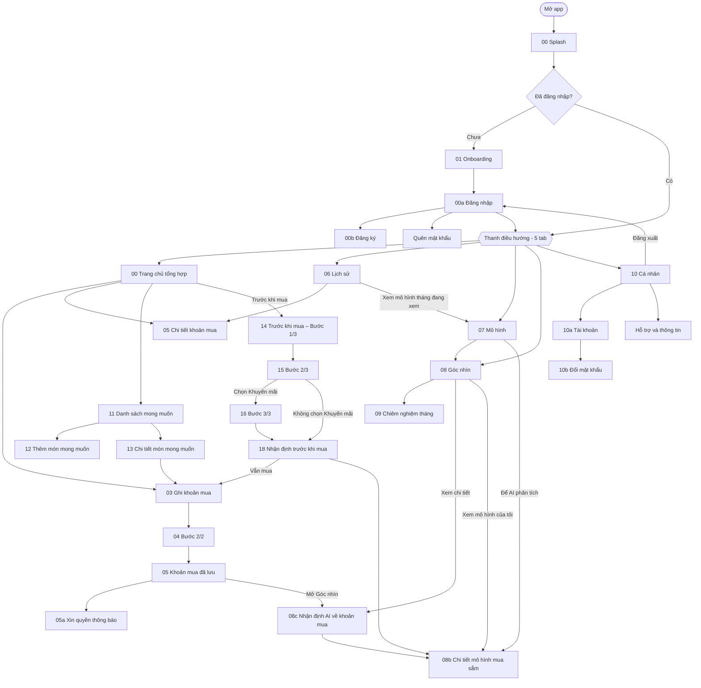
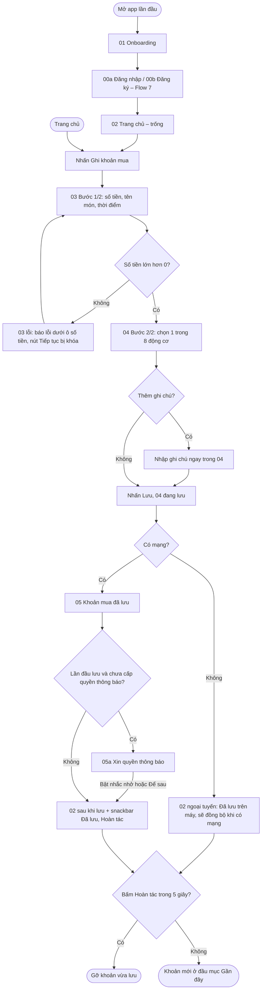
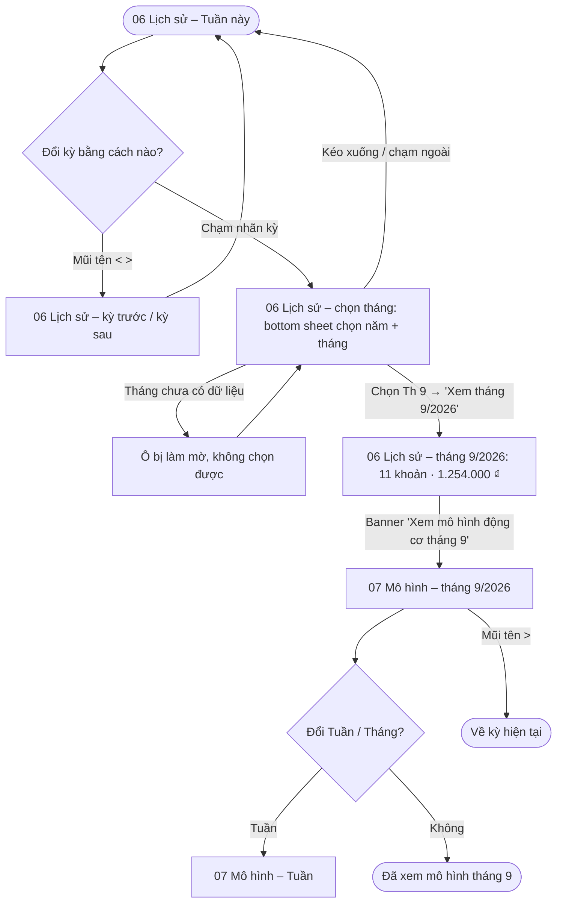
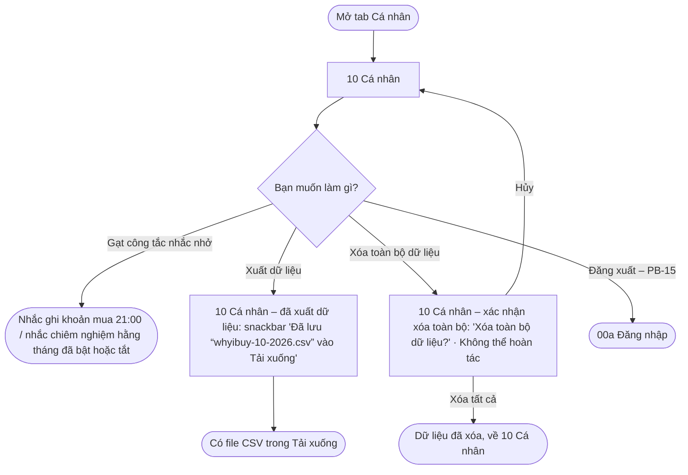
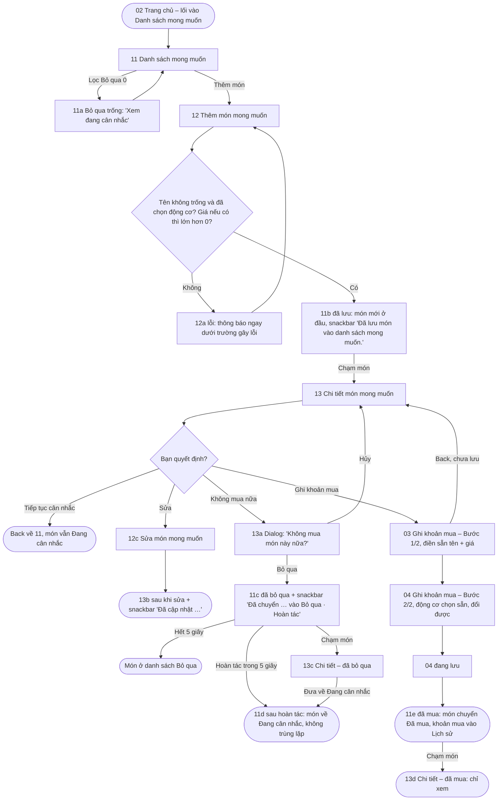
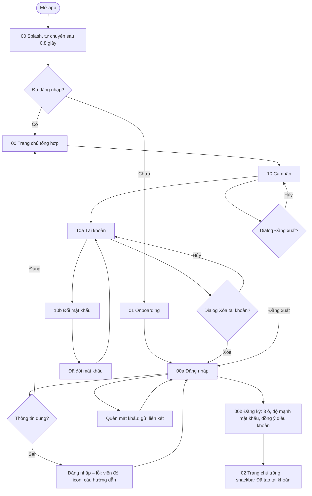
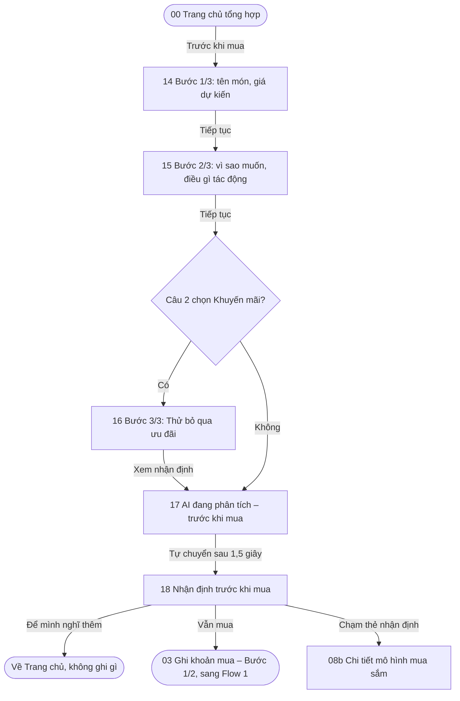
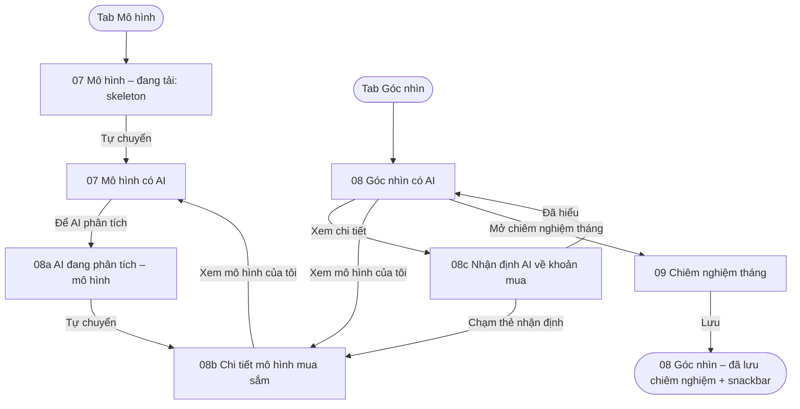

# Information Architecture & User Flows

**Project:** Why I Buy? – lấy cảm hứng từ "The Psychology of Money"
**Course:** PRM323 – Cross-Platform Application Development

---

## 1. Danh sách màn hình

| # | Màn hình | Cấp | Truy cập từ | Mục đích |
|---|---|---|---|---|
| 00 | Splash | Điểm vào (mọi lần mở app) | Mở app | Logo khoảng 0,8 giây, kiểm tra đã đăng nhập hay chưa |
| 00a | Đăng nhập | Điểm vào | 00 Splash (chưa đăng nhập), 01 ("Bắt đầu"), 00b, Đăng xuất ở 10, Xóa tài khoản ở 10a | Vào tài khoản để đồng bộ dữ liệu; báo lỗi sai thông tin ngay dưới ô |
| 00b | Đăng ký | Điểm vào | 00a ("Đăng ký") | Tạo tài khoản mới |
| — | Quên mật khẩu | Điểm vào | 00a ("Quên mật khẩu?") | Gửi liên kết đặt lại mật khẩu |
| 01 | Onboarding | Điểm vào (lần đầu mở app) | 00 Splash | Giới thiệu thông điệp "Hiểu trước khi thay đổi" |
| 00 Hub | Trang chủ tổng hợp | Tab 1 (sau khi đăng nhập) | 00 Splash (đã đăng nhập), 00a, thanh điều hướng | Tổng quan tuần, lối vào Danh sách mong muốn, thẻ "Trước khi mua", nút "Ghi khoản mua" |
| 02 | Home Dashboard | Tab 1 | Thanh điều hướng, sau 01 | Tổng quan tuần, nút "Ghi khoản mua", khoản gần đây |
| 03 | Add Purchase | Lồng – bước 1/2 | 02, trạng thái trống của 07 | Nhập số tiền, tên món, thời điểm |
| 04 | Purchase Reason | Lồng – bước 2/2 | 03 | Chọn 1 trong 8 động cơ, ghi chú tùy chọn, lưu |
| 05 | Purchase Detail | Lồng | 02 (mục Gần đây), 06 | Xem, sửa hoặc xóa một khoản mua |
| 05 | Khoản mua đã lưu | Lồng | 04 (sau khi lưu) | Xác nhận khoản vừa lưu; mở Góc nhìn để xem nhận định AI, hoặc về Trang chủ |
| 05a | Xin quyền thông báo | Lồng | 05 Khoản mua đã lưu (lần đầu), 10 "Mở cài đặt" | Xin quyền gửi nhắc nhở 21:00, có "Để sau" |
| 06 | Purchase History | Tab 2 | Thanh điều hướng | Danh sách khoản mua theo ngày, lọc theo động cơ |
| 07 | Buying Patterns | Tab 3 | Thanh điều hướng | Tỷ lệ động cơ, khung giờ hay mua |
| 08 | Personal Insights | Tab 4 | Thanh điều hướng, 07 | Thẻ góc nhìn tổng hợp từ dữ liệu người dùng ghi |
| 08b | Chi tiết mô hình mua sắm | Lồng | 07 Mô hình (có AI) "Để AI phân tích", 08 "Xem mô hình của tôi", thẻ nhận định ở 08c và 18 | Đọc phân tích AI về các động cơ đã ghi trong tháng |
| 08c | Nhận định AI về khoản mua | Lồng | 05 Khoản mua đã lưu "Mở Góc nhìn", 08 "Xem chi tiết" | Đọc nhận định AI về một khoản mua cụ thể |
| 09 | Monthly Reflection | Lồng | 08 | Tự đánh giá mức hài lòng và đặt mục tiêu tháng |
| 10 | Profile & Settings | Tab 5 | Thanh điều hướng, 09 | Nhắc nhở, xuất dữ liệu, cài đặt |
| 10a | Tài khoản | Lồng | 10 (thẻ tài khoản) | Email, Đổi mật khẩu, Xóa tài khoản |
| 10b | Đổi mật khẩu | Lồng | 10a | Đổi mật khẩu, phải nhập mật khẩu hiện tại |
| 11 | Wishlist Overview (Danh sách mong muốn) | Lồng | 02 (thẻ "Danh sách mong muốn", luôn hiện, PB-1) | Xem món muốn mua theo trạng thái Đang cân nhắc / Đã mua / Bỏ qua |
| 12 | Add Wishlist Item (Thêm món mong muốn) | Lồng | 11 | Lưu một món muốn mua kèm 1 trong 8 động cơ; dùng lại để sửa món (12c) |
| 13 | Wishlist Detail (Chi tiết món mong muốn) | Lồng | 11 | Xem lý do muốn mua; quyết định Ghi khoản mua / Không mua nữa / tiếp tục cân nhắc |
| 14 | Trước khi mua – Bước 1/3 | Lồng – bước 1/3 | 00 Hub, 02 – lối vào Trước khi mua ("Trước khi mua") | Ghi tên món và giá dự kiến; không ghi khoản mua |
| 15 | Trước khi mua – Bước 2/3 | Lồng – bước 2/3 | 14 | Chọn vì sao muốn món và điều gì tác động đến lần mua |
| 16 | Trước khi mua – Bước 3/3 | Lồng – bước 3/3 | 15 (chỉ khi chọn Khuyến mãi) | Tự hỏi nếu không có khuyến mãi thì có còn muốn món này |
| 18 | Nhận định trước khi mua | Lồng | 16, hoặc 15 khi không chọn Khuyến mãi (qua 17 đang tải) | Đọc nhận định AI, rồi tự quyết định "Để mình nghĩ thêm" hoặc "Vẫn mua" |

Ghi chú về Flow 8–10: `07 Mô hình (có AI)` và `08 Góc nhìn (có AI)` là **phiên bản hiện tại** của 07, 08 (không tính là màn mới). `08a AI đang phân tích` (2 khung) và `17 AI đang phân tích – trước khi mua` là trạng thái đang tải. `02 Trang chủ – lối vào Trước khi mua` là biến thể của 02. Tên màn giữ đúng tên khung Figma; có 2 màn mang số 05 (Chi tiết khoản mua, Khoản mua đã lưu), luôn ghi kèm tên.

Tám động cơ (dùng thống nhất trong toàn bộ dự án): Nhu cầu, Mong muốn, Khuyến mãi,
Ảnh hưởng MXH, Quảng cáo, Cảm xúc, Tiện lợi, Khác.

## 2. Cấu trúc điều hướng

Độ sâu tối đa: 2–3 lần chạm từ một tab (ví dụ Cá nhân → Tài khoản → Đổi mật khẩu; 02 → 11 → 13 → 03 khi mua từ danh sách mong muốn). Riêng Flow 9 là chuỗi bước nối tiếp (14 → 15 → 16 → 18) có nhãn "BƯỚC n/3" để người dùng biết còn bao nhiêu bước. Cấu trúc 5 tab giữ nguyên; Danh sách mong muốn và Trước khi mua là màn lồng, không thêm tab.

## 3. User flows

### Flow 1 — Ghi nhanh một khoản mua (có nhánh lỗi và phục hồi)
- **Bắt đầu:** 02 Home Dashboard (lần đầu: 01 Onboarding)
- **Mục tiêu:** ghi một khoản mua kèm động cơ trong ≤ 25 giây
- **Kết thúc:** quay về 02 với snackbar "Đã lưu “Trà sữa nướng”" kèm "Hoàn tác", khoản mới ở đầu mục Khoản mua gần đây

- **Happy path:** 02 → 03 (nhập "Trà sữa nướng", 45.000 ₫) → 04 (chọn Cảm xúc) → Lưu → 04 đang lưu → 02 sau khi lưu.
- **Nhánh thay thế:** thêm ghi chú "Mệt sau giờ làm đồ án" trong 04 trước khi lưu.
- **Nhánh lỗi và phục hồi:** nhập 0 ₫ → báo lỗi, nút "Tiếp tục" bị khóa đến khi sửa; mất mạng → vẫn lưu trên máy, không mất dữ liệu; chọn nhầm động cơ → bấm "Hoàn tác" trên snackbar trong 5 giây.
- Lần lưu đầu tiên: hỏi quyền thông báo ở 05a. Chọn "Để sau" không chặn người dùng; Cá nhân sẽ
  hiện "Chưa cấp quyền thông báo · Mở cài đặt" để bật lại sau.

### Flow 2 — Khám phá mô hình và chiêm nghiệm tháng
- **Bắt đầu:** 02 Home Dashboard
- **Mục tiêu:** hiểu động cơ mua phổ biến nhất trong tháng và tự đánh giá
- **Kết thúc:** hoàn tất Monthly Reflection (tùy chọn bật nhắc hằng tháng)

### Flow 3 — Xem lại, xóa và hoàn tác (nhánh phục hồi)
- **Bắt đầu:** 06 Purchase History
- **Mục tiêu:** sửa hoặc xóa một khoản ghi nhầm
- **Kết thúc:** lịch sử được cập nhật, hoặc khôi phục nếu hoàn tác

### Flow 4 — Xem lịch sử và mô hình của một tháng bất kỳ
- **Bắt đầu:** 06 Lịch sử (hoặc 07 Mô hình), đang xem "Tuần này"
- **Mục tiêu:** xem lại các khoản mua và động cơ của một tháng cũ (ví dụ 9/2026) mà không phải lướt qua từng tuần
- **Kết thúc:** 07 Mô hình hiển thị đúng tháng đã chọn, hoặc quay về kỳ hiện tại

- **Happy path:** 06 → chạm nhãn kỳ → chọn Th 9 → "Xem tháng 9/2026" → 06 tháng 9/2026 → banner → 07 tháng 9/2026.
- **Nhánh thay thế:** dùng mũi tên `<` `>` để lùi từng kỳ; đổi sang chế độ Tuần ở 07.
- **Nhánh phòng ngừa lỗi:** tháng chưa có dữ liệu (Th 11, Th 12) bị làm mờ và không chọn được; mũi tên `>` bị khóa ở kỳ hiện tại, nên không thể mở một kỳ trống.

### Flow 5 — Cá nhân & dữ liệu (cài nhắc nhở, xuất dữ liệu, xóa có xác nhận)
- **Bắt đầu:** 10 Cá nhân (tab 5)
- **Mục tiêu:** chủ động quản lý nhắc nhở và dữ liệu cá nhân
- **Kết thúc:** nhắc nhở đã bật/tắt, có file CSV trong Tải xuống, hoặc dữ liệu đã xóa sau khi xác nhận

- **Happy path:** 10 → Xuất dữ liệu → 10 đã xuất dữ liệu → snackbar tự ẩn.
- **Nhánh thay thế:** bật/tắt nhắc nhở ngay trên 10.
- **Nhánh phòng ngừa lỗi:** xóa toàn bộ luôn qua dialog xác nhận, có "Hủy".

### Flow 6 — Danh sách mong muốn: hiểu lý do trước khi mua (có nhánh lỗi, xác nhận và hoàn tác)
- **Bắt đầu:** 02 Trang chủ, thẻ phụ "Danh sách mong muốn · 2 món đang cân nhắc"
- **Mục tiêu:** lưu một món muốn mua kèm động cơ, rồi tự quyết định mua, bỏ qua hay tiếp tục cân nhắc. Không có thời gian chờ bắt buộc.
- **Kết thúc:** món ở trạng thái Đã mua (khoản mua vào Lịch sử), Bỏ qua, hoặc vẫn Đang cân nhắc
- **Ràng buộc dữ liệu:** lưu một món vào danh sách mong muốn KHÔNG tính vào chi tiêu, không đổi biểu đồ và Lịch sử. Món chỉ chuyển Đã mua khi khoản mua ở 04 được lưu thành công.

- **Happy path:** 02 → 11 → Thêm món → 12 (Chuột công thái học, 520.000 ₫, Tiện lợi) → Lưu → 11b → chạm "Bàn phím cơ" → 13 → Ghi khoản mua → 03 (650.000 ₫ điền sẵn) → 04 (Khuyến mãi chọn sẵn) → Lưu → 11e.
- **Nhánh thay thế:** tiếp tục cân nhắc (Back từ 13); sửa ghi chú (12c → 13b); bỏ qua món (13a → 11c).
- **Nhánh lỗi và phục hồi:** bấm Lưu khi chưa nhập tên và chưa chọn động cơ → 12a báo lỗi ngay dưới từng trường, sửa xong lưu được; bỏ qua nhầm → "Hoàn tác" trong 5 giây; thoát 03/04 trước khi lưu → món vẫn Đang cân nhắc.

### Flow 7 — Khởi động, đăng nhập và tài khoản
- **Bắt đầu:** mở app
- **Mục tiêu:** vào app, sửa lỗi đăng nhập, quản lý tài khoản (đổi mật khẩu, xóa tài khoản, đăng xuất)
- **Kết thúc:** tới Trang chủ tổng hợp, hoặc quay về Đăng nhập sau khi đăng xuất / xóa tài khoản

- **Happy path:** Splash → Onboarding → Đăng nhập → Trang chủ tổng hợp.
- **Nhánh lỗi và phục hồi:** sai mật khẩu → báo ngay dưới ô Mật khẩu kèm gợi ý "Quên mật khẩu?";
  sai email → "Email này chưa được đăng ký" ở ô Email.
- **Nhánh phụ:** đổi mật khẩu (nút Lưu khóa đến khi nhập đủ 3 ô); xóa tài khoản và đăng xuất đều
  có dialog với nút "Hủy".

### Flow 8 — Nhận định AI sau khi lưu khoản mua
- **Bắt đầu:** 05 Khoản mua đã lưu (ngay sau khi lưu ở 04, Flow 1)
- **Mục tiêu:** đọc nhận định AI về khoản vừa lưu, dựa trên động cơ người dùng đã chọn
- **Kết thúc:** về 00 Trang chủ tổng hợp, hoặc sang 07 Mô hình (có AI) / 08b Chi tiết mô hình

```mermaid
flowchart TD
    Save([04 Lưu khoản mua – Flow 1]) --> S05[05 Khoản mua đã lưu]
    S05 -->|Mở Góc nhìn| Load[08a AI đang phân tích – khoản vừa lưu]
    Load -->|Tự chuyển sau 1,5 giây| S08c[08c Nhận định AI về khoản vừa lưu]
    S05 -->|Về Trang chủ| Home([02 Trang chủ – sau khi lưu + snackbar Đã lưu])
    S08c -->|Đã hiểu| Hub([00 Trang chủ tổng hợp])
    S08c -->|Xem mô hình của tôi| S07([07 Mô hình có AI – sang Flow 10])
    S08c -->|Chạm thẻ nhận định| S08b[08b Chi tiết mô hình mua sắm]
```

- **Happy path:** 04 Lưu → 05 Khoản mua đã lưu → "Mở Góc nhìn" → 08a AI đang phân tích (1,5 giây) → 08c Nhận định AI về khoản vừa lưu → "Đã hiểu" → 00 Trang chủ tổng hợp.
- **Nhánh thay thế:** "Về Trang chủ" ở 05 → 02 sau khi lưu; "Xem mô hình của tôi" ở 08c → 07 Mô hình (có AI); chạm thẻ nhận định → 08b.
- **Nhánh lỗi và phục hồi:** Figma chưa có khung lỗi cho AI (mất mạng, AI không trả lời). *(Đề xuất, chưa có khung trong Figma)*: dùng Empty / Error state có nút "Thử lại", giống "07 Mô hình – lỗi". Khoản mua đã được lưu trước khi AI phân tích, nên lỗi AI không làm mất dữ liệu.

### Flow 9 — Trước khi mua: 3 câu hỏi nhanh
- **Bắt đầu:** 00 Trang chủ tổng hợp, nút Tonal "Trước khi mua"
- **Mục tiêu:** hiểu điều gì đứng sau một lần mua trước khi quyết định
- **Kết thúc:** 18 Nhận định trước khi mua → về Trang chủ (không ghi gì) hoặc sang 03 Ghi khoản mua (Flow 1)

- **Happy path:** 00 Hub → "Trước khi mua" → 14 (Tai nghe Bluetooth, 389.000 ₫) → 15 (Mong muốn + Khuyến mãi) → 16 ("Chưa chắc") → 17 AI đang phân tích → 18 → "Để mình nghĩ thêm" → về Trang chủ.
- **Nhánh thay thế:** câu 2 không chọn Khuyến mãi → bỏ qua 16, đi thẳng tới 17 (quy tắc trên sơ đồ Figma: "16: hiện khi chọn Khuyến mãi"); "Vẫn mua" → 03 (Flow 1); chạm thẻ nhận định → 08b.
- **Ràng buộc:** Flow 9 **không tạo khoản mua** nếu người dùng không chọn "Vẫn mua".
- **Nhánh lỗi và phục hồi:** Figma chưa có khung lỗi cho AI. *(Đề xuất, chưa có khung trong Figma)*: dùng Empty / Error state có nút "Thử lại", giống "07 Mô hình – lỗi"; tên món trống ở 14 thì nút "Tiếp tục" bị khóa.

### Flow 10 — AI phân tích mô hình
- **Bắt đầu:** tab Mô hình, hoặc tab Góc nhìn
- **Mục tiêu:** đọc phân tích AI về các động cơ đã ghi trong tháng, rồi chiêm nghiệm tháng
- **Kết thúc:** quay lại 07 Mô hình (có AI), hoặc 08 Góc nhìn – đã lưu chiêm nghiệm

- **Happy path:** tab Mô hình → 07 đang tải → 07 Mô hình (có AI) → "Để AI phân tích" → 08a → 08b → "Xem mô hình của tôi" → 07.
- **Nhánh thay thế:** tab Góc nhìn → 08 Góc nhìn (có AI) → "Xem chi tiết" → 08c → "Đã hiểu" → 08; "Xem mô hình của tôi" → 08b; "Mở chiêm nghiệm tháng" → 09 → "Lưu" → 08 Góc nhìn – đã lưu chiêm nghiệm.
- **Nhánh lỗi và phục hồi:** Figma chưa có khung lỗi cho AI. *(Đề xuất, chưa có khung trong Figma)*: dùng Empty / Error state có nút "Thử lại", giống "07 Mô hình – lỗi" (khung lỗi đã có của Flow 2).

## 4. Bảng ánh xạ flow → màn hình

| Màn hình | Flow 1 | Flow 2 | Flow 3 | Flow 4 | Flow 5 | Flow 6 | Flow 7 | Flow 8 | Flow 9 | Flow 10 |
|---|:-:|:-:|:-:|:-:|:-:|:-:|:-:|:-:|:-:|:-:|
| 00 Splash | | | | | | | ✓ bắt đầu | | | |
| 00 Hub | ✓ chưa ghi hôm nay | | | | | | ✓ kết thúc | ✓ "Đã hiểu" ở 08c | ✓ bắt đầu | |
| 00a Đăng nhập | ✓ (lần đầu) | | | | ✓ sau Đăng xuất | | ✓ nhánh lỗi, kết thúc sau đăng xuất / xóa tài khoản | | | |
| 00b Đăng ký | | | | | | | ✓ nhánh thay thế | | | |
| Quên mật khẩu | | | | | | | ✓ nhánh phục hồi | | | |
| 01 Onboarding | ✓ (lần đầu) | | | | | | ✓ trước bắt đầu | | | |
| 02 Home Dashboard | ✓ bắt đầu, kết thúc | ✓ bắt đầu | | | | ✓ bắt đầu (thẻ Danh sách mong muốn) | ✓ kết thúc | ✓ "Về Trang chủ" (sau khi lưu) | ✓ biến thể lối vào Trước khi mua | |
| 03 Add Purchase | ✓ bước 1, nhánh lỗi | ✓ từ trạng thái trống | ✓ sửa (03b) | | | ✓ điền sẵn từ món mong muốn | | | ✓ "Vẫn mua" | |
| 04 Purchase Reason | ✓ bước 2, đang lưu, giải thích động cơ | | ✓ sửa (04c) | | | ✓ động cơ chọn sẵn, lưu → Đã mua | | ✓ lưu → 05 Khoản mua đã lưu | | |
| 05 Purchase Detail | | | ✓ sửa, xóa | | | | | | | |
| 05 Khoản mua đã lưu | ✓ sau khi lưu | | | | | | | ✓ bắt đầu | | |
| 05a Xin quyền thông báo | ✓ lần lưu đầu tiên | | | | ✓ "Mở cài đặt" | | | | | |
| 06 Purchase History | | | ✓ bắt đầu, kết thúc | ✓ bắt đầu, chọn tháng, tháng 9 | | | | | | |
| 07 Buying Patterns | | ✓ loading, lỗi, trống | | ✓ kết thúc (tháng 9, Tuần) | | | | ✓ "Xem mô hình của tôi" | | ✓ bắt đầu, kết thúc (có AI) |
| 08 Personal Insights | | ✓ (đã lưu chiêm nghiệm) | | | | | | | | ✓ bắt đầu (có AI), đã lưu chiêm nghiệm |
| 08b Chi tiết mô hình mua sắm | | | | | | | | ✓ chạm thẻ nhận định | ✓ chạm thẻ nhận định | ✓ AI phân tích (08a đang tải) |
| 08c Nhận định AI về khoản mua | | | | | | | | ✓ khoản vừa lưu (08a đang tải) | | ✓ "Xem chi tiết" ở 08 |
| 09 Monthly Reflection | | ✓ | | | | | | | | ✓ "Mở chiêm nghiệm tháng" |
| 10 Profile & Settings | | ✓ bật nhắc | | | ✓ bắt đầu, kết thúc | | ✓ đăng xuất | | | |
| 10a Tài khoản | | | | | | | ✓ xóa tài khoản | | | |
| 10b Đổi mật khẩu | | | | | | | ✓ nhánh phụ | | | |
| 11 Wishlist Overview | | | | | | ✓ bắt đầu, kết thúc (11a–11e) | | | | |
| 12 Add Wishlist Item | | | | | | ✓ thêm, nhánh lỗi, sửa (12a–12c) | | | | |
| 13 Wishlist Detail | | | | | | ✓ quyết định, dialog bỏ qua (13a–13d) | | | | |
| 14 Trước khi mua – Bước 1/3 | | | | | | | | | ✓ bước 1 | |
| 15 Trước khi mua – Bước 2/3 | | | | | | | | | ✓ bước 2 | |
| 16 Trước khi mua – Bước 3/3 | | | | | | | | | ✓ khi chọn Khuyến mãi | |
| 18 Nhận định trước khi mua | | | | | | | | | ✓ kết thúc (17 đang tải) | |

Mọi màn hình đều thuộc ít nhất một flow. Mỗi flow có starting point riêng ở page `06 Prototype` của Figma.

## 5. Khung trạng thái theo flow

Mỗi trạng thái là một khung riêng, giống hệt màn gốc và chỉ khác phần thay đổi (xem `design/DESIGN.md`).

| Khung trạng thái | Màn gốc | Flow | Khi nào xuất hiện | Hành động tiếp theo |
|---|---|---|---|---|
| Trang chủ – trống | 02 | Flow 1 | Lần đầu dùng, tuần chưa có khoản mua | "Ghi khoản mua" → 03 |
| Ghi khoản mua – lỗi số tiền | 03 | Flow 1 | Số tiền bằng 0 | Sửa số tiền, nút "Tiếp tục" mở lại |
| Ghi khoản mua – đang lưu | 04 | Flow 1 | Sau khi nhấn "Lưu" | Tự chuyển sang 02 sau khi lưu |
| Trang chủ sau khi lưu | 02 | Flow 1 | Lưu thành công | "Hoàn tác" trong 5 giây |
| Trang chủ sau khi lưu – ngoại tuyến | 02 | Flow 1 | Lưu khi mất mạng | Tự đồng bộ khi có mạng |
| Mô hình – đang tải | 07 | Flow 2 | Mở tab Mô hình | Tự chuyển sang kết quả |
| Mô hình – lỗi | 07 | Flow 2 | Không tải được dữ liệu | "Thử lại" |
| Mô hình – chưa đủ dữ liệu | 07 | Flow 2 | Ít hơn 5 khoản | "Ghi khoản mua" → 03 (Flow 1) |
| Dialog xóa | 05 | Flow 3 | Nhấn icon xóa | "Hủy" → 05 · "Xóa" → 06 sau khi xóa |
| Lịch sử – không có kết quả | 06 | Flow 3 | Bộ lọc không có khoản nào | "Xóa bộ lọc" |
| Lịch sử sau khi xóa | 06 | Flow 3 | Xóa thành công | "Hoàn tác" trong 5 giây |
| Cá nhân – đã xuất dữ liệu | 10 | Flow 5 | Bấm "Xuất dữ liệu" | Snackbar tự ẩn, về 10 |
| Cá nhân – xác nhận xóa toàn bộ | 10 | Flow 5 | Bấm "Xóa toàn bộ dữ liệu" | "Hủy" → 10 · "Xóa tất cả" → 10 (đã xóa) |
| Trang chủ – lối vào Danh sách mong muốn | 02 | Flow 6 | Luôn hiện (PB-1); 0 món thì ghi "Chưa có món nào · Thêm món" | Chạm thẻ → 11 |
| Ghi khoản mua – giải thích động cơ | 04 | Flow 1 | Chạm "?" hoặc "Các động cơ nghĩa là gì?" | Đóng sheet → 04 |
| Sửa khoản mua – Bước 1/2 và 2/2 | 03, 04 | Flow 3 | "Sửa" ở 05 | "Lưu thay đổi" → 05 |
| Lịch sử – chọn tháng | 06 | Flow 4 | Chạm nhãn kỳ | "Xem tháng 9/2026" → Lịch sử – tháng 9/2026 |
| Lịch sử – tháng 9/2026 | 06 | Flow 4 | Chọn tháng 9 | Banner → Mô hình – tháng 9/2026 |
| Mô hình – tháng 9/2026 | 07 | Flow 4 | Từ banner ở 06 | Mũi tên `>` về kỳ hiện tại |
| Mô hình – Tuần | 07 | Flow 4 | Chọn "Tuần" trên segmented | Chọn "Tháng" |
| Góc nhìn – đã lưu chiêm nghiệm | 08 | Flow 2 | "Lưu chiêm nghiệm" ở 09 | Snackbar tự ẩn |
| Danh sách mong muốn – trống | 11 | Flow 6 | Chưa có món nào | "Thêm món" → 12 |
| Danh sách mong muốn – Bỏ qua trống | 11 | Flow 6 | Lọc Bỏ qua khi chưa có món | "Xem đang cân nhắc" → 11 |
| Danh sách mong muốn – đã lưu | 11 | Flow 6 | Lưu món thành công | Snackbar tự ẩn |
| Danh sách mong muốn – đã bỏ qua | 11 | Flow 6 | Xác nhận Bỏ qua | "Hoàn tác" trong 5 giây |
| Danh sách mong muốn – sau hoàn tác | 11 | Flow 6 | Bấm Hoàn tác | Món về Đang cân nhắc |
| Danh sách mong muốn – đã mua | 11 | Flow 6 | Lưu khoản mua từ món | Kết thúc |
| Thêm món mong muốn – lỗi | 12 | Flow 6 | Lưu khi tên trống / chưa chọn động cơ | Sửa trường lỗi rồi Lưu |
| Thêm món mong muốn – đã điền | 12 | Flow 6 | Dữ liệu hợp lệ | "Lưu món" |
| Sửa món mong muốn | 12 | Flow 6 | Nút Sửa ở 13 | "Lưu thay đổi" → 13b |
| Chi tiết món – xác nhận bỏ qua | 13 | Flow 6 | "Không mua nữa" | "Hủy" → 13 · "Bỏ qua" → 11c |
| Chi tiết món – sau khi sửa | 13 | Flow 6 | Lưu thay đổi | Snackbar tự ẩn |
| Ghi khoản mua – Bước 1/2 và 2/2 (từ danh sách mong muốn) | 03, 04 | Flow 6 | "Ghi khoản mua" ở 13 | Lưu → 11e · Back → 13 |
| Chi tiết món – đã bỏ qua | 13 | Flow 6 | Chạm món ở bộ lọc Bỏ qua | "Đưa về Đang cân nhắc" → 11d |
| Chi tiết món – đã mua | 13 | Flow 6 | Chạm món ở bộ lọc Đã mua | Chỉ xem; Back → 11e |
| Đăng nhập – lỗi | Đăng nhập | Flow 7 | Sai email hoặc mật khẩu | Sửa lại, hoặc "Quên mật khẩu?" |
| Trang chủ – vừa tạo tài khoản | 02 | Flow 7 | Tạo tài khoản thành công | "Ghi khoản mua" → 03 |
| Trang chủ tổng hợp – chưa ghi hôm nay | 00 Hub | Flow 1 | Hôm nay chưa có khoản nào | "Ghi khoản mua" → 03 |
| Ghi khoản mua – đang nhập số tiền | 03 | Flow 1 | Chạm ô số tiền | Bàn phím số, "Tiếp tục" nằm trên bàn phím |
| Cá nhân – chưa cấp quyền thông báo | 10 | Flow 1, 5 | Đã chọn "Để sau" ở 05a | "Mở cài đặt" → 05a |
| Cá nhân – xác nhận đăng xuất | 10 | Flow 7 | Nhấn "Đăng xuất" | "Hủy" → 10 · "Đăng xuất" → Đăng nhập |
| Tài khoản – xác nhận xóa | 10a | Flow 7 | Nhấn "Xóa tài khoản" | "Hủy" → 10a · "Xóa tài khoản" → Đăng nhập |
| Đổi mật khẩu – đã lưu | 10a (khung Figma tên "10b Đổi mật khẩu – đã lưu") | Flow 7 | Lưu mật khẩu mới | Tự về Tài khoản sau 2,5 giây |
| AI đang phân tích – khoản vừa lưu | 08c (khung 08a) | Flow 8 | "Mở Góc nhìn" ở 05 Khoản mua đã lưu | Tự chuyển sang 08c sau 1,5 giây |
| AI đang phân tích – mô hình | 08b (khung 08a) | Flow 10 | "Để AI phân tích" ở 07 Mô hình (có AI) | Tự chuyển sang 08b |
| AI đang phân tích – trước khi mua | 18 (khung 17) | Flow 9 | "Xem nhận định" ở 16, hoặc "Tiếp tục" ở 15 khi không chọn Khuyến mãi | Tự chuyển sang 18 sau 1,5 giây |
| Góc nhìn – đã lưu chiêm nghiệm (có AI) | 08 | Flow 10 | "Lưu" ở 09 | Snackbar "Đã lưu chiêm nghiệm tháng 10" tự ẩn |
| Trang chủ – lối vào Trước khi mua | 02 | Flow 9 | Biến thể của 02: giống Hub nhưng không có thẻ Danh sách mong muốn | "Trước khi mua" → 14 |
